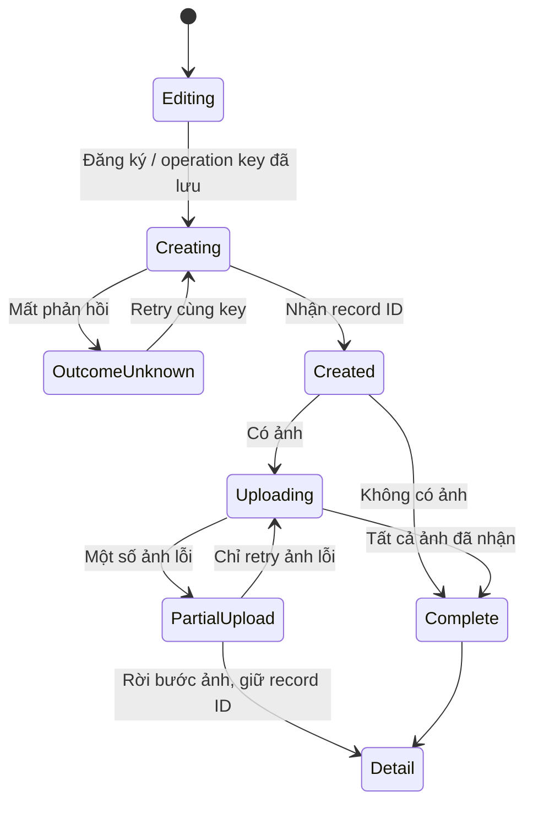

# Design — Khắc phục audit và cải thiện UI/UX

Tài liệu triển khai cho [requirements.md](requirements.md). Trạng thái: **thiết kế đề xuất, chưa triển khai**. Các bảng/cột/component/API được ghi “mới” bên dưới chưa có trong worktree tham chiếu. Agent phải điều chỉnh tên cho phù hợp conventions hiện tại nhưng không được làm yếu các invariant hoặc bỏ acceptance criteria.

## D01. Bối cảnh mã và ranh giới thực thi

### Kiến trúc cần giữ

React 18 + TypeScript + Vite ở `frontend`; FastAPI + SQLAlchemy + Alembic ở `backend`; PostgreSQL 16 trong CI; PostgreSQL production theo cấu hình repo; SQLite cho test nhanh/sandbox; Redis cho cache; file Excel/ảnh trong storage; nginx/Caddy/Docker cho triển khai. Không đưa thêm framework giao diện hoặc chuyển database để sửa các lỗi này.

| Vùng | Điểm bắt đầu đọc/sửa hiện có |
|---|---|
| App shell, phiên, điều hướng | `frontend/src/app/App.tsx`, `frontend/src/api/client.ts` |
| Editor OKR | `frontend/src/features/web-input/WebInputForm.tsx`, `backend/app/api/routes/web_input.py`, `backend/app/schemas/web_input.py`, `backend/app/services/okr/web_input.py` |
| FI | `frontend/src/features/fi/FIWorkspace.tsx`, `backend/app/api/routes/fi.py`, `backend/app/services/fi/service.py`, `backend/app/services/fi/workflow.py` |
| KHMT/FI chốt | `backend/app/services/fi/monthly_allocation.py`, các route KHMT/FI trong `backend/app/api/routes/admin.py`, `frontend/src/features/admin/AdminPanel.tsx` |
| ET | `frontend/src/features/et/ETModule.tsx`, `backend/app/api/routes/et.py`, `backend/app/services/et_service.py`, `backend/app/models/et_domain.py`, `backend/app/schemas/et_schemas.py` |
| Dashboard STOP | `frontend/src/features/okr/components/VisualBlockRenderer.tsx` |
| User, notification, report, sequence | `backend/app/models/domain.py`, `backend/app/core/security.py`, `backend/app/api/routes/auth.py`, `backend/app/api/routes/notifications.py` |
| Deploy/import/seed | `deploy_prod.py`, `.github/workflows/deploy.yml`, `backend/scripts/import_historical.py`, `backend/scripts/seed_users_xuong_dk.py`, `backend/scripts/seed_et_personnel.py`, `backend/app/services/okr/historical_import.py`, `backend/app/services/bootstrap.py` |
| LLM/file | `backend/app/api/routes/llm.py`, `backend/app/services/llm/chatbot.py`, `backend/app/api/routes/okr.py`, `backend/app/services/et_excel_service.py` |
| QA | `backend/tests/conftest.py`, `backend/tests/unit`, `backend/tests/integration`, `backend/tests/property`, các `*.test.ts(x)` ở frontend, `.github/workflows/ci.yml` |

Mã đang có thay đổi chưa commit tại README, các route/schema/service web input, monthly allocation, AdminPanel, client, CSS và test. Không ghi đè những thay đổi này. Migration gần nhất quan sát là `0011_fi_monthly_allocations.py`; khi thực hiện phải kiểm tra `alembic heads` lại, không hardcode số revision tiếp theo.

### Chế độ thử an toàn

Tạo một launcher test riêng (đề xuất mới `backend/scripts/run_isolated_checks.py`) đặt biến môi trường **trước import app/tests**: database mới, storage mới, JWT thử, bootstrap user giả, Redis riêng hoặc tắt, LLM tắt. Launcher phải tự tạo tên database thử hoặc nhận đích từ manifest do chính nó tạo, không nhận tùy ý URL production rồi tin tên chứa “test”. Không log URL kèm mật khẩu.

Hiện `backend/tests/conftest.py` dùng `os.environ.setdefault` và fixture xóa bảng; biến môi trường bên ngoài có thể thắng giá trị mặc định. `sandbox_engine` nằm dưới `settings.storage_dir/sandbox`; vì vậy phải cô lập **cả** database chính **và** storage, không chỉ `OKR_DATABASE_URL`. Một số test cũ dựa vào seed development; giữ hành vi đó trong harness cô lập hoặc chuyển fixture sang user factory rõ ràng trước khi đổi environment. Không đổi thành `test` rồi bỏ qua test fail vì mất user demo.

Browser QA local dùng fake account, fake API hoặc backend thử. Test write phải chặn host ngoài allowlist localhost/staging thử. Production smoke, nếu có ủy quyền sau, dùng danh sách route đọc đã kiểm tra side effect; GET export hiện có thể tạo file và audit log nên không có trong allowlist đọc mặc định.

## D02. Deploy, seed và import lịch sử

### Thay đổi deploy

1. Bỏ lời gọi import tháng 5/6 và seed người dùng/nhân sự/framework khỏi chuỗi deploy mặc định, kể cả nhánh bỏ qua cờ CLI. Không chỉ đổi text log hoặc truyền cờ skip ở một workflow.
2. Deploy chỉ backup theo runbook, phát hành artifact, chạy migration schema đã được duyệt, health check và ghi build ID. Bootstrap lần đầu là workflow riêng, không nằm trong restart thường kỳ.
3. Test `remote_deploy_command()` bằng chuỗi lệnh sinh ra: không có business import/seed trong cấu hình mặc định. Không chạy chuỗi remote để test.
4. Rà startup `seed_baseline` và các service init: tạo dữ liệu tối thiểu nếu chưa có, không tự cập nhật bản ghi người dùng đã sửa. ET framework seed cũng phải kiểm tra; D02 audit không chứng minh mọi framework đã bị ghi đè nhưng thiết kế phải tránh cùng kiểu lỗi.

### Hợp đồng công cụ import mới

Mặc định `preview`; apply phải truyền manifest đã tạo và phạm vi đội/kỳ. Giữ script hiện có nhưng đổi hành vi mặc định an toàn, hoặc tạo wrapper và chặn chế độ ghi ngầm của script cũ. Không để hai lối CLI có invariant khác nhau.

Manifest gồm `operation_id`, schema version, source file SHA-256, actor dự kiến, thời điểm, mode (`insert_missing` / `replace_selected`), từng kỳ, current draft/published ID + revision, action, cảnh báo và lý do bỏ qua. File manifest không chứa credentials. Preview không commit report hoặc tạo file export chuẩn.

`insert_missing`: mọi kỳ đã có bất kỳ draft/published/locked đều skip. `replace_selected`: chỉ kỳ chưa chốt, người có quyền, preview chưa cũ, chỉ những kỳ được liệt kê; thay một kỳ trong transaction dùng khóa D05/D06. Recheck source hash và revision tại apply, không dùng kết quả kiểm tra trước transaction làm bảo đảm.

Một file chứa nhiều kỳ dùng transaction theo kỳ, để giới hạn khóa. Kết quả tổng thể phải nêu `applied`, `skipped`, `conflicted`, `failed` theo kỳ, exit code khác 0 nếu có lỗi apply. Chạy lặp manifest đã áp dụng không tạo bản mới. Không gọi “atomic toàn file” nếu đang commit từng kỳ.

Seed insert-only tìm theo khóa ổn định hiện tại, không theo display name. Existing record chỉ được báo skipped, không đặt lại active, role, team, password, bậc hoặc hidden flags. Nếu cần cập nhật dữ liệu gốc, viết migration dữ liệu riêng với plan trước/sau; không cung cấp `--force` mặc định để vượt kỳ chốt.

## D03. Hợp đồng API, lỗi và client chung

### Metadata lỗi

Chuẩn hóa response của endpoint được sửa theo envelope tương thích FastAPI:

```json
{
  "detail": {
    "code": "VERSION_CONFLICT",
    "message": "Dữ liệu đã được cập nhật ở phiên khác. Phần bạn đang soạn vẫn được giữ.",
    "request_id": "opaque-request-id",
    "retryable": false,
    "fields": [],
    "context": {"team": "TEAM_DEMO", "month": 9, "year": 2026},
    "current_revision": 18
  }
}
```

Tên `error_code` cũ nếu đang tồn tại được adapter đọc cùng `code`; chỉ một shape được sinh bởi code mới. Không đưa snapshot đầy đủ hoặc nội dung người khác vào error khi chưa xác minh quyền đọc. `request_id` là ID ngẫu nhiên, không encode user/secret.

| HTTP / code | Client xử lý |
|---|---|
| 401 `SESSION_EXPIRED` / `SESSION_REVOKED` | Dừng mutation; lưu khôi phục; một dialog/luồng đăng nhập lại ở App |
| 403 `FORBIDDEN` / `TEAM_MISMATCH` | Giải thích thiếu quyền; giữ editor; không retry |
| 403 `PASSWORD_CHANGE_REQUIRED` | Mở đổi mật khẩu bắt buộc; không coi như danh sách rỗng |
| 404 `NOT_FOUND` | Resource không còn/không truy cập được; quay lại danh sách; không tự tạo thay thế |
| 409 `VERSION_CONFLICT` | Conflict UI; GET bản mới riêng; giữ bản local |
| 409 `PERIOD_LOCKED` / `REPORT_LOCKED` | Chuyển trạng thái chỉ xem; giữ bản soạn để copy/xuất, không ghi đè |
| 409 `PREVIEW_STALE` | Yêu cầu preview lại trước chốt/import |
| 409 `IDEMPOTENCY_CONFLICT` | Không retry key đó với payload khác; hiện hồ sơ đã tạo/đối soát |
| 428 `CLIENT_UPDATE_REQUIRED` | Client thiếu revision hợp lệ; hướng dẫn tải bản nháp rồi cập nhật trang |
| 400/422 `VALIDATION_ERROR` | Chuẩn hóa field paths vào lỗi tại trường/tóm tắt lỗi |
| 429 `RATE_LIMITED` | Đọc `Retry-After`, hiển thị thời gian chờ, không loop |
| 5xx / network timeout | Giữ nội dung; GET retry giới hạn; mutation đối soát bằng operation key nếu có |

`ApiError` mới trong client giữ `status`, `code`, `message`, `fields`, `requestId`, `retryAfter`, `context`, `currentRevision`, `outcomeUnknown`. Cả `request()` và `requestBlob()` dùng cùng parser; xử lý response 204, JSON không hợp lệ, HTML proxy error và network failure mà không đưa raw body lên UI.

Không sửa mọi caller một lần bằng string matching. Tạo adapter tương thích lỗi cũ, chuyển editor/FI/auth/ET trước, rồi các màn hình còn lại. `AbortSignal` được truyền tới GET. GET retry tối đa 2 lần với backoff có jitter, không retry 401/403/404/409/422. Mutation chỉ retry khi có hợp đồng idempotency; không coi HTTP timeout là giao dịch chưa chạy.

## D04. Editor controller, bản khôi phục và navigation guard

### Component đề xuất mới

- `frontend/src/shared/editing/useDraftController.ts`: state machine chung, không chứa công thức OKR/ET.
- `frontend/src/shared/editing/DraftRecoveryStore.ts`: storage và phân tách user/context.
- `frontend/src/shared/editing/NavigationGuardProvider.tsx`: đăng ký editor dirty, xử lý mọi điều hướng app.
- `frontend/src/shared/editing/SaveStatus.tsx`, `ConflictDialog.tsx`, `UnsavedChangesDialog.tsx`.
- Adapter OKR và ET chuyển payload/validate/endpoint hiện có, không đồng nhất hai schema nghiệp vụ.

Nếu repo đã có component tương đương khi triển khai, mở rộng nó; không tạo lớp thứ hai cạnh tranh với guard cũ.

### State và invariant

```ts
type DraftState<T> = {
  contextKey: string;       // namespace:user:module:resource-or-team-period
  contextEpoch: number;     // tăng khi chuyển context/phiên đăng nhập
  localRevision: number;    // tăng ngay mỗi thay đổi của người dùng
  acknowledgedLocalRevision: number;
  serverRevision: number;
  current: T;
  lastAcknowledged: T;
  inFlight?: { requestId: string; epoch: number; localRevision: number; snapshot: T };
  phase: 'loading' | 'clean' | 'dirty' | 'saving' | 'offline' |
         'conflict' | 'error' | 'locked' | 'auth-required';
};
```

Dirty được suy ra từ `localRevision > acknowledgedLocalRevision`; không có boolean `unsaved` bị reset tùy ý bởi request cũ. Snapshot gửi phải immutable. Debounce 1.000 ms; queue chỉ giữ **snapshot mới nhất chưa gửi**, không gửi mọi keystroke. Tối đa một mutation in-flight cho một context. Sau response thành công cập nhật serverRevision và acknowledgedLocalRevision của snapshot đó. Nếu người dùng đã gõ thêm, giữ `current`, phase vẫn dirty và flush tiếp.

Phản hồi chuẩn hóa nội dung server chỉ được áp vào editor khi `localRevision == sentLocalRevision` và epoch vẫn đúng. Nếu không, giữ bản local, chỉ cập nhật base/metadata thích hợp. Trường server tính toán không nên biến thành input editable; re-fetch phần summary khi cần.

```mermaid
sequenceDiagram
  participant U as Người nhập
  participant E as Draft controller
  participant A as API
  U->>E: Gõ A (local revision 1)
  E->>A: Save snapshot A, expected revision 7
  U->>E: Gõ B (local revision 2)
  A-->>E: A đã lưu, server revision 8
  Note over E: Giữ B; ack local 1; vẫn chưa lưu hết
  E->>A: Save snapshot B, expected revision 8
  A-->>E: B đã lưu, server revision 9
  Note over E: ack local 2; hiện Đã lưu lúc ...
```

### Nhãn trạng thái và hành động

| Phase | Nội dung người dùng nhìn thấy | Hành động |
|---|---|---|
| clean | “Đã lưu lúc HH:mm:ss” | Gửi/chốt tùy quyền và validation |
| dirty | “Có thay đổi chưa lưu” | “Lưu ngay” |
| saving | “Đang lưu…”; nếu gõ thêm, “Đang lưu, còn thay đổi mới” | Không gửi snapshot cũ; chờ flush hoặc hủy ý định submit |
| offline | “Mất kết nối. Nội dung đang được giữ trên thiết bị này.” chỉ nếu store thành công | Thử lại khi online; tải bản nháp |
| conflict | “Có phiên khác cập nhật. Phần bạn đang soạn vẫn được giữ.” | So sánh, hợp nhất, dùng bản server có xác nhận |
| error | “Chưa lưu được. Vui lòng thử lại.” + field/message cụ thể | Retry phù hợp, tải bản nháp |
| locked | “Kỳ đã chốt. Không thể lưu thay đổi.” | Xem bản chốt; copy/tải bản đang soạn |
| auth-required | “Phiên đăng nhập đã hết hạn. Đăng nhập lại để tiếp tục.” | Re-auth, không replay tự động |

Submit sử dụng `await flushLatest()` rồi lấy đúng revision đã ack; nếu user tiếp tục sửa trong lúc chờ, bắt snapshot mới hoặc yêu cầu dừng/chọn gửi bản hiện tại rõ ràng. Trong request submit, khóa input ngắn hạn với thông báo hoặc giữ thay đổi mới thành draft riêng; lựa chọn mặc định của spec là khóa input trong giao dịch submit, vẫn cho chọn/copy text. Không làm mất chữ đã gõ trước khi bấm submit.

### Conflict resolution

Giữ ba bản: base lần đọc/lưu đã xác nhận, local hiện tại, server vừa đọc lại. Diff theo field ID ổn định; các mảng công việc/điểm cần key ổn định phía client hoặc server, không merge theo index khi có reorder. Có các lựa chọn:

1. **Tiếp tục soạn/so sánh:** không ghi gì; xem giá trị thay đổi theo từng trường.
2. **Hợp nhất:** tự ghép field chỉ một bên đổi; field cả hai đổi phải chọn giá trị. Preview kết quả, bấm “Lưu bản đã hợp nhất” với revision server vừa đọc.
3. **Dùng bản trên hệ thống:** xác nhận sẽ bỏ phần local, cung cấp tải/copy trước; sau đó mới replace editor và xóa recovery tương ứng.

Không có nút force-write vượt revision. Nếu server tiếp tục đổi trong lúc merge, nhận 409 lần nữa và giữ bản merge, không lặp ghi tự động.

### Storage và vòng đời phiên

Mặc định dùng `sessionStorage` cho text của từng tab, key gồm namespace thực/sandbox, user ID, module và resource ID/kỳ, schema version. Lưu mỗi thay đổi nhỏ bằng adapter có try/catch; nội dung lớn debounce tối đa 250 ms và flush đồng bộ snapshot mới nhất khi `pagehide` nếu browser cho phép. Nhãn lưu thiết bị chỉ hiện sau write thành công. Không lưu token/password vào recovery object. Không ghi nội dung editor vào telemetry.

Store gồm payload, base revision, timestamp, schema version, operation key/record ID khi FI đã tạo. TTL mặc định 24 giờ trong phiên tab; UI hiển thị tuổi bản nháp, dữ liệu hết TTL không bị âm thầm dùng lại. Browser có thể xóa sessionStorage khi đóng tab; luôn nói rõ giới hạn này, không hứa khôi phục qua mọi lần đóng trình duyệt.

Auth expiry giữ snapshot nhưng che nội dung sau màn re-auth; chỉ cùng user xác thực mới được khôi phục. Login user khác xóa snapshot user trước trong tab sau khi đã cho lựa chọn xuất/bỏ ở luồng logout chủ động; không lộ nội dung cũ. Logout chủ động dùng guard; user chọn bỏ thì dọn đúng namespace. Multi-tab là hai editor độc lập, chống xung đột ở backend. `BroadcastChannel` có thể báo metadata resource đã đổi, không phát payload/token; không phải thành phần bảo đảm tính đúng.

Storage quota/private mode lỗi: không crash editor, hiển thị giới hạn, vẫn cho “Lưu ngay” và tải bản nháp do user chủ ý. File ảnh không lưu trong sessionStorage; chỉ metadata; sau reload yêu cầu chọn lại.

### Navigation guard

Đưa thay đổi module/path/tab/kỳ/đội/phiếu qua một hàm `requestNavigation(intent)`. Tích hợp click sidebar, bottom nav, tab nội bộ, `popstate`, selector kỳ/đội, đóng editor và logout. Dialog có “Ở lại”, “Lưu rồi chuyển” và “Bỏ thay đổi chưa lưu”; nút bỏ phải mô tả context bị bỏ, không mặc định focus.

Nếu server chưa xác định kết quả request đang chạy, lựa chọn bỏ chỉ bỏ các thay đổi **chưa gửi**; không thể thu hồi nội dung server đã nhận. Dialog nói rõ và chờ đối soát request trước khi chuyển nếu cần tránh hiểu nhầm. Không dùng `sendBeacon` để gửi mutation không có version khi đóng trang. `beforeunload` là lớp cuối, không thay thế guard React.

## D05. Revision và mô hình cạnh tranh báo cáo/ET

### Bảng/cột mới

| Thay đổi đề xuất | Mục đích và invariant |
|---|---|
| `team_report_period_states(team, year, month, revision)` | PK ghép theo kỳ; revision bigint không âm, mặc định 0; một hàng khóa ổn định ngay cả khi chưa có report |
| `competency_assessments.revision` | bigint không null, backfill 0; tăng khi notes/items/scores/status thay đổi |
| Unique partial index draft | Một current `web_input` + `draft` cho team/month/year hợp lệ |
| Unique partial index published | Một current `submitted` hoặc `locked` cho team/month/year hợp lệ |

Không đặt unique chung cho mọi `is_current_version=true`: điều đó phá việc draft và published cùng tồn tại. Trước tạo index, liệt kê nhóm trùng và report thiếu team/kỳ; không tự deactivate dòng. Những report import đang parsing/không xác định kỳ có thể ngoài index, nhưng không được thành bản editor hiện hành cho tới khi hợp lệ.

Không dùng `TeamReportModel.version` làm concurrency token chung vì số phiên bản draft và published hiện tăng theo hai luồng khác nhau. Giữ số đó để hiển thị/lịch sử. Token mới là `server_revision` ở response và `expected_revision` trong mutation. Query GET kỳ chưa có state trả revision 0 ảo, **không ghi row chỉ để đọc**.

### Transaction chuẩn cho OKR

1. Xác thực principal/quyền, validate kỳ, parse payload; chưa tạo file chuẩn.
2. Lấy team guard D06 rồi `INSERT period_state ... ON CONFLICT DO NOTHING`; khóa period row `FOR UPDATE` và re-read report bên trong transaction. Hai request tạo đầu tiên phải đi qua cùng hàng này.
3. So `expected_revision` với `revision`; mismatch trả 409 trước mọi thay đổi. Kiểm tra locked và invariant draft/published.
4. Apply save/submit/lock/unlock/import đúng workflow; increment revision chính xác một lần cho mutation logic thành công. Audit cùng transaction. File export tách D14.
5. Commit một lần ở transaction owner; cache invalidation sau commit; serialize response có revision mới và report ID/version.

Các service hiện có `commit()` nội bộ phải được tách phiên bản composable hoặc chuyển ownership ra service transaction điều phối. Không mở transaction bọc ngoài trong khi helper vẫn tự commit giữa chừng. Lỗi rollback không để report cũ mất cờ current. Nếu mutation không đổi gì, định nghĩa trả revision cũ hoặc tăng vẫn nhất quán; lựa chọn mặc định là no-op trả revision cũ và không tạo event nghiệp vụ mới.

Thông báo `OKR_TEAM_SUBMITTED` hiện được tạo ở route sau service submit. Khi refactor, đưa notification nội bộ này vào cùng transaction với report/audit, hoặc outbox có idempotency nếu chuyển sang xử lý nền. Không giữ hai commit rồi trả lỗi toàn request chỉ vì commit notification sau cùng thất bại; điều đó làm người dùng tưởng báo cáo chưa được gửi và gửi lại. Regression phải kiểm tra lỗi notification không tạo report lặp hoặc mất kết quả commit.

Mutation cần revision: draft, submit, lock, unlock, admin finalize/unlock, import/replace và sửa tay report qua admin. Những route bypass phải được inventory rõ trong test; không chỉ sửa route editor chính. Lock lấy report đã gửi làm nguồn; nếu draft hiện hành khác bản gửi, trả `UNSUBMITTED_DRAFT` để người dùng gửi/xử lý draft trước. Trường hợp hiện hỗ trợ chốt draft khi chưa có published: giữ khả năng này chỉ sau validation đủ, chuyển draft vào luồng locked nguyên tử và kiểm tra unique published. Không chốt một draft còn thiếu dữ liệu chỉ để giữ API cũ.

Khi draft và published hiện hành có nội dung nghiệp vụ bằng nhau, finalize có thể chốt published và bỏ cờ hiện hành của draft trong cùng transaction; giữ nguyên row draft để truy vết. Phép so sánh dùng payload nghiệp vụ chuẩn hóa, không so timestamp hoặc file hash dẫn xuất. Nếu draft khác published, chỉ chặn chốt và yêu cầu xử lý draft, không tự chọn một bản để xóa. Sau chốt thành công, GET editor phải trả bản locked, không chọn một draft còn hiện hành làm UI trông như vẫn sửa được. Đây là trạng thái chuyển luồng phải có regression riêng trong C31.

### Hợp đồng request/response cụ thể

Các đường dưới đây dùng prefix `/api/v1`. Tên route hiện có được giữ; schema được mở rộng có kiểm soát. Các field dự kiến mới phải được đưa vào OpenAPI/client typings và contract tests cùng một task.

| Endpoint | Body bắt buộc khi bật bảo vệ | Response quan trọng |
|---|---|---|
| `PUT /okr/web-input/{team}/{month}/{year}/draft` | `data` theo WebInputPayload hiện có, `expected_revision` | Payload editor hiện hành, `report_id`, `version` nghiệp vụ, `server_revision`, `report_status`, trạng thái artifact |
| `POST /okr/web-input/{team}/{month}/{year}/submit` | Cùng snapshot `data`, `expected_revision` | Bản published được gửi, `server_revision` mới và trạng thái artifact |
| `POST /okr/web-input/{team}/{month}/{year}/lock` | `reason`, `expected_revision`, `expected_fi_revision`, `plan_hash`; assessment override nếu endpoint hỗ trợ | Report locked, revision mới, allocation và selected IDs đúng preview |
| `POST /okr/web-input/{team}/{month}/{year}/unlock` | `reason`, `expected_revision` | Report mở chốt, revision mới, allocation reopened |
| Admin finalize/unlock hiện có | Các field cạnh tranh và lý do tương ứng route web-input | Cùng invariant và cấu trúc kết quả, không thành đường bypass |
| `PUT /et/assessments/{assessment_id}` | Fields cập nhật theo AssessmentUpdate hiện có, `expected_revision` | Assessment/items hiện hành và `server_revision` |
| `POST /et/assessments/{assessment_id}/submit` hoặc `/refresh-required-scores` | `expected_revision`; các field nghiệp vụ hiện có nếu có | Assessment mới và `server_revision` |

Ví dụ request draft: `{ "data": <WebInputPayload hiện có>, "expected_revision": 17 }`; ký hiệu trong dấu `<...>` là placeholder mô tả schema, không phải JSON để gửi nguyên văn. `expected_revision=0` là giá trị hợp lệ cho tài nguyên chưa có dữ liệu, không được xem như missing qua kiểm tra truthy.

Để trả 428 rõ ràng cho client cũ, handler phân biệt field không có/null với giá trị số trước khi mutation. Có thể khai báo field optional trong schema ở cửa sổ compatibility rồi kiểm tra bằng dependency/handler; sau khi bỏ compatibility có thể cập nhật OpenAPI bắt buộc và giữ adapter lỗi cần cập nhật client. Không để Pydantic trả 422 chung trong khi frontend chỉ biết xử lý 428 mà không có contract test.

GET kỳ/assessment trả revision hiện tại nhưng không tạo state trong database. Conflict response chỉ trả metadata có quyền; UI GET bản server riêng để so sánh. Các route export/preview chỉ đọc nội dung không tăng revision. Submit timeout không được tự gửi lại mù: đối soát report/revision đã gửi hoặc dùng operation key tương tự D07 nếu bổ sung idempotency cho submit; giữ outcome unknown trong controller tới khi xác định được kết quả.

### ET

Update assessment khóa row và so expected revision trước sửa collection items. Submit/refresh-required-scores cũng nhận revision. `updated_at` không đủ thay version nguyên tử. Giữ unique personnel+assessment_period hiện có, không tạo assessment mới để né conflict. Tất cả endpoint thay điểm hoặc status đều phải increment revision, bao gồm bulk/internal nếu có.

### Client cũ

Release mở rộng GET trả revision/capability trước; frontend mới hiểu field mới; sau cutover ghi, server yêu cầu revision. Client cũ thiếu field nhận 428 kèm hướng dẫn tải bản nháp rồi refresh, không tiếp tục ghi mù. Không nhận `expected_version=null` như bypass lâu dài. Staging phải thử cả client mới/server mới, client cũ/server mới và quay về build UI trước nhưng **server sửa lỗi vẫn được giữ**; trạng thái viết của client không tương thích phải fail closed có thông báo.

## D06. Khóa kỳ KHMT và thứ tự khóa FI

### Quy tắc transaction chung

Đề xuất bảng nhỏ `fi_team_write_guards(team PK, revision bigint default 0)`. Đây là hàng khóa ổn định cho nguồn FI của mỗi đội, giúp tránh race khi pool đang rỗng hoặc FI mới được duyệt giữa preview/chốt. Chọn serialization theo đội vì quy mô nội bộ; chỉ tối ưu khóa hẹp hơn khi có benchmark và proof tương đương.

**Thứ tự khóa duy nhất:** team guards theo tên đội chuẩn hóa tăng dần → period state rows theo `(team, year, month)` tăng dần → FI rows theo ID tăng dần → report/allocation rows. Mọi writer có liên quan phải theo thứ tự này, kể cả import, approve/reject, manual assignment và finalize. Không có đường khóa FI trước rồi chờ team guard.

Với đổi đội hoặc kỳ: đọc sơ bộ để xác định nguồn/đích, lấy các guard theo thứ tự, re-read FI dưới khóa và xác nhận nguồn vẫn khớp. Nếu nguồn đã đổi ra ngoài tập guard, rollback và retry toàn transaction có giới hạn; không tiếp tục dưới khóa sai. Tối đa 3 lần retry deadlock/serialization, trả lỗi tạm dễ hiểu nếu hết; không retry lỗi nghiệp vụ.

### Predicate bảo vệ

Tạo service chung đề xuất `backend/app/services/fi/period_guard.py`:

```text
lock_affected_contexts(principal, old_record, requested_change)
assert_periods_mutable(affected_team_periods)
assert_expected_preview(report_revision, fi_team_revision, plan_hash)
```

Không dựa vào cờ UI “đã chốt”. Query locked report và allocation tương ứng dưới các guard. Nguồn/đích cần kiểm tra gồm `team`, `khmt_month/year` cũ và mới; trường đổi trạng thái/xóa hoặc ngày duyệt/hoàn thành nếu ảnh hưởng count/pool cũng là mutation liên quan. Chỉ sửa mô tả/ảnh không ảnh hưởng số chốt có thể được cho phép theo workflow hiện tại; phải kiểm kê từng field tính toán, không blanket cho phép mọi update vì tên route không có KHMT.

Những đường phải rà: assign, clear assignment, update, transition approve/reject/defer/cancel/complete, delete, import lịch sử FI, admin điều chỉnh, finalize, unlock, script maintenance. Role Admin không được bypass. Khi bản cũ mâu thuẫn, báo lỗi toàn vẹn với ID chẩn đoán, không tự sửa dữ liệu.

### Preview và finalize

Preview trả `report_revision`, `fi_team_revision`, `plan_hash` từ assessment/strategy/selected IDs/required count, cùng summary hiện có. Preview chỉ đọc. Finalize nhận các mốc này, dưới khóa tính lại cùng plan; không khớp trả `409 PREVIEW_STALE` kèm lý do cần tải lại. Mọi thay đổi FI ảnh hưởng pool phải tăng `fi_team_write_guards.revision` trong cùng transaction. Save text không ảnh hưởng FI vẫn tăng report revision; preview cũ không được dùng để chốt text mới ngoài ý định.

Finalize đủ quota cập nhật FI + report locked + `FIMonthlyAllocationModel` + status history + audit trong một commit. Thiếu nguồn rollback toàn bộ. Các trường hợp quota 0, FI tồn cũ, approved_at thiếu, ngày hiệu lực và assessment override giữ theo code nghiệp vụ hiện tại, có fixture riêng. Không dùng count sau commit làm bằng chứng snapshot đã nguyên tử.

Unlock chỉ Admin có lý do, tăng revision, đánh allocation reopened, giữ lịch sử, không tự tái phân bổ. Sau điều chỉnh cần preview và finalize lại.

## D07. Sequence FI và idempotency

### Sequence

Giữ `SKCodeSequenceModel.prefix` và format `FI/MM/YYYY-TEAM-NN`. Với PostgreSQL dùng một câu upsert-returning:

```sql
INSERT INTO sk_code_sequences (prefix, next_value)
VALUES (:prefix, 2)
ON CONFLICT (prefix)
DO UPDATE SET next_value = sk_code_sequences.next_value + 1
RETURNING next_value - 1 AS allocated_value;
```

Đây là minh họa theo tên bảng cần kiểm tra lại ở model trước khi code. Dòng mới cấp 1, dòng cũ cấp giá trị next_value trước tăng. Câu lệnh nằm trong transaction tạo FI, unique `sk_code` hiện tại vẫn giữ làm lớp cuối. SQLite test có thể dùng upsert tương ứng; test SQLite không thay kiểm thử hai connection PostgreSQL đồng thời.

Không reset sequence khi deploy. Preflight so sequence với mã đã có để phát hiện lệch; chỉ đề xuất tăng sequence tới giá trị an toàn sau review dữ liệu, không đánh số lại hồ sơ cũ. Cho phép khoảng trống, không dùng mã FI làm số đếm hồ sơ.

### Idempotency record mới

`idempotency_operations`: ID, namespace, actor_user_id, operation_type, operation_key UUID, normalized_payload_hash, resource_id, result_status, created_at. Unique `(namespace, actor_user_id, operation_type, operation_key)`. Không lưu token hoặc toàn payload chứa mô tả cá nhân trong ledger. Giữ ledger tối thiểu cùng vòng đời hồ sơ; không tự expire key rồi tạo lại hồ sơ khi user mở draft cũ.

Flow tạo FI:

1. Frontend tạo operation key một lần khi bắt đầu ý định đăng ký; lưu cùng recovery trước POST. Double click dùng cùng key.
2. Backend xác thực, chuẩn hóa payload và tác giả theo quyền hiện có; hash payload có nghĩa nghiệp vụ, canonical serialization, không chứa trường volatile.
3. Đặt idempotency claim và tạo FI/sequence/notification/audit trong **cùng transaction**. Concurrent request cùng key dùng unique claim, chờ transaction đầu và đọc lại sau conflict; không để session ở trạng thái failed transaction rồi tiếp tục query.
4. Key đã có + hash khớp → trả đúng resource ID hiện có; hash khác → 409. Không phát thông báo lần hai.
5. Commit thành công → client ghi record ID và trạng thái `created` vào recovery/ledger ngay trước upload.

Timeout không rõ kết quả: retry cùng key hoặc GET status endpoint mới `/fi/operations/{operation_key}` theo actor/namespace, trả record ID nếu đã xong; không lộ operation user khác. Không tự tạo key mới. Nếu quyền author thay đổi trước retry, vẫn kiểm tra quyền xem record đã tạo trước khi trả nội dung; ledger không phải bypass quyền.

## D08. Luồng đăng ký FI, ảnh và chi tiết

### Trạng thái tạo/upload



Không có cạnh `PartialUpload → Creating`. Nút sau create đổi thành “Mở hồ sơ [mã]”, “Thử lại ảnh lỗi”, “Chọn lại ảnh”; “Đăng ký hồ sơ mới” là thao tác riêng khởi tạo operation key mới sau xác nhận.

Tách phần form khỏi component FIWorkspace lớn: `FIRegistrationForm`, `FIAttachmentQueue`, `FIDetailPanel`, `FIHistoryView` là tên đề xuất, không yêu cầu đổi hết cấu trúc cùng một commit. Tác giả và người đăng ký hộ hiển thị riêng; backend `_apply_selected_author` tiếp tục là nguồn xác thực, không tin text UI.

Ảnh: giới hạn hiện có lấy từ config/capability, không hardcode lệch client/server. Queue concurrency tối đa 2; mỗi item có key UUID, tên, size, type, SHA-256 khi cần, state, lỗi. Backend xác minh quyền record và nội dung ảnh; dedupe cùng `(record_id, upload_operation_key)` và fingerprint đúng file. Cùng key khác nội dung trả conflict. Ảnh đã commit trả ID cũ khi retry. Không dedupe global theo tên file.

File write theo D14: file temp riêng → verify → promote path riêng → DB row; thất bại trước commit dọn file temp của chính request; file mồ côi được reconcile, không xóa ảnh đã tồn tại của user. Nếu response mất sau commit, GET list ảnh đối soát theo upload key.

Chi tiết FI hiển thị: mã, tiêu đề, tác giả, người đăng ký, đội, trạng thái có nhãn, kỳ KHMT, tiến độ, lịch sử thời gian/người thao tác và ảnh. Một CTA chính theo state/quyền; các hành động ít dùng trong menu có nhãn. Lý do bị khóa kỳ đặt ngay vùng hành động; không chỉ toast sau bấm. Không đổi transition nghiệp vụ hoặc tự approve khi sửa UX.

## D09. Lịch sử FI, bộ lọc, pagination và query state

### Bố cục mobile

```text
[Tên phân hệ                  Thông báo / Tài khoản]  topbar gọn
[Đăng ký] [Dashboard] [Lịch sử]                         tabs cuộn riêng
[Tìm mã / tiêu đề…                   Lọc (3)]          toolbar ngắn
[175 kết quả · Đã đồng ý 95 · Xóa lọc]                 summary gọn, cuộn thường
[FI/...  Tiêu đề                        Trạng thái]
[Tác giả · Đội · Ngày · Kỳ KHMT                     ]
[Mở hồ sơ                                           ]
...
[Trang 1 / 7                           Trước / Sau]
[OKR] [FI] [ET nếu có quyền]                          bottom nav
```

Trên mobile chỉ toolbar gọn có thể sticky, không ghim wrapper chứa tất cả thống kê/bộ lọc. Tab row có thể cuộn ngang riêng, focus item đang chọn không bị cắt. Summary các chỉ số đầy đủ đặt dưới nút mở rộng “Xem thống kê”; phần mặc định không đẩy kết quả đầu tiên khỏi viewport 320×568.

Filter mở bottom sheet/drawer có tiêu đề, vùng scroll nội bộ, nút “Áp dụng”, “Xóa bộ lọc”, “Đóng”. Giá trị đang chọn trong sheet chưa tác động query cho tới Apply; Cancel giữ query cũ. Badge đếm số **nhóm filter** có giá trị khác mặc định, multi-select nhiều đội vẫn tính một nhóm. Ngoài sheet hiện chip tóm tắt bỏ từng nhóm được.

Trên desktop, filters nằm hàng/grid tối đa hai hàng mặc định, có “Thêm bộ lọc”. Thống kê không sticky. Table/card có mật độ đọc phù hợp, dòng tiêu đề rõ. Không rải nhiều export/reset/reload icon giống nhau thiếu label.

### Query contract mới

Đề xuất endpoint `/fi/history` trả pagination envelope, tránh đổi array shape của `/fi/sk-ctkt` và `/fi/sk-ctkt/public` ngay lập tức. Kiểm kê caller rồi chuyển view lịch sử và export dùng chung query builder.

```json
{
  "items": [],
  "page": 1,
  "page_size": 25,
  "total": 175,
  "total_pages": 7,
  "summary": {"approved": 95, "rejected": 8},
  "applied_filters": {},
  "sort": "created_at_desc_id_desc",
  "data_revision": "opaque-revision"
}
```

Query gồm `q`, teams, registration month+year, authors, submitters, decisions, KHMT assigned/unassigned/period, completion, historical mode, page/page_size/sort. Không gộp “tháng đăng ký” với “kỳ KHMT”. Giữ các filter hiện có, đặc biệt tác giả và người đăng ký hộ. Validate năm/tháng, giới hạn chuỗi query, allowlist sort, SQL parameterized.

Search mã/tiêu đề/tác giả/mô tả không phân biệt hoa-thường; chuẩn hóa tiếng Việt cho trải nghiệm tìm không dấu bằng cột search hoặc hàm được kiểm thử, không bật extension database production tự động. Index/search normalization có migration riêng. Nếu chưa có accent folding, ghi rõ trong gói trung gian và chưa tick yêu cầu tìm kiếm hoàn chỉnh.

Áp predicate quyền trước đếm/paginate. `summary` theo tất cả kết quả đã lọc có quyền, không chỉ trang hiện tại. `mine_only`, visibility và lịch sử giữ đúng semantics hiện tại; không biến endpoint public FI thành private theo suy đoán UX. Không dùng cache giữa user khi predicate khác.

Sort mặc định `created_at DESC, id DESC`; đổi filter reset page 1. Page và total được tính cùng snapshot transaction đọc để không lệch trong một response. Khi dataset đổi giữa các trang, UI thông báo cập nhật và hỗ trợ tải lại; không hứa offset pagination là snapshot vĩnh viễn. Nếu page vượt total sau refresh, chuyển trang cuối hợp lệ và thông báo, không trả màn trống mơ hồ.

Lưu query trong URL/History state theo phân hệ, chỉ những trường không nhạy cảm. Từ khóa có tên người không ghi telemetry. Back từ detail khôi phục query + scroll + focused row. Data revision đổi thì phục hồi gần record ID còn tồn tại và thông báo.

## D10. Capabilities và ma trận quyền

Mở rộng `/auth/me` trả capabilities tính ở backend từ Role/policy và feature availability. Có thể cung cấp capabilities trong login response để tránh flash menu; `/auth/me` vẫn xác minh nguồn hiện tại. Client không tin role decode JWT để quyết định quyền ghi.

Ma trận ET **theo backend hiện quan sát**, cần regression đầy đủ:

| Role | Summary | Heatmap | Framework/personnel | Assessment/plan | Ghi ET |
|---|---|---|---|---|---|
| Admin | Có | Có | Có | Có | Theo endpoint, UI edit mode bật |
| Workshop_Leader | Có | Có | Xem | Xem | Không tự suy ra quyền ghi |
| FI_Coordinator | Có | Không | Không | Không | Không |
| Team_Account | Không | Không | Không | Chỉ Personnel có `user_id` liên kết chính user | Không |
| Staff | Không | Không | Không | Không | Không |

Capability đề xuất: `okr.view`, `okr.edit`, `okr.finalize`, `et.summary.read`, `et.heatmap.read`, `et.frameworks.read`, `et.personnel.read`, `et.assessments.read`, `et.assessments.write`, `et.plans.read`, `fi.create`, `admin.read`, `sandbox.reset`. Capability resource-wide không thay `can_view_sk`, author check, own personnel, trạng thái workflow ở server. Scope cụ thể trả riêng (`own_linked_personnel`, `own_team`, `all_allowed`), không trả danh sách ID không cần thiết.

Các helper policy backend dùng chung để sinh capabilities và kiểm tra route; chuyển dần require_role hiện có, không tạo hai bảng quyền độc lập không có contract test. Unknown role/capability mặc định deny. Staff không có ET capability thì ẩn item desktop/mobile; deep link hiện “Tài khoản của bạn chưa được cấp quyền sử dụng Năng lực ET” và nút về phân hệ có quyền. Không gọi API rồi dùng 403 để khám phá quyền.

`sandbox.reset` chỉ true khi sandbox được bật ở backend + principal sandbox hợp lệ + chính sách role sandbox cho phép. `showEditCommands = role !== Admin || editMode` không còn là điều kiện reset. Admin edit mode là safety affordance UI, không security boundary; server vẫn kiểm tra đầy đủ.

## D11. Dashboard STOP và ET population

### STOP

Tách `rawRate`, `displayPercent`, `barWidthPercent`. `displayPercent = round(numerator / denominator * 100)` khi denominator > 0; bar clamp độc lập trong [0,100] theo scale thiết kế. Nếu bar dùng scale 140, ghi chú scale và vẫn hiển thị nhãn thật; mặc định ưu tiên scale mục tiêu rõ thay giới hạn số. Không clamp nhãn.

Mục tiêu/KPI là config/nghiệp vụ hiện có; không chuyển số thẻ/người thành tỷ lệ người tham gia. Hiển thị tử/mẫu ngay thẻ, ví dụ “15 thẻ / 7 nhân sự · 214%”. Tổng dùng tổng numerator/denominator. Missing/zero denominator hiển thị “— · Chưa có số nhân sự”; 0 thẻ / 7 người là 0% hợp lệ. Giá trị âm/không hữu hạn từ API báo chất lượng dữ liệu, không tự sửa thành 0 để che lỗi.

### ET population

Không dùng một chữ “Tổng” cho hai tập khác nhau. Backend summary mới bổ sung các nhóm:

- `linked_accounts_count`: tài khoản trong scope hiện tại theo chính sách include_users.
- `personnel_count`: hồ sơ Personnel trong cùng scope, dedupe bằng liên kết stable ID, không ghép theo tên.
- `dashboard_eligible_count`: đúng predicate hiện tại active, không hidden, position_code và current_level không null, cùng filters.
- `assessment_ready_count`: hồ sơ đủ điều kiện tạo assessment theo validator hiện có, có framework phù hợp; là chỉ số khác, không âm thầm đổi dashboard_eligible.
- `incomplete_primary_reasons`: các nhóm loại trừ nhau để cộng ra incomplete tổng; thứ tự missing_personnel → inactive/hidden nếu được phép thống kê → missing_position → missing_level → missing_applicable_framework → other_validation.
- `incomplete_reason_flags`: tùy chọn các cờ chồng lấp phục vụ filter, UI phải gắn nhãn “Có thể trùng nhau”. Không dùng flags để cộng tổng.

Population, filter và hidden policy phải được giải thích tại response/tooltip. Không đưa số hidden cho role không được biết. Một tài khoản không đồng nghĩa một Personnel sẵn sàng; một Personnel có thể tồn tại mà chưa liên kết user. Không tự tạo/sửa Personnel trong GET dashboard.

Empty state: “Chưa có nhân sự đủ điều kiện hiển thị. Hoàn thiện vị trí và bậc trong hồ sơ nhân sự.” Chỉ Admin có CTA sửa; Workshop_Leader thấy hướng dẫn liên hệ. Có người đủ điều kiện nhưng chưa đánh giá thì thông báo khác “Chưa có kết quả đánh giá cho kỳ này”. Heatmap không có cột người thì không render hàng tiêu chí rỗng.

## D12. Phiên đăng nhập, re-auth và limiter

### Session version

Thêm `users.session_version bigint NOT NULL DEFAULT 0`; JWT mới chứa `sv` lấy từ DB khi ký. `current_principal` phải so `sv` với phiên bản user cùng namespace trước cho vào API nghiệp vụ; tiếp tục check active/role/team hiện tại. Password change/reset/revoke-all tăng session_version cùng transaction với thay đổi liên quan. Change-password trả token mới sau commit; token cũ luôn sai version.

`POST /auth/revoke-all-sessions` mới cho chính user đã xác thực, có guard nháp UI và thông báo đây là đăng xuất mọi thiết bị. Admin reset target tăng version của target, không tăng của admin. Không thêm quyền admin đọc token/session user.

Cutover: schema mở rộng và signer mới trước; khi bật enforcement, token thiếu `sv` bị coi là phiên cũ cần đăng nhập lại. Thời điểm enforcement phải nằm trong kế hoạch release để user đang soạn có cơ hội lưu/khôi phục. Không tạm coi missing sv = current version. Nếu cần hai giai đoạn, chỉ có cửa sổ thời gian rõ, theo config không nhận từ request, và gate đóng compatibility trước phát hành hoàn chỉnh.

Re-auth là state ở App, chỉ mở một lần khi nhiều request đồng thời 401. Hủy GET không cần thiết; dừng mutation mới; giữ outcome unknown của request đã gửi. Sau login cùng user, refresh capability, fetch revision/context rồi hiện lựa chọn khôi phục. User khác không được xem dữ liệu phiên cũ. Luồng must_change_password không bị vòng lặp 401/403.

### Limiter

Mặc định đề xuất cấu hình thử: tối đa 10 lần thất bại / 10 phút cho cặp IP+tài khoản chuẩn hóa; 100 lần thử / 10 phút cho IP, có thời gian chờ ngắn và `Retry-After`. Đây là giá trị khởi đầu cần tuning theo NAT nội bộ, không phải kết luận mức lưu lượng thực tế. Không reset limiter cặp thất bại do một username khác đăng nhập thành công.

Redis shared counter có TTL, thao tác tăng/check nguyên tử (Lua/transaction hoặc thư viện tương đương đã review). Chỉ trust forwarded IP từ proxy đã cấu hình; không lấy tùy ý header client. Redis hỏng dùng limiter in-process bảo thủ có TTL cùng cảnh báo degraded, không claim nó đảm bảo quota global nhiều worker; vẫn có IP throttling ở edge nếu đã xác minh. Trạng thái degraded phải xuất hiện ở health/metrics nội bộ để xử lý.

Không trả message “user không tồn tại” khác “sai mật khẩu”. Log chỉ outcome + keyed hash danh tính nếu cần, không password và không token. Test với fake clock, không chờ thực nhiều phút.

## D13. Notification receipts và migration lịch sử

Tách `NotificationModel` (sự kiện + đối tượng nhận) khỏi trạng thái đọc. Bảng mới `notification_receipts(notification_id, user_id, read_at)` có composite PK/unique và FK phù hợp; receipt không tự cấp quyền xem notification.

Predicate list/mark dùng chung theo semantics đang có: user_id khớp **hoặc** role khớp **hoặc** cả hai target null là broadcast. Trường hợp cả user và role đều được set là union người nhận, phải có test/document rõ; notification riêng mới dùng user_id và role null. Không đổi sang intersection chỉ vì muốn sửa phép `and` đang sai ở route read.

Mark-read: tìm notification trong query có predicate người nhận; không có → trả 404/403 nhất quán không lộ payload; insert receipt ON CONFLICT DO NOTHING. Response `read=true`, read_at của **current user**. Unread count chỉ tính notification visible chưa có receipt và không thuộc nhóm historical unknown. Không mark mọi notification khi chỉ mở dropdown; mặc định mark từng item khi user mở/xác nhận đã đọc; “Đánh dấu tất cả đã đọc” là action có nhãn, scope visible của chính user.

### Dữ liệu read cũ

- Thông báo đích user riêng có `read=true`: có thể backfill receipt cho user đích; timestamp nếu không biết giữ `legacy` metadata, không bịa thời điểm.
- Thông báo role/broadcast có audit `mark_read` đáng tin, có actor tồn tại và đủ thông tin quyền tại lúc đọc: backfill các receipt chứng minh được.
- Cờ shared `read=true` còn lại không suy ra người đọc. Giữ `legacy_read_state=unknown` và cutoff migration; hiển thị trong lịch sử với nhãn “Trạng thái đọc trước nâng cấp không xác định”. Không tạo receipt cho mọi thành viên role hiện tại.
- Để không phát hàng loạt thông báo cũ như mới, historical unknown không nằm trong badge unread. Response mới có `read_status: read | unread | legacy_unknown`; field `read` cũ có thể trả true cho legacy_unknown chỉ để tương thích badge cũ, nhưng UI mới phải dùng read_status, không diễn đạt là user chắc chắn đã đọc.
- Legacy `read=false` không có receipt tiếp tục là unread. Migration receipt chạy lặp không trùng; không xóa cột cũ ở release đầu.

Chính sách role membership giữ behavior hiện tại khi list: membership hiện tại quyết định visibility; receipt đã có không cho phép user mất role tiếp tục xem. Nếu sản phẩm muốn recipient snapshot tại thời điểm gửi, đó là thay đổi chính sách riêng, không tự làm trong bản sửa này.

## D14. File artifact, export và thay thế Excel

### Nội dung là dữ liệu chuẩn; file là artifact dẫn xuất

Hiện save/submit gọi tạo Excel trong transaction. Thiết kế tách tính đúng dữ liệu khỏi khả năng render file: commit payload chuẩn + version + audit trước, đánh artifact pending hoặc tạo lazy khi user yêu cầu export. Lưu nội dung thành công trả trạng thái lưu thành công và artifact status; render lỗi không làm UI nói nội dung chưa lưu.

Đề xuất `generated_artifacts(id, resource_type, resource_id, revision, format, status, storage_key, checksum, created_by, created_at, error_code)`; unique cache key `(resource_type, resource_id, revision, format, scope_hash)` khi export có scope. `storage_key` UUID/version riêng, không đường dẫn do user truyền. File tải xuống vẫn có tên thân thiện đội/kỳ.

Artifact workflow: render vào temp của request → verify file hợp lệ → atomic rename cùng filesystem tới path riêng → transaction gắn metadata ready. DB commit lỗi sau promote để lại orphan có manifest; reconciler chỉ dọn file chứng minh không có reference sau grace period. Không tuyên bố filesystem và DB có cùng ACID transaction. Nếu dùng lazy synchronous ở quy mô nhỏ thì vẫn phải có trạng thái pending/failed và retry đúng resource/version, không tạo report mới.

Download endpoint xác thực resource/scope, không public static path. Hai request cùng export có thể share artifact immutable cùng version bằng unique claim hoặc tạo hai artifact riêng; không ghi đè file mà request khác đang đọc. Cache invalidation/version tránh trả Excel cũ sau cập nhật.

### Export scope và Excel replace

Dashboard export nhận tháng/năm bắt buộc, report policy published/current rõ; không lấy draft lẫn published dẫn double count. FI export dùng cùng filter builder D09 và không giới hạn page UI khi nhãn nói “Xuất toàn bộ kết quả”. Trước export hiển thị kỳ/filter/số kết quả khi có UI hiện hữu. Nếu chỉ export trang hiện tại phải ghi đúng nhãn.

Kiểm kê caller của `/okr/dashboard/export` và upload/confirm_replace trước đổi hợp đồng; route legacy có thể chuyển adapter validation rồi deprecate, không tự thêm feature public để hợp thức hóa hàm chưa dùng. Replace Excel dùng manifest preview D02, expected revision D05 và khóa D06. Nội dung lịch sử, cell reference và file nguồn phải còn; không ghi đè workbook gốc.

Regression Excel dùng fixture nhỏ có công thức/giá trị đã định nghĩa; so cell quan trọng và sheet names bằng openpyxl, không compare binary zip toàn bộ có timestamp. Kiểm thử đường dẫn Unicode, tên trùng, filename traversal, render lỗi và tải đồng thời.

## D15. Backup, restore và release runbook

Không giả định `/backup/okr` cùng VPS là toàn bộ hệ thống backup thực. Chuẩn bị checklist đọc config/job/log khi có quyền. Đề xuất manifest backup gồm build/schema revision, thời điểm bắt đầu/kết thúc UTC, DB dump checksum, danh mục file referenced, file checksum, nơi lưu, retention và kết quả restore gần nhất. Không để secrets vào manifest.

Database + files cần một snapshot có thể đối chiếu. Với file immutable theo D14, lấy database dump consistent snapshot rồi copy tất cả file referenced trong snapshot; trì hoãn dọn orphan cho tới khi backup hoàn tất. Với file legacy mutable, cần maintenance write pause được ủy quyền hoặc cơ chế snapshot phối hợp; không claim `pg_dump` một mình đóng băng file storage.

Đề xuất retention 7 bản ngày + 4 bản tuần + 3 bản tháng, ít nhất một bản ngoài VPS do chủ sản phẩm chọn. Mã hóa/quyền truy cập theo hạ tầng; không upload backup sang cloud cá nhân do agent tự chọn. Mục tiêu RPO 24h/RTO 4h là đề xuất chưa xác minh.

Restore rehearsal vào database/storage mới: migrate tới schema mong đợi, kiểm tra count và nội dung mẫu, unique current lanes, report locked và FI allocation, user active/role không đổi, ảnh/file tải đúng, smoke app bằng tài khoản thử. Backup thật nếu được dùng sau này phải có ủy quyền riêng và môi trường kiểm soát dữ liệu; hiện chỉ dùng fixture synthetic.

Rollback release mặc định là đổi application image tương thích schema additive, không downgrade bảng có dữ liệu mới và không restore dump đè sản xuất. Nếu bất biến dữ liệu lỗi, tạm khóa write thuộc luồng bị ảnh hưởng, xuất chẩn đoán và lập plan sửa; không cho seed/import chạy như “tự phục hồi”.

## D16. LLM sessions và tool scope

Session key server = namespace + owner user ID + random session ID; owner không nhận từ body. Mọi get/create/send/history/delete nhận principal, validate owner trước đọc/gọi model. Unknown hoặc owner khác → 404 nhất quán. Session ID client gửi không được tự tạo session mới nếu thuộc namespace/user khác đã tồn tại.

Session store có TTL mặc định 24h và giới hạn số session/message/bytes theo user; không lưu vô hạn trong dict. Dùng Redis đã có nếu cần nhiều worker, hoặc store process có behavior mất lịch sử rõ ở release đầu; hoàn thành hỗ trợ multi-worker phải dùng kho chia sẻ, không dựa sticky session ngầm. Không persist system prompt có secrets.

Tool executors phải nhận principal và reuse scope policy từ API; Team_Account không được xem dashboard/report ngoài quyền thông qua chat. LLM response không được thực thi mutation nghiệp vụ tự động. Provider fake cho test, mọi đường test có network allowlist. Khi `llm_enabled=false`, server không khởi tạo client ngoài và UI không mời gọi tính năng hoạt động.

## D17. Hệ thống UI cho ứng dụng nội bộ

### Nguyên tắc và tokens

Giữ logo, màu nhận diện và tên phân hệ. Ưu tiên đọc số liệu, nhập dài và xử lý công việc; không áp layout landing page, scroll pin nhiều màn hình hoặc motion trang trí. Trích token từ CSS hiện có rồi gom về một chỗ, thay từng khu vực có regression; không append hàng loạt override specificity cao vào cuối `styles.css`.

| Nhóm | Giá trị mục tiêu ban đầu |
|---|---|
| Spacing | 4, 8, 12, 16, 24, 32 px; form nhóm lớn 24–32 px |
| Text | Body mobile 16 px, desktop 14–16 px; line-height 1.45–1.6; chữ nhỏ không dùng cho dữ liệu quyết định |
| Heading | Cấp trang 24–28 px desktop / 20–24 px mobile; tên dài wrap tự nhiên |
| Controls | Vùng chạm chính ≥44×44 px; label luôn có, icon-only có accessible name và tooltip/focus hint |
| Surface | Nền app, panel, border, text-primary/secondary, success/warning/danger; contrast đo bằng tool |
| Width | Form text giới hạn chiều rộng dễ đọc; bảng dữ liệu được rộng hơn, có vùng scroll riêng khi cần |
| Motion | Phản hồi ngắn 100–180 ms tùy tác vụ; reduced-motion tắt chuyển động không thiết yếu |
| Z-index | Content < sticky toolbar < top/bottom nav < drawer backdrop < dialog; một scale chung |

44 px là quyết định sản phẩm. Đối chiếu các tiêu chí [WCAG 2.2](https://www.w3.org/TR/WCAG22/) liên quan: contrast, keyboard/focus, reflow, focus không bị che, target size; không coi checklist tự động là chứng nhận accessibility đầy đủ. Text thường mục tiêu contrast ≥4.5:1, text lớn/control/focus theo tiêu chí tương ứng ≥3:1 khi áp dụng.

### Shell, điều hướng và trạng thái

Desktop sidebar giữ phân hệ, collapse có tooltip và tên truy cập. Mobile bottom nav chỉ hiển thị phân hệ có quyền, active state bằng icon + text + aria-current. Profile/logout/đổi mật khẩu nằm một vị trí nhất quán. Không ép nút admin và thông báo chen lấn tiêu đề dài; cho tiêu đề wrap/ellipsis có tên đầy đủ truy cập được.

Context đội/kỳ phải hiển thị gần tên trang/editor và phản ánh chính xác data key. Bộ lọc có loading trạng thái riêng khi đổi; không ghi header kỳ mới lên nội dung cũ không có nhãn đang tải. Admin edit mode có badge và nút bật/tắt, guard nếu tắt khi đang dirty.

| Trạng thái | Mẫu UI dùng chung |
|---|---|
| Loading lần đầu | Skeleton đúng bố cục, `aria-busy`, không giả dữ liệu 0 |
| Refresh có dữ liệu cũ | Giữ dữ liệu, nhãn “Đang cập nhật…”; không đổi context label gây hiểu nhầm |
| Empty lần đầu | Giải thích dữ liệu gì chưa có + CTA có quyền hoặc hướng dẫn người chịu trách nhiệm |
| Empty do filter | “Không có kết quả phù hợp” + chip + Xóa lọc |
| Forbidden | Thông báo quyền, không render empty table và không retry loop |
| Error mạng/server | Message giữ lại + retry + request ID hỗ trợ, không raw JSON |
| Read-only/locked | Badge + lý do + quyền/hành động tiếp theo; có thể copy/xuất nếu được phép |
| Success | Thông báo tại context, mã hồ sơ/giờ lưu, CTA tiếp theo; toast chỉ bổ sung |
| Pending/partial | Nói rõ phần đã hoàn thành và phần cần tiếp tục, ví dụ đã tạo FI / còn 2 ảnh |

### Luồng theo phân hệ

- **OKR:** kỳ/đội rõ, mục tiêu/KR thành nhóm, summary dễ đọc, tử/mẫu chính xác, bảng tiêu chí cuộn trong vùng có tên; editor có thanh trạng thái lưu nhìn thấy mà không ghim toàn form. Validation liên kết tới KR thiếu, không chỉ một toast đầu trang.
- **FI:** đăng ký → đã tạo mã → ảnh → chi tiết; lịch sử search/filter/page; trạng thái xét duyệt bằng nhãn tiếng Việt nhất quán; giữ lịch sử khi quay lại từ chi tiết.
- **ET:** landing theo quyền; phân biệt population; assessment có progress số tiêu chí đã nhập, nhóm năng lực thu gọn không làm mất state; lỗi điểm nằm tại ô tương ứng; plan có trạng thái/bước tiếp theo.
- **Admin:** mặc định xem; nhóm tài khoản, nhân sự, chốt KHMT/FI và cấu hình dễ tìm; preview chốt hiển thị assessment/định mức/nguồn FI/thiếu nguồn trước nút xác nhận; không đặt reset cạnh reload/export; action có phạm vi target cụ thể.

### Keyboard và assistive technology

Tabs có role tablist/tab/tabpanel, selected đúng, arrow/Home/End và focus management; không chỉ thêm ARIA mà thiếu keyboard. Dialog dùng focus trap, Escape, return focus; dialog có dirty decision không tự đóng qua click ngoài gây mất nội dung. Table header/caption/row action accessible names chứa mã hồ sơ. Form có label/id, mô tả lỗi `aria-describedby`, `aria-invalid`; không chặn paste password/password manager. Status live region polite cho autosave, alert cho lỗi cần hành động; không announce mọi keystroke.

Sticky dùng CSS variables đo topbar/toolbar và `scroll-padding/scroll-margin`, safe-area inset, `dvh` có fallback. Khi viewport height thấp hoặc zoom làm sticky vượt budget, chuyển `position: static`; không giảm text/target để nhét. Kiểm thử 320, 360, 390, 430, 768, 1280, 1440 px, portrait/landscape, zoom200% và reflow tương đương320px. WebKit automation không thay iPhone thật; báo rõ mức coverage.

## D18. Performance, dependency và cache

Lazy-load theo module bằng React.lazy/Suspense, giữ guard/draft store ở lớp App không bị unmount theo chunk. Chart/export/html2canvas chỉ import khi cần. Tránh tải font/icon dư; không đổi font thương hiệu nếu không có lý do. Không tạo skeleton fallback gây layout shift lớn.

Pagination/filter SQL ở D09, index theo predicate/sort có EXPLAIN trên dataset thử. Không truy vấn ảnh từng row kiểu N+1; summary dùng aggregate query hoặc subquery chung. Cache key gồm namespace + scope + filters canonical + data/schema version. Chỉ share public result khi kiểm tra visibility giống hệt; receipt/draft/user scope không share global.

**Ngân sách lab đề xuất để nghiệm thu**, không phải số đo production:

- Dataset 5.000 FI + đủ users/status/kỳ, 25 item/trang; warm API p95 ≤500 ms ở 10 client đồng thời trên máy thử đã ghi cấu hình, không tăng >20% so baseline cho query không đổi.
- 10 navigation mẫu/luồng trên Chromium, network 1.6 Mbps down / 750 Kbps up / RTT150ms, CPU throttle4x: mục tiêu LCP ≤2.5s ở màn FI chính; nếu baseline/máy khiến mục tiêu không khả thi phải ghi chẩn đoán và điều chỉnh mục tiêu được review, không đổi cấu hình đo để che lỗi.
- Phản hồi tương tác UI mục tiêu ≤200ms trong trace lab; CLS ≤0.1 cho các trang kiểm tra; không gọi kết quả lab là field INP.
- Initial JS gzip ở entry dành cho Staff mục tiêu giảm ít nhất 25% so baseline cùng toolchain khoảng184KB, không mất chức năng; tổng chunk chỉ tải sau có thể lớn hơn entry. Build warning được giải thích chứ không chỉ tăng threshold.

Chạy npm audit lúc thực hiện và xác minh primary advisory; phân biệt build-time/runtime path. Update tối thiểu tương thích + lockfile + build/tests; không cập nhật toàn bộ major cùng PR fix autosave. Backend dependencies cũng được inventory, ưu tiên advisory có đường dùng thực; không coi không có npm runtime exploit là không cần cập nhật.

## D19. Feedback và observability nội bộ

Nút “Báo vấn đề” trong trợ giúp/tài khoản, không che CTA công việc. Form gồm loại (`loi`, `kho_su_dung`, `gop_y`), mô tả bắt buộc, context route mẫu + build ID + user consent gửi. Không tự chụp màn hình vì có thể chứa dữ liệu nội bộ; ảnh đính kèm là tính năng riêng có quyền và preview nếu được làm sau.

Đề xuất API nội bộ `POST /feedback`, server lấy user từ principal, validate độ dài/rate limit/idempotency; response ticket ID. Bảng `user_feedback` lưu tối thiểu context, mô tả, actor, created_at, status. Admin read list/filter/status theo quyền; không gửi email/Slack ngoài. Feedback là nội dung người dùng chủ động gửi, phải hiển thị cho họ biết thông tin nào kèm theo.

Telemetry riêng không lấy payload feedback/editor. Allowlist: `event_name`, `route_template`, `module`, `duration_ms`, `http_status`, `error_code`, `request_id`, `build_id`, `environment`; optional role coarse khi cần phân tích quyền. Không query string, token, nội dung, tên tác giả, file path, chat. Event ví dụ `draft_save_failed`, `draft_conflict`, `unexpected_forbidden`, `fi_upload_failed`, `api_latency`; phân biệt 403 kỳ vọng của negative test với lỗi UI thật.

Không gửi mỗi phím bấm. Queue giới hạn, sample success, không retry vô hạn; backend logs/metrics cùng request ID. Feature telemetry lỗi không chặn save. Mặc định retention đề xuất feedback90 ngày, event30 ngày; cấu hình/đối tượng xem rõ, không tự xóa dữ liệu production cũ khi đưa tính năng lên.

Usability study chuẩn bị 5 kịch bản dữ liệu giả: Staff đăng ký FI có ảnh lỗi; tìm hồ sơ cũ mobile; admin nhập OKR/mạng chậm; admin giải quyết conflict; lãnh đạo xem số liệu/ET incomplete. Ghi số lần hoàn thành, thời gian, lỗi, chỗ lúng túng và ý kiến tự nguyện. 3–5 người là đề xuất số người để quan sát, không được tạo “feedback người dùng” bằng AI rồi gọi là nghiên cứu thật.

## D20. Migration, compatibility và thứ tự triển khai

| Nhóm schema mới | Preflight | Cách backfill | Lớp tương thích |
|---|---|---|---|
| Period state + current indexes | Nhóm current trùng/thiếu kỳ; locked/allocation mismatch | Tạo state revision0 cho kỳ hợp lệ; không đổi report status/content | GET additive trước; enforce write revision theo cutover |
| FI team guards | Danh sách đội chuẩn và alias | Tạo guard cho đội hợp lệ; không tự đổi tên đội | Mọi writer chuyển cùng protocol trước bật guarantee |
| ET revision | Assessment hiện có, child consistency | revision0 không sửa điểm | Require version update/submit sau frontend mới |
| User session version | Các đường ký token/reset/bootstrap | version0 không đổi hash/active | Cutover token thiếu sv có lịch rõ |
| Notification receipts | Private/role/broadcast, audit actor | Chỉ backfill được chứng minh; legacy_unknown riêng | Giữ read cũ, UI dùng read_status |
| Idempotency/ảnh operation key | FI/image cũ không có key | Không bịa key cho request cũ; nullable cho legacy | Key bắt buộc ở create client mới; backend enforcement rõ |
| Artifact metadata | File referenced/missing/duplicate path | Inventory; migrate reference từng loại, không xóa file | Download adapter cho legacy |
| Feedback/index search | Namespace, retention, loại dữ liệu | Bảng mới trống; search derived từ dữ liệu bằng migration có scope | Không bật gửi ngoài |

Migration tăng thêm trước; không drop/rename phá client cũ trong release đầu. Preflight read-only chạy riêng, fail với báo cáo nhóm lỗi nếu chưa đủ điều kiện unique/FK. Test upgrade từ revision trước với fixtures realistic, không chỉ `Base.metadata.create_all`. Index lớn cần đánh giá lock time; nếu dùng CREATE INDEX CONCURRENTLY phải tách transaction Alembic đúng cách, không dùng tự động trên production lúc viết spec.

Gates: (A) local regression + migration rehearsal; (B) staging synthetic + old/new client contract + UX; (C) chủ sản phẩm duyệt release/runbook/backup; (D) production smoke đúng quyền; (E) theo dõi sau phát hành và đóng hạn compatibility. Bước C/D/E không được tự thực thi theo yêu cầu hiện tại.

Ưu tiên release đầu cho hai lỗi deploy/seed, autosave, bảo vệ kỳ chốt và phần ghim trên mobile. Schema và client phải phát hành đúng thứ tự phụ thuộc, không bật UI gửi `expected_revision` vào server chưa hiểu rồi coi lỗi là thao tác sai của người dùng. Không rollback sang backend có lỗ hổng ghi chỉ vì frontend mới có bug; chuẩn bị chế độ chỉ xem cho luồng gặp lỗi để giữ dữ liệu.

## D21. Test strategy và bằng chứng nghiệm thu

### Các lớp kiểm tra

1. Unit/state machine: fake timers, deferred promises, revision, error parsing, labels, permission helpers, formula, sequence helper, predicate notification.
2. API integration: quyền đủ năm role, source/destination locks, file error, idempotency, session cutover; fixtures user/data giả.
3. PostgreSQL concurrency: hai connection/transaction thực với barrier, không chỉ hai object cùng session; simultaneous first draft, save/save, save/submit, lock/assign, approve/finalize, same FI key, sequence cold start.
4. Migration rehearsal: dữ liệu legacy giả, duplicates có chủ ý phải fail không đổi payload; valid upgrade giữ counts/checksums/lịch sử.
5. Browser E2E: Playwright mới, local/staging allowlist; fake slow/offline/409/401/403/422/429/500, multi-tab, reload, mobile drawer/nav, keyboard.
6. Visual/accessibility: ảnh cùng fixture và viewport trước/sau, contrast/axe và walkthrough bàn phím; không replace expected screenshot khi chưa đọc diff.
7. Performance: dữ liệu/load lab D18 có baseline, trace và query plans; dependency report kèm đường dùng.

Các test property hiện có tiếp tục giữ cho công thức/quota/workflow. Không viết snapshot mirror implementation thay cho test hành vi. Không chạy toàn bộ suite sau mỗi thay đổi text; khi code hoàn thành gate chạy suite hiện có và regression liên quan đầy đủ. Không bỏ test fail chỉ vì test có dữ liệu giả không hợp code mới; xác định test đang bảo vệ hành vi nào trước cập nhật.

### Invariants để đối chiếu database

- I01: không quá một current draft web-input và một current published mỗi kỳ; không mất report cũ.
- I02: acknowledged revision không vượt local revision; “Đã lưu” iff nội dung hiển thị đã được server ack đúng snapshot/context.
- I03: locked report + allocation + FI selected nhất quán; mọi mutation liên quan bị chặn hoặc đi trước/sau chốt hợp lệ.
- I04: một operation FI tạo tối đa một record/notification/audit event thành công; mã FI unique.
- I05: token trước password/session revoke không dùng được sau cutover.
- I06: receipt user A không làm unread của B thay đổi; receipt không cấp quyền.
- I07: GET đọc thông thường không tự seed/import/sửa hồ sơ để lấp empty state.
- I08: file chuẩn không bị request export khác ghi đè; nội dung đã commit vẫn được giữ khi render lỗi.
- I09: menu/request API khớp capability; scope list/count/export giống nhau.
- I10: test không kết nối production hoặc storage thật.

### Đầu ra cần agent cung cấp sau triển khai

Trong `output/remediation-verification/<date-or-run-id>/` (đường dẫn đề xuất mới): baseline/worktree manifest không có secrets, requirement-test matrix theo AC, logs test/build, migration before-after report, concurrency traces, ảnh trước-sau, accessibility checklist, performance report, advisory decisions, runbook/rollback, known gaps. Đây là artifact tương lai, không tồn tại chỉ vì được nhắc trong spec.

Evidence phải ghi commit/diff hash, môi trường, thời gian, command, expected/actual. Test bị skip/thiếu browser/thiếu PostgreSQL đánh dấu thiếu coverage; không gọi SQLite test là proof row lock. `tasks.md` chỉ được tick các task đã hoàn thành; gate sản xuất chưa có quyền ghi rõ pending.
