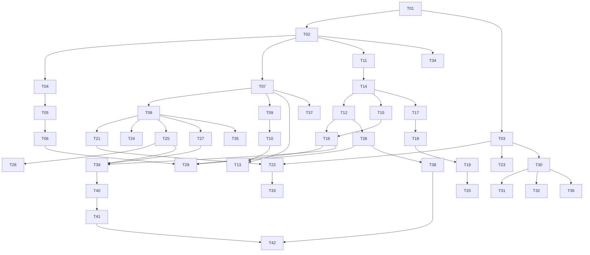

# Tasks — Kế hoạch triển khai cho AI Agent

Đọc [requirements.md](requirements.md) → [design.md](design.md) → file này trước khi sửa. **Mọi checkbox đang chưa hoàn thành vì đây là kế hoạch, không phải kết quả sửa lỗi.** Việc tạo bộ spec không cho phép ghi/seed/reset/import/deploy lên production.

## 1. Quy tắc thực hiện và báo cáo

1. Dùng worktree hiện tại làm nguồn sự thật. Lưu danh sách thay đổi có sẵn, đọc code quanh symbol; không reset file hoặc áp patch từ audit một cách mù quáng.
2. Thực hiện task theo dependency. Nếu finding đã được người khác sửa, kiểm chứng bằng đúng regression/AC rồi ghi bằng chứng; không sửa lại chỉ để có diff.
3. Chỉ dùng dữ liệu giả và database/storage mới. T01/T02 là tiền điều kiện mọi test mutation, kể cả fixture gọi `table.delete()` hoặc `drop_all`.
4. Mỗi task phải có implementation, kiểm tra có ý nghĩa, bằng chứng và cập nhật traceability. Không đánh dấu xong khi chỉ thay UI text mà còn đường API gây lỗi.
5. Các file/component/command ghi “mới/đề xuất” chưa có trong repo. Phải tạo và kiểm tra chúng ở task tương ứng trước khi gọi; không báo command giả đã chạy.
6. Không tự thay role/nghiệp vụ, force-write kỳ chốt hoặc tự sửa dữ liệu legacy mâu thuẫn. Xuất diagnostic và tiếp tục phần độc lập; chỉ xin quyết định khi đã có phạm vi/bản thay đổi cụ thể để chủ sản phẩm xem.
7. Không tự push/deploy, dùng mật khẩu thật trong test, tạo feedback giả trên production, cài analytics ngoài hoặc upload backup. Sự cho phép vận hành thật phải đến từ chỉ dẫn mới của chủ sản phẩm.
8. Khi task thiếu điều kiện (PostgreSQL, browser, người tham gia, hạ tầng backup), ghi rõ phần thiếu; không dùng test hẹp hơn để chứng minh yêu cầu rộng hơn.

Mẫu ghi kết quả task: `Txx | AC | commit/diff hash | environment | command/test case | expected | actual | artifact | pass/fail/pending`. Không chứa credentials. Mọi log/ảnh phải ghi rõ local/mock/staging/production-read-only.

## 2. Lộ trình và phụ thuộc chính

| Đợt | Tasks | Kết quả cụ thể |
|---|---|---|
| 0 | T01–T03 | Baseline, harness an toàn, ma trận role/state/device và ảnh trước |
| 1A | T04–T06 | Deploy/seed/import không thay dữ liệu đã quản lý |
| 1B | T07–T16 | Typed errors, quyền, recovery/autosave, revision và khóa kỳ thống nhất |
| 2A | T17–T20 | FI tạo đồng thời, idempotency, draft và ảnh phục hồi được |
| 2B | T21–T24 | FI history mobile, pagination, STOP, ET population |
| 3 | T25–T29 | Phiên, limiter, notification receipts, file/import/export |
| 4 | T30–T37 | UX toàn app, performance/dependency, LLM, feedback/metrics |
| 5 | T38–T42 | Backup/runbook, migration compatibility, regression tổng, UX validation và gói bàn giao |

P1 mobile che nội dung có thể sửa ngay sau T03 bằng phần CSS/toolbar của T22; không cần chờ toàn bộ backend pagination. T22 chỉ được đánh dấu hoàn thành khi cả hành vi danh sách/phục hồi query đạt. Không dùng dependency dài để trì hoãn bản sửa che nội dung đã rõ.

Sơ đồ biểu diễn các phụ thuộc quan trọng; mục “Phụ thuộc” trong từng task là danh sách đầy đủ. Không tự spawn nhiều agent dựa vào sơ đồ; cách tổ chức nhân lực theo phiên làm việc và quyền hiện tại.

## 3. Danh sách công việc

### Đợt 0 — Baseline và môi trường thử

- [ ] **T01 — Chốt baseline và inventory điểm ghi**

  - Phụ thuộc: không.
  - Đọc: audit, git status/diff, cấu hình app, startup/bootstrap, routes, scripts, tests, migrations, CI/deploy.
  - Thực hiện: ghi commit/diff hash; liệt kê đường save/submit/lock/unlock/import/seed/update/delete/transition/export, transaction owner, caller UI, side effect và scope quyền.
  - Đầu ra: manifest local không có secrets; ma trận finding → symbol/caller hiện tại; inventory legacy endpoint còn/không có caller; danh sách biến môi trường thử cần ghi đè.
  - Kiểm tra: không thêm credentials; diff người dùng được giữ; endpoint GET có ghi file/audit được đánh dấu riêng.
  - Hoàn thành khi: inventory đủ để tìm mọi writer ảnh hưởng report/FI/ET và phân biệt mã local với bản production đã audit; không dựa số dòng cũ làm định vị duy nhất.
  - _Requirements: R01.1, R01.4, R01.5, R01.6, R17.2, R24.1._

- [ ] **T02 — Tạo harness test cô lập và factory dữ liệu giả**

  - Phụ thuộc: T01.
  - File: `backend/tests/conftest.py`, cấu hình test/CI; launcher mới `backend/scripts/run_isolated_checks.py`; factory và browser network guard mới.
  - Thực hiện: tạo DB/storage/sandbox path mới trước import engine; validation đích; token/bootstrap thử; tắt LLM/network ngoài; tách PostgreSQL integration khỏi SQLite quick tests; không dùng `setdefault` cho biến bảo vệ quan trọng.
  - Kiểm tra: C01; cố tình đưa production-like URL, storage thật, missing manifest phải dừng trước fixture; test hai run không chung DB; fake fixture đủ năm role và namespace.
  - Đầu ra: command chạy an toàn được kiểm thử, logs chỉ hiển thị host/db thử đã che secret; negative tests kiểm tra guard.
  - Hoàn thành khi: mọi task test ghi bên dưới có thể gọi harness, và cả sandbox_engine được chứng minh nằm trong vùng thử.
  - _Requirements: R01.2, R01.3, R01.5, R15.6, R19.5, R24.2, R24.5._

- [ ] **T03 — Ghi baseline UI/UX, role và thiết bị**

  - Phụ thuộc: T01, T02.
  - File: cấu hình Playwright/E2E mới ở frontend; dùng ảnh audit làm tham chiếu bổ sung, không thay baseline local bằng production bundle khác.
  - Thực hiện: fixtures desktop/mobile, long labels, 0/1/175/5.000 FI, ET đủ/thiếu hồ sơ, editor dài; capture từng role và state loading/empty/error/read-only/locked.
  - Kiểm tra: C12, C13, C32; smoke keyboard, overflow, sticky height, focus; lưu viewport/browser/font/dataset.
  - Hoàn thành khi: có ảnh trước và danh sách hành vi cụ thể để so sau; lỗi known không bị tick pass vì screenshot đã được chấp nhận.
  - _Requirements: R10.1, R10.2, R21.1, R21.9, R22.3, R24.3, R24.6._

### Đợt 1A — Deploy, seed, import

- [ ] **T04 — Gỡ business import/seed khỏi deploy/restart**

  - Phụ thuộc: T01, T02.
  - File: `deploy_prod.py`, `.github/workflows/deploy.yml`, bootstrap/startup liên quan, `backend/tests/unit/test_deploy_security.py`.
  - Thực hiện: deploy mặc định không import T5/T6 hoặc seed user/ET; kiểm kê mọi cờ và entrypoint; giữ backup, migration schema, host verification/health check.
  - Kiểm tra: C02; assert chuỗi remote command không chứa business import/seed; không thực thi remote command. Lặp simulated deploy không đổi checksum dữ liệu thử.
  - Hoàn thành khi: không còn đường default deployment ghi lại dữ liệu nghiệp vụ và CI không kích hoạt workflow bootstrap thay thế ngầm.
  - _Requirements: R02.1, R03.1, R24.2._

- [ ] **T05 — Seed insert-only và bảo toàn user/personnel/framework**

  - Phụ thuộc: T04.
  - File: seed users, seed ET personnel/framework, bootstrap và integration/unit test liên quan.
  - Thực hiện: lookup khóa ổn định; existing → skipped; tạo mới với cấu hình an toàn; report field-preservation; migration dữ liệu riêng nếu cần, không overwrite mặc định.
  - Kiểm tra: C03; inactive giữ inactive, role/team/tên/bậc/hidden/user link/password giữ nguyên; framework chỉnh tay không đổi; seed lặp không tăng số bản ghi.
  - Hoàn thành khi: cold bootstrap hoạt động và seed snapshot cũ không hoàn tác quản trị ở các field nêu trong R03.
  - _Requirements: R03.2, R03.3, R03.4, R03.5, R03.6, R01.6._

- [ ] **T06 — Import preview/manifest và insert-missing an toàn**

  - Phụ thuộc: T05.
  - Phạm vi: task này hoàn thiện preview/insert-missing; phần apply replace được thực hiện ở T29 sau T12/T16.
  - File: `backend/scripts/import_historical.py`, `backend/app/services/okr/historical_import.py`, tests historical import/property.
  - Thực hiện: preview mặc định, source hash, scope kỳ, mode, IDs/revision, kết quả per-period; insert-missing skip mọi kỳ có dữ liệu; ledger chống apply manifest hai lần; chưa bật replace cho tới T29.
  - Kiểm tra: C04; locked/submitted/draft giữ nguyên ID/current/status/nội dung/file/allocation; source thay sau preview bị từ chối; partial failure có báo kỳ cụ thể, không xóa bản cũ.
  - Hoàn thành khi: preview/insert-missing đã đầy đủ; replace được chặn rõ và track T29, không để đường unsafe hoạt động tạm thời.
  - _Requirements: R02.2, R02.3, R02.5, R02.6, R17.3, R24.2._

### Đợt 1B — Editor, quyền và khóa dữ liệu

- [ ] **T07 — Typed API errors, cancellation và error-state UI**

  - Phụ thuộc: T02.
  - File: `frontend/src/api/client.ts`, client tests, backend error helper/schema, shared error components mới.
  - Thực hiện: ApiError metadata theo D03; JSON/blob/204/network parser; normalize legacy detail; GET signal + retry giới hạn; không raw JSON/HTML; request ID.
  - Kiểm tra: C18; 401/403/409/422/429/500, text proxy response, invalid JSON, empty response, network timeout; field paths và retry policy không mất metadata.
  - Hoàn thành khi: caller mới phân biệt lỗi bằng code/status, caller cũ không crash, mutation không bị retry mù.
  - _Requirements: R14.1, R14.3, R14.4, R14.5, R14.6, R24.2._

- [ ] **T08 — Capabilities và đồng bộ menu/API theo năm role**

  - Phụ thuộc: T01, T02, T07.
  - File: security/policy backend, `/auth/me`, App, ETModule, OKRWorkspace, client typings, permission tests.
  - Thực hiện: ma trận D10, scope own-linked-personnel; Staff ẩn ET/deep link fallback; FI_Coordinator chỉ summary không gọi heatmap; sandbox reset capability; admin edit mode giữ mặc định off.
  - Kiểm tra: C14, C15; đủ role × endpoint phụ trợ × deep link × mobile/desktop; unknown role deny; reset production bị chặn cả API/UI; UI không request endpoint đã biết forbidden.
  - Hoàn thành khi: không mở rộng quyền backend để làm menu hết lỗi; capability/resource checks đồng bộ, không chỉ hide CSS.
  - _Requirements: R11.1, R11.2, R11.3, R11.4, R11.5, R11.6, R11.7, R24.2._

- [ ] **T09 — Recovery store và guard mọi kiểu điều hướng**

  - Phụ thuộc: T07, T08.
  - File mới đề xuất: DraftRecoveryStore, NavigationGuardProvider, UnsavedChangesDialog; tích hợp App/selector/tab/logout.
  - Thực hiện: namespace/user/context schema; sessionStorage/TTL/error path; guard module, tab, kỳ, đội, phiếu, Back/Forward, edit-mode off, logout; beforeunload và pagehide hỗ trợ.
  - Kiểm tra: C07, C08; đổi tab trước debounce, reload, expired login cùng/khác user, storage quota/private mode, nhiều dirty editor, request outcome unknown; không lộ draft user trước.
  - Hoàn thành khi: không còn navigation bypass trong inventory T01; lựa chọn bỏ không hứa thu hồi request đã gửi.
  - _Requirements: R04.5, R04.6, R04.7, R04.9, R08.1, R08.2, R08.6, R14.2, R11.6._

- [ ] **T10 — Draft controller chống response cũ và conflict UI**

  - Phụ thuộc: T07, T09.
  - Phạm vi: controller được test bằng API giả ở đây; T12/T13 nối endpoint thực sau, không phải điều kiện để bắt đầu T10.
  - File: shared editing controller/status/conflict mới, WebInputForm adapter.
  - Thực hiện: immutable snapshot, local/ack/server revision, queue single-flight latest-only, debounce1s, flushLatest; compare base/local/server theo stable field key, không merge array theo index.
  - Kiểm tra: C05, C06, C07; A lưu chậm/gõB → server cuốiB; 409 giữ local/error; 5 lần chỉnh liên tiếp; manual save khi autosave in-flight; submit chờ đúng snapshot; request context cũ không thay UI mới.
  - Hoàn thành khi: “Đã lưu” chỉ hiện đúng snapshot đã ack, conflict có merge/keep/discard rõ ràng, lỗi không bị load() xóa.
  - _Requirements: R04.1, R04.2, R04.3, R04.4, R04.8, R05.6, R14.5, R21.6._

- [ ] **T11 — Migration period revision và unique current lanes**

  - Phụ thuộc: T02, T01.
  - File: model/migration mới; preflight script; migration tests mới.
  - Thực hiện: team_report_period_states; unique draft/published tách lane; preflight duplicates/unknown kỳ/locked mismatch; GET chưa có state không write.
  - Kiểm tra: C09, C30; draft+published hợp lệ cùng tồn tại; duplicate cùnglane bị report/fail không autoclean; upgrade dữ liệu legacy giữ nội dung/current IDs; replay migration/backfill không đổi nghiệp vụ.
  - Hoàn thành khi: schema bảo vệ được cold period và không phá semantics existing draft/published.
  - _Requirements: R05.1, R05.5, R06.7, R02.6, R24.4._

- [ ] **T12 — Report save/submit/import transaction với revision bắt buộc**

  - Phụ thuộc: T07, T10, T11, T14.
  - File: web_input route/schema/service, admin report routes, importer adapter, test unit/integration/property.
  - Thực hiện: một nơi quản lý transaction; khóa kỳ và kiểm tra expected_revision; tăng revision; submit đúng draft; current flags, audit và notification nội bộ nguyên tử; thiếu revision trả 428; rollback khi lỗi; nối WebInputForm mới.
  - Kiểm tra: C09, C10; hai draft đầu tiên, save/save, save/submit, submit bản cũ và import cạnh tranh ở kỳ chưa chốt; client cũ không bypass; lỗi notification không làm report gửi lặp; render file không làm sai current flags (tách hoàn chỉnh ở T28).
  - Hoàn thành khi: mọi writer nội dung report trong inventory dùng protocol; SQLite + PostgreSQL tests phù hợp đạt; version nghiệp vụ không bị dùng nhầm làm revision.
  - _Requirements: R05.1, R05.2, R05.3, R05.4, R05.5, R05.6, R04.1, R04.2, R04.3, R02.5._

- [ ] **T13 — ET revision và controller autosave**

  - Phụ thuộc: T07, T08, T09, T10.
  - File: CompetencyAssessment revision migration, ET schemas/service/routes, AssessmentView adapter.
  - Thực hiện: update items/notes/status/refresh-required-scores/submit kiểm tra cùng revision; response cũ không setDraft đè; đổi phiếu có guard, recovery đúng resource.
  - Kiểm tra: C06, C07, C11; hai admin sửa assessment, items reorder, notes gõ khi save, refresh điểm cạnh tranh submit; role chỉ xem không gửi mutation.
  - Hoàn thành khi: ET có regression riêng, không chỉ suy diễn hook đã qua test OKR là đủ.
  - _Requirements: R05.1, R05.2, R05.3, R05.4, R05.7, R04.1, R04.2, R04.4, R04.5, R04.9._

- [ ] **T14 — Team guard và quy tắc thứ tự khóa thống nhất**

  - Phụ thuộc: T01, T02, T11.
  - File mới đề xuất: FI team guard model/migration, `backend/app/services/fi/period_guard.py`; transaction helper.
  - Thực hiện: guard team → kỳ → FI → report/allocation; insert-on-conflict cold guard; re-read nguồn cũ sau khóa; retry bounded khi scope nguồn đổi/deadlock; không helper tự commit.
  - Kiểm tra: C10, C12; hai giao dịch đổi đội/kỳ ngược nhau; empty pool; xác minh khóa dùng hai connection thật, không chỉ mock with_for_update.
  - Hoàn thành khi: helper có invariant/test và mọi task writer sau bắt buộc dùng protocol; không bật claim bảo vệ chốt trước T15/T16.
  - _Requirements: R06.1, R06.4, R05.2, R24.2._

- [ ] **T15 — Chặn mọi mutation FI ảnh hưởng kỳ đã chốt**

  - Phụ thuộc: T14, T08.
  - File: FI service/routes/workflow, scripts importer/admin update có liên quan; tests monthly allocation/workflow/API.
  - Thực hiện: inventory field ảnh hưởng count/snapshot/pool; kiểm tra source/destination locked ở assign/clear/update/status/delete/import; team guard revision tăng khi pool thay đổi; harmless content theo policy rõ.
  - Kiểm tra: C12; locked source, locked target, hai locked, no-lock, khác team, Admin và Team_Account; approve/reject/cancel/complete/delete đúng scope; lỗi không thay lịch sử hoặc invalidation thành công.
  - Hoàn thành khi: finding D04 không còn đường bypass đã biết; API/UI đều giải thích locked nhưng server là lớp bảo đảm.
  - _Requirements: R06.1, R06.2, R06.3, R06.4, R06.6, R22.5._

- [ ] **T16 — Preview/finalize/unlock nguyên tử và stale preview**

  - Phụ thuộc: T12, T14, T15.
  - File: monthly_allocation, các route web_input/admin, preview trong AdminPanel và tests.
  - Thực hiện: trả report_revision, fi_team_revision và plan_hash; preview chỉ đọc; finalize kiểm tra lại dưới khóa; xử lý định mức 0, thiếu nguồn, assessment override và draft chưa gửi; mở chốt có lý do, giữ lịch sử.
  - Kiểm tra: C12, C31; chạy assign/finalize, approve/finalize và submit/lock đồng thời; preview cũ không được chốt một danh sách mới âm thầm; lỗi thiếu nguồn rollback toàn bộ dữ liệu.
  - Hoàn thành khi: report locked, allocation và danh sách FI khớp nhau sau mọi thứ tự cạnh tranh hợp lệ; định mức và chiến lược chọn FI hiện có không đổi.
  - _Requirements: R06.3, R06.4, R06.5, R06.6, R06.7, R05.2, R05.3, R05.6._

### Đợt 2A — FI tạo, nháp và ảnh

- [ ] **T17 — Cấp số FI nguyên tử**

  - Phụ thuộc: T02, T14.
  - File: generate_sk_code, sequence tests và công cụ kiểm tra sequence trước nâng cấp.
  - Thực hiện: upsert-returning trong transaction; giữ unique sk_code; xử lý cả prefix chưa tồn tại; không reset sequence hoặc đánh lại mã cũ.
  - Kiểm tra: C19; 20 request đồng thời cùng prefix, nhiều prefix độc lập, rollback khi tạo FI lỗi; sequence lệch với dữ liệu cũ phải có báo cáo. Dùng PostgreSQL thật.
  - Hoàn thành khi: hồ sơ khác nhau có mã duy nhất, không lộ lỗi constraint/500 do cạnh tranh và không đổi format mã.
  - _Requirements: R07.1, R07.2, R07.6, R24.2._

- [ ] **T18 — Idempotency tạo FI và endpoint đối soát**

  - Phụ thuộc: T07, T08, T17.
  - File: model/migration/service idempotency mới, endpoint tạo FI và tra trạng thái operation, API client.
  - Thực hiện: khóa duy nhất theo actor/namespace/operation key; hash payload chuẩn hóa; claim, FI, sequence, notification và audit trong cùng transaction; cùng key trả hồ sơ cũ, payload khác trả conflict; tra operation phải có quyền.
  - Kiểm tra: C20; hai request cùng key đồng thời, mất response sau commit, cùng key nhưng user/namespace khác, cùng key khác payload, commit thất bại; số hồ sơ và event thành công phải đúng 1.
  - Hoàn thành khi: retry, refresh và bấm hai lần không tạo hồ sơ trùng; tra operation không lộ dữ liệu người khác.
  - _Requirements: R07.3, R07.4, R07.5, R07.6, R08.5, R09.1._

- [ ] **T19 — FI registration draft và hành vi form dài**

  - Phụ thuộc: T09, T18.
  - File: FIWorkspace và form component được tách, recovery adapter, validation biểu mẫu.
  - Thực hiện: lưu draft ID, operation key và record ID; phân biệt tác giả/người gửi hộ; khôi phục text, lỗi tại trường và guard khi đổi phân hệ/reload; không lưu file blob vào sessionStorage.
  - Kiểm tra: C08, C21; rời FI sang OKR trước submit, validation lỗi vẫn giữ nội dung, quyền thay đổi, reload sau tạo nhưng trước upload; chỉ bắt đầu hồ sơ mới mới sinh operation key mới.
  - Hoàn thành khi: không mất nội dung âm thầm và không khôi phục hồ sơ đã có ID thành một ý định tạo mới.
  - _Requirements: R08.1, R08.2, R08.3, R08.4, R08.5, R08.6, R21.7._

- [ ] **T20 — Upload queue theo record ID và retry từng ảnh**

  - Phụ thuộc: T18, T19.
  - Phạm vi: xây primitive ghi file an toàn cho upload tại đây; T28 tái sử dụng, không tạo phụ thuộc vòng.
  - File: FI upload API, metadata SKImage, upload queue component/client và tests.
  - Thực hiện: state machine D08, tối đa 2 ảnh đang gửi; upload key, hash và kiểm tra nội dung; thử lại từng ảnh; đối soát response bị mất/reload; nói rõ phần thành công, giữ FI đã tạo khi ảnh lỗi.
  - Kiểm tra: C22; 3 ảnh, ảnh thứ hai lỗi; chỉ gửi lại ảnh lỗi, POST tạo FI chỉ một lần; response upload mất không tạo ảnh trùng; kiểm tra MIME, kích thước, traversal, quyền và chọn lại ảnh sau reload.
  - Hoàn thành khi: trạng thái lỗi ảnh không quay về bước tạo FI; không xóa FI để bù lỗi ảnh.
  - _Requirements: R09.1, R09.2, R09.3, R09.4, R09.5, R09.6, R08.3, R08.5, R17.6._

### Đợt 2B — Lịch sử mobile và dashboard

- [ ] **T21 — API FI history phân trang, filter/search/summary chung**

  - Phụ thuộc: T01, T08.
  - File: history route/query schema, SQL query builder dùng chung, indexes và API client; giữ adapter endpoint cũ khi còn caller.
  - Thực hiện: giữ đủ bộ lọc hiện có; tìm trên toàn tập dữ liệu có quyền; sort ổn định; trang mặc định 25, tùy chọn 50, tối đa 100; count/summary cùng scope; chuẩn hóa tìm kiếm tiếng Việt; tránh N+1.
  - Kiểm tra: C23; 5.000 FI, nhiều đội/trạng thái/năm, ranh giới trang, filter/total/summary, tác giả khác người đăng ký, đã/chưa phân bổ, tìm có dấu/không dấu, bản ghi cùng thời gian và cache theo quyền.
  - Hoàn thành khi: server lọc/phân trang trước serialize; API cũ trả array không bị đổi shape âm thầm nếu còn caller.
  - _Requirements: R10.5, R10.6, R10.8, R22.2, R22.5, R17.1._

- [ ] **T22 — Sửa FI history mobile, filter sheet và khôi phục vị trí**

  - Phụ thuộc để hoàn thành: T03, T07, T08, T21.
  - Phạm vi sớm: sửa phần sticky sau T03; phần query/pagination còn chờ T21. Không tick toàn task chỉ vì phần sticky đã sửa.
  - File: FIHistoryView, toolbar/filter components, CSS có phạm vi, query state và History.
  - Thực hiện: bỏ sticky wrapper cao; thống kê mặc định gọn; toolbar theo ngân sách D09; filter sheet có Apply/Cancel/reset/chips; query trong URL/state; phân trang; quay lại từ chi tiết giữ vị trí và focus.
  - Kiểm tra: C13, C23, C32; 320×568, 390×844, rộng 430 px, landscape, bàn phím ảo, zoom, cuộn 900 px; thấy hồ sơ đầu tiên, focus không bị che; đóng bộ lọc giữ query cũ, empty state đúng.
  - Hoàn thành khi: xem/mở hồ sơ được bằng chạm và bàn phím; mọi filter cũ còn chức năng; không chỉ giảm font để nhét vừa màn hình.
  - _Requirements: R10.1, R10.2, R10.3, R10.4, R10.5, R10.6, R10.7, R10.8, R21.2, R21.5._

- [ ] **T23 — Sửa nhãn STOP, zero/missing và tổng**

  - Phụ thuộc: T02, T03.
  - File: VisualBlockRenderer và các test dashboard/formatter hiện có.
  - Thực hiện: tách rawRate, nhãn hiển thị và chiều dài thanh; ghi rõ tử/mẫu; không clamp nhãn; phân biệt thiếu/không hợp lệ với 0; không đổi quy tắc chấm điểm.
  - Kiểm tra: C16; 15/7 → 214%, 11/6 → 183%, 12/8 → 150%, 6/5 → 120%, 44/26 → 169%; 0/7, 0/0, null, NaN và số âm; tổng từ tổng tử/tổng mẫu.
  - Hoàn thành khi: có regression local cho U03, nhãn sau sửa đúng và screenshot thể hiện rõ tử/mẫu.
  - _Requirements: R12.1, R12.2, R12.3, R12.4, R12.5._

- [ ] **T24 — ET population và onboarding có giải thích**

  - Phụ thuộc: T08, T03.
  - File: ET summary/service/schema, DashboardView, PersonnelView và liên kết bộ lọc.
  - Thực hiện: tách tài khoản, Personnel, người đủ điều kiện dashboard và người sẵn sàng đánh giá; nhóm lý do không cộng trùng; không tự điền dữ liệu; CTA đúng quyền; bỏ heatmap rỗng và thống nhất scope bộ lọc.
  - Kiểm tra: C17; fixture 55 tài khoản/0 người đủ điều kiện; Personnel chưa liên kết user, liên kết trùng, thiếu vị trí/bậc/khung, hidden/inactive, scope quyền và phản hồi lọc chậm; CTA tới đúng danh sách.
  - Hoàn thành khi: UI giải thích được chênh lệch tổng; không sửa predicate nghiệp vụ âm thầm chỉ để các con số trông hợp lý.
  - _Requirements: R13.1, R13.2, R13.3, R13.4, R13.5, R13.6, R11.2, R14.6._

### Đợt 3 — Phiên, thông báo, file

- [ ] **T25 — Session version, reset/revoke và re-auth giữ draft**

  - Phụ thuộc: T07, T08, T09.
  - File: User model/migration, security/auth/admin reset, LoginResponse, App, ChangePasswordForm và auth tests.
  - Thực hiện: ký sv từ DB; tăng version cùng transaction đổi mật khẩu; revoke-all; giữ kiểm tra active/role hiện tại; chính sách token thiếu sv khi cutover; re-auth một lần, không tự replay mutation, khôi phục cùng user và cô lập user khác.
  - Kiểm tra: C24; token cũ sau change/reset vẫn vô hiệu sau khi hoàn thành đổi mật khẩu bắt buộc; token mới hợp lệ; nhiều 401 đồng thời; sandbox tách biệt; guard khi revoke-all; token legacy; đổi mật khẩu thất bại không tăng version.
  - Hoàn thành khi: token cũ không phục hồi hiệu lực; draft không mất hoặc lộ giữa users; có kế hoạch cutover cụ thể để review.
  - _Requirements: R15.1, R15.2, R15.3, R15.4, R15.5, R15.6, R14.2, R04.9._

- [ ] **T26 — Login limiter và degraded behavior**

  - Phụ thuộc: T25, T07.
  - File: limiter/config đăng nhập mới, cấu hình proxy tin cậy, tests và cảnh báo vận hành.
  - Thực hiện: bộ đếm Redis chia sẻ, TTL và tăng nguyên tử; khóa theo cặp IP+tài khoản và theo IP; thông báo trung tính, Retry-After, fake clock; fallback có TTL/cảnh báo khi Redis lỗi; không log secrets.
  - Kiểm tra: C25; nhiều worker, nhiều user chung NAT, khác hoa/thường username, giả header forwarded IP, Redis ngừng hoạt động, thời gian retry và đăng nhập thành công/thất bại; chỉ danh tính giả.
  - Hoàn thành khi: limiter đúng hợp đồng; fallback không khóa vô hạn và không bị mô tả là bảo đảm quota toàn cụm.
  - _Requirements: R19.1, R19.2, R19.3, R19.4, R19.5, R14.3._

- [ ] **T27 — Notification visibility, receipts và legacy migration**

  - Phụ thuộc: T08, T02.
  - File: model/migration notification receipts, predicate dùng chung, routes/repositories notify và panel/badge thông báo.
  - Thực hiện: visibility OR đúng semantics; upsert receipt theo user; badge dùng read_status; legacy_unknown không bịa người đọc; chỉ backfill từ audit có bằng chứng; mark-all là hành động có phạm vi rõ.
  - Kiểm tra: C26; thông báo riêng với role null không cho user khác đọc; role/broadcast do A đọc vẫn unread với B; target hỗn hợp là union; retry, đổi role, dữ liệu legacy true/false và audit đủ/thiếu bằng chứng.
  - Hoàn thành khi: list/mark dùng cùng predicate; migration không coi mọi thành viên role đã đọc; UI không phát hàng loạt thông báo lịch sử như mới.
  - _Requirements: R16.1, R16.2, R16.3, R16.4, R16.5, R16.6, R24.4._

- [ ] **T28 — Artifact/file lifecycle không làm sai trạng thái lưu**

  - Phụ thuộc: T12, T07, T20.
  - Phạm vi: tái sử dụng primitive file an toàn đã kiểm chứng ở T20; T20 không phụ thuộc T28.
  - File: generated artifact model/service/migration mới, web_input _write_generated_files, ET Excel/FI export và download helpers.
  - Thực hiện: commit nội dung chuẩn tách render; trạng thái pending/ready/failed; storage key UUID/version; verify file tạm rồi promote; kiểm tra quyền tải; manifest file mồ côi, thời gian chờ và reconcile chỉ file chứng minh không còn reference.
  - Kiểm tra: C27; save thành công nhưng render lỗi; hai export cùng giây không ghi đè; commit lỗi sau rename; retry cùng resource/version; Unicode, traversal và file legacy còn nguyên.
  - Hoàn thành khi: UI nói đúng phần nội dung đã lưu và file chưa tạo; retry export không tạo report/FI lần hai.
  - _Requirements: R17.4, R17.5, R17.6, R04.2, R09.4, R24.4._

- [ ] **T29 — Export đúng scope và replace Excel theo preview/revision**

  - Phụ thuộc: T06, T12, T16, T21, T28.
  - File: OKR export/upload, apply replace lịch sử, FI reports export dùng query chung, frontend caller hiện hữu và workbook tests.
  - Thực hiện: bắt buộc month/year/filter; published policy; scope count/export; replacement manifest, hash, expected revision và lý do; chặn kỳ chốt; compatibility endpoint cũ rõ ràng.
  - Kiểm tra: C04, C28; kỳ đã chọn không lẫn draft/kỳ khác; export toàn kết quả lọc không chỉ trang; preview cũ, source đổi hoặc replace kỳ chốt bị từ chối; so cell/formula/sheet mẫu, giữ file gốc.
  - Hoàn thành khi: caller hiện hữu không hỏng; không thêm nút ghi mới không cần thiết; insert-only và replace có chủ ý đều theo guard.
  - _Requirements: R02.4, R02.5, R02.6, R17.1, R17.2, R17.3, R17.7._

### Đợt 4 — UX toàn app, hiệu năng, quan sát

- [ ] **T30 — Shared UI patterns, tokens và accessibility primitives**

  - Phụ thuộc: T03, T07, T08.
  - File: CSS/tokens và component chung cho tabs, dialog, drawer, field error, loading/empty state; không thêm override trùng.
  - Thực hiện: spacing, typography, contrast, z-index; target chạm 44 px theo tiêu chuẩn sản phẩm; thông báo screen reader; reduced motion; keyboard tabs, Escape, focus trap/return focus và kiểm soát overflow.
  - Kiểm tra: C32; đo contrast, axe và keyboard walkthrough; nhãn tiếng Việt dài, 320 px, zoom 200%, ARIA tab/panel đúng; không có thông tin chỉ đọc được khi hover.
  - Hoàn thành khi: primitive có examples/test harness và được dùng vào màn hình thực, không là bộ component bỏ không.
  - _Requirements: R21.1, R21.2, R21.3, R21.4, R21.5, R21.6, R21.8, R14.6._

- [ ] **T31 — Hoàn thiện UX OKR và Admin theo luồng nghiệp vụ**

  - Phụ thuộc: T10, T12, T16, T23, T25, T30.
  - File: OKRModule/Workspace/editor/dashboard, AdminPanel, bộ chọn ngữ cảnh và actions.
  - Thực hiện: nhãn đội/kỳ chính xác; nhóm KR và điểm neo tới lỗi; trạng thái lưu; chỉ xem/đã chốt; preview rõ nguồn FI/định mức; guard edit mode và nhãn thống nhất; không đổi công thức/quota.
  - Kiểm tra: C05–C10, C31, C32; Admin chỉ xem không POST; edit/save/conflict/lock/thiếu nguồn; đổi kỳ khi mạng chậm; bảng tiêu chí cuộn riêng và focus tới KR lỗi bằng bàn phím.
  - Hoàn thành khi: hai phân hệ áp dụng đầy đủ ma trận trạng thái D17; fixture nghiệp vụ giữ kết quả, ảnh trước/sau đủ.
  - _Requirements: R21.1, R21.2, R21.3, R21.6, R21.7, R21.9, R11.6, R14.6, R06.6._

- [ ] **T32 — Hoàn thiện UX FI detail/ET assessment/plan và shell**

  - Phụ thuộc: T13, T19, T20, T22, T24, T27, T30.
  - File: shell/nav/notification, FI detail, ET views và nội dung hiển thị dùng chung.
  - Thực hiện: CTA theo quyền/trạng thái; timeline, tác giả/người gửi, thành công một phần; tiến độ ET/nhóm năng lực và summary đủ điều kiện; menu bàn phím, profile/sandbox marker, empty/error states thống nhất.
  - Kiểm tra: C14, C17, C21, C22, C26, C32; đủ năm role; không gọi API phụ trợ bị cấm; focus/scroll/recovery khi quay lại; sidebar/bottom nav không che nội dung.
  - Hoàn thành khi: các luồng thực được cải thiện, không chỉ style lịch sử FI; mọi chức năng cũ có quyền vẫn truy cập được.
  - _Requirements: R21.1, R21.2, R21.3, R21.5, R21.6, R21.7, R21.9, R11.4, R14.6._

- [ ] **T33 — Lazy loading, query/index tuning và đo performance**

  - Phụ thuộc: T21, T22, T28, T31, T32.
  - File: module imports trong App, lazy export/chart, query indexes/caches và benchmark fixture/script.
  - Thực hiện: chia bundle nhưng giữ guard/store bên ngoài module; pagination SQL/index/N+1; cache key theo namespace/scope; baseline cùng toolchain; ngân sách D18.
  - Kiểm tra: C33; 5.000 FI/10 client, query plan và API p95, trace 10 lượt navigation, entry bundle gzip/CLS/độ trễ tương tác lab; không lộ scope qua cache và không invalidation như thành công khi rollback.
  - Hoàn thành khi: báo cáo trước/sau đạt mục tiêu hoặc có điều chỉnh được review bằng bằng chứng; không chỉ tăng ngưỡng cảnh báo Vite.
  - _Requirements: R22.1, R22.2, R22.3, R22.5, R10.6._

- [ ] **T34 — Dependency remediation có đánh giá đường sử dụng**

  - Phụ thuộc: T02, T01.
  - File: package manifests/lockfiles, advisory report và inventory dependency backend.
  - Thực hiện: kiểm tra lại advisory chính thức hiện hành; phân loại build/runtime; cập nhật có mục tiêu browserslist/nanoid/postcss và rủi ro hiện hành khác; không audit fix --force hoặc nâng major không có lý do.
  - Kiểm tra: C34; npm test/build; kiểm tra backend liên quan nếu đổi Python dependencies; xác minh export/parse artifact; ghi advisory đã xử lý hoặc chấp nhận cùng lý do.
  - Hoàn thành khi: mọi high advisory có phân loại và quyết định; không tuyên bố nginx static đã bị khai thác chỉ vì npm audit báo high.
  - _Requirements: R22.4, R24.5, R24.6._

- [ ] **T35 — Owner/namespace/TTL cho LLM và tool scope**

  - Phụ thuộc: T02, T08, T07.
  - File: LLM routes/chatbot/store/tool_executors, trạng thái tính năng trên client và tests với provider giả.
  - Thực hiện: owner do server gắn, authorize mọi nhánh; tool nhận principal; shared store cho nhiều worker; TTL/giới hạn/trạng thái hết hạn; khi tắt không khởi tạo kết nối ngoài.
  - Kiểm tra: C29; A tạo, B đọc/gửi/xóa bị từ chối dù biết ID; cùng ID khác namespace; Team_Account không đọc vượt quyền qua tool; TTL/restart; chỉ provider giả.
  - Hoàn thành khi: mã được kiểm tra an toàn ở cả chế độ bật với mock và chế độ tắt; không bỏ owner fix chỉ vì production chưa dùng LLM.
  - _Requirements: R20.1, R20.2, R20.3, R20.4, R20.5, R01.5._

- [ ] **T36 — Kênh feedback nội bộ có chủ ý gửi**

  - Phụ thuộc: T08, T30, T18 để tái sử dụng cơ chế idempotency khi phù hợp.
  - File mới đề xuất: feedback schema/model/routes/UI/admin list, limiter và retention config.
  - Thực hiện: form ngắn, context route/build tối thiểu, explicit Send, ticket ID, lưu nội bộ, quyền Admin, retry/idempotency; không tự chụp màn hình hoặc gửi ra dịch vụ ngoài.
  - Kiểm tra: C35; mở/đóng không ghi; bấm gửi tạo một record, retry không trùng; escape XSS/giới hạn độ dài; chặn đọc admin list trái quyền; server lỗi giữ mô tả; không gửi dữ liệu trước hành động Send.
  - Hoàn thành khi: feedback có đầy đủ lưu/xem/xử lý ở môi trường thử, không chỉ là nút Báo vấn đề không có đích nhận.
  - _Requirements: R23.1, R23.2, R21.6, R24.2._

- [ ] **T37 — Metrics lỗi/độ trễ với allowlist dữ liệu**

  - Phụ thuộc: T07, T10, T20, T26.
  - File: structured logs/metrics, client queue/config; không dùng debug log để ghi raw payload.
  - Thực hiện: allowlist D19; liên kết request ID; sampling, queue có giới hạn, không chặn nghiệp vụ; retention; phân biệt 403 dự kiến trong negative tests; không query strings/nội dung/token.
  - Kiểm tra: C36; đặt chuỗi canary nhạy cảm trong editor/password/filename và chứng minh không xuất hiện trong log; telemetry lỗi không chặn Save; đếm đúng conflict/upload fail; tôn trọng cấu hình tắt.
  - Hoàn thành khi: Admin có cách đọc metric/report nội bộ để tìm lỗi mà không cần nội dung người dùng.
  - _Requirements: R23.3, R23.4, R22.3, R19.4, R01.5._

### Đợt 5 — Nghiệm thu và bàn giao

- [ ] **T38 — Backup/restore rehearsal và runbook vận hành**

  - Phụ thuộc: T28, T01, T02.
  - File/artifact: backup manifest, runbook, restore verification mới; script chỉ chạy fixture synthetic trong phạm vi hiện tại.
  - Thực hiện: snapshot DB/file theo D15; checksum/reference checks; template cấu hình offsite không chứa secrets; retention/RPO/RTO đề xuất; restore đích mới, rollback ứng dụng tương thích.
  - Kiểm tra: C37; restore DB/ảnh/report/allocation đúng fixture; phát hiện thiếu file hoặc checksum sai; không restore đè đích cũ; ghi thời gian diễn tập thực đo.
  - Hoàn thành local khi: script/runbook/test đạt với dữ liệu giả; phần xác minh production ghi pending nếu chưa có quyền. Không đồng nhất kết quả này với việc đã có backup offsite thật.
  - _Requirements: R18.1, R18.2, R18.3, R18.4, R18.5, R18.6, R24.6._

- [ ] **T39 — Tổng duyệt migration và hợp đồng client cũ/mới**

  - Phụ thuộc: T11, T12, T13, T14, T18, T20, T25, T27, T28, T29, T35, T36.
  - File/artifact: migration rehearsal Alembic, preflight report, contract tests và release matrix.
  - Thực hiện: upgrade đủ fixtures legacy; dữ liệu trùng phải fail mà không sửa; legacy receipts không xác định được giữ đúng; so hash/count/status; client thiếu revision, session cutover và rollback ứng dụng với schema additive.
  - Kiểm tra: C30, C38; counts/checksums/references trước/sau; database rỗng, legacy hợp lệ và legacy mâu thuẫn; compatibility bật/tắt đúng kế hoạch; frontend cũ bị chặn ghi có thông báo.
  - Hoàn thành khi: mọi bảng/cột mới có migration path được chứng minh; không dùng create_all thay kiểm thử upgrade và không tự giải quyết mâu thuẫn dữ liệu cũ.
  - _Requirements: R24.4, R24.5, R05.4, R06.7, R15.5, R16.5, R18.5._

- [ ] **T40 — Regression tổng theo AC, concurrency và UI states**

  - Phụ thuộc: T04–T39, nghĩa là mọi task implementation trong khoảng này.
  - Thực hiện: suite hiện có và regression mới; PostgreSQL barrier tests; browser nhiều tab/offline/errors; role matrix; network guard; inventory khóa nguồn/đích; bảng AC → test hiện hành.
  - Kiểm tra: C01–C38. Chuẩn bị phần kiểm tra tự động của C40; C39 và kiểm tra bàn giao cuối C40 thuộc T41/T42. Báo skipped/failed rõ; số 224/58 là baseline lịch sử, không hardcode số pass mới.
  - Hoàn thành khi: các yêu cầu triển khai có bằng chứng đúng phạm vi, mọi P1 hết tái hiện; gate người dùng/hạ tầng thật được ghi riêng, không tạo vòng phụ thuộc với T41/T42.
  - _Requirements: R24.1, R24.2, R24.3, R24.4, R24.5, R24.7._

- [ ] **T41 — Nghiệm thu UX theo tác vụ và người đại diện**

  - Phụ thuộc: T40, T33.
  - Thực hiện: walkthrough theo ma trận mục 5; ảnh trước/sau cùng fixture; keyboard/zoom/WebKit; chuẩn bị kịch bản cho 3–5 người đại diện và ghi kết quả thật nếu có người tham gia.
  - Kiểm tra: C32, C33, C39; thời gian tìm/mở FI, hoàn thành form, hiểu trạng thái/conflict/ET population; không cần production; ghi điểm chưa rõ, sửa và kiểm tra lại phần ảnh hưởng.
  - Hoàn thành local khi: walkthrough và bằng chứng kỹ thuật đạt, kịch bản study sẵn; nếu thiếu người/thiết bị thật thì ghi user-validation pending. Không bịa kết quả và không giữ mọi công việc local vô hạn để chờ người.
  - _Requirements: R21.1, R21.2, R21.3, R21.4, R21.5, R21.6, R21.7, R21.8, R21.9, R23.5, R24.3, R24.7._

- [ ] **T42 — Gói bàn giao, traceability và kế hoạch phát hành**

  - Phụ thuộc: T38, T39, T40, T41.
  - Thực hiện: changelog theo hành vi; kết luận đủ 14 finding; AC/test matrix; logs, ảnh, performance/advisory report; hợp đồng schema/API; runbook migration/backup/rollback/cutover; known limitations; hướng dẫn Admin về draft, conflict, phiên và thông báo lịch sử.
  - Kiểm tra: C40; mọi AC có evidence hoặc gate pending đúng phạm vi; file/link tồn tại; không credentials; giữ thay đổi có sẵn; release pending không được tick như đã deploy.
  - Hoàn thành khi: chủ sản phẩm có gói cụ thể để review và quyết định phát hành mà không phải tự suy từ diff; bàn giao local dù production chưa được ủy quyền.
  - _Requirements: R24.1, R24.6, R24.7, R18.6, R01.1, R01.5._

## 4. Ma trận regression bắt buộc

Đây là đặc tả test cần triển khai, **không phải kết quả đã chạy**. Mọi fixture là dữ liệu giả. Một case có thể chia thành nhiều test nhỏ theo role hoặc thứ tự cạnh tranh, nhưng phải giữ đầy đủ kết quả cần chứng minh.

| Case | Thiết lập và thao tác | Kết quả cần chứng minh | Task |
|---|---|---|---|
| C01 | Launcher nhận DB/storage thật hoặc thiếu manifest thử | Dừng trước import engine/fixture; không ghi hoặc gọi mạng ngoài | T02 |
| C02 | Sinh deploy command mặc định; mô phỏng hai lần với dữ liệu đã chốt/chỉnh tay | Không business import/seed; checksum dữ liệu không đổi | T04 |
| C03 | User inactive/chuyển đội; Personnel bậc 5/hidden; framework chỉnh tay; seed hai lần | Các trường quản trị giữ nguyên; chỉ bản mới được tạo | T05 |
| C04 | Import vào kỳ draft/submitted/locked; thay source/revision sau preview | Insert-missing bỏ qua; replace cũ hoặc kỳ chốt bị chặn; lịch sử còn | T06,T29 |
| C05 | Gõ A, save chậm 2 giây, gõ B; chờ flush | B không bị đè; chỉ báo đã lưu sau khi server xác nhận B; single-flight | T10,T12,T31 |
| C06 | Local B, server C; save trả 409; server tiếp tục đổi trong lúc merge | Giữ B/bản merge; conflict rõ; không force-write hoặc tự bỏ nội dung | T10,T13 |
| C07 | Gõ rồi đổi phân hệ/tab/kỳ/đội/phiếu hoặc Back trước debounce | Guard bao phủ mọi intent; lưu rồi chuyển đúng; cancel giữ nội dung | T09,T10,T13 |
| C08 | Reload, hết phiên, storage đầy hoặc login user khác khi có draft | Khôi phục đúng user/context; báo giới hạn; không lộ hoặc gửi chéo nội dung | T09,T19,T25 |
| C09 | Hai connection PostgreSQL tạo draft đầu tiên/save cùng revision | Một writer thắng, một conflict; không trùng current trong cùng luồng | T11,T12 |
| C10 | Save B mới rồi submit A cũ; save/submit/import chạy cạnh tranh | A không bỏ cờ hiện hành của B; conflict rollback mọi thay đổi | T12,T14 |
| C11 | ET save điểm/ghi chú/refresh-required-scores/submit cạnh tranh | Revision bao phủ dữ liệu con và trạng thái; không mất điểm/ghi chú | T13 |
| C12 | Kỳ nguồn/đích đã chốt; assign/approve/finalize/delete đồng thời | Snapshot chốt không đổi; kết quả theo thứ tự hợp lệ; Admin không bypass | T14,T15,T16 |
| C13 | FI history 320×568/390×844, cuộn 900 px, bàn phím ảo, filter drawer | Sticky trong ngân sách, thấy/mở được hồ sơ, không cuộn ngang toàn trang | T22 |
| C14 | Năm role × tab ET, API phụ trợ và deep link | Menu/API khớp quyền; Staff không gọi ET; Coordinator không gọi heatmap | T08,T32 |
| C15 | Cấu hình production/sandbox, claim sandbox, role lạ, Admin chỉ xem | Reset ẩn/bị từ chối; edit mode không cấp quyền backend; role lạ mặc định deny | T08 |
| C16 | Tỷ lệ STOP chuẩn, mẫu số 0/thiếu/không hợp lệ | Nhãn đúng; giới hạn thanh độc lập; không Infinity/NaN hoặc đạt chỉ tiêu giả | T23 |
| C17 | Các tập tài khoản/Personnel/eligible/ready khác nhau; hidden và filters | Count/CTA/empty state đúng định nghĩa; không tự điền hoặc đếm trùng | T24 |
| C18 | GET/mutation trả 401/403/409/422/429/500/HTML/204/lỗi mạng | Metadata đúng, message tiếng Việt, retry đúng, không empty state giả | T07 |
| C19 | 20 FI khác payload cùng prefix; sequence mới/cũ và rollback | Mã duy nhất, format giữ nguyên, không constraint/500, không đánh lại mã | T17 |
| C20 | Double POST cùng key; mất response sau commit; key cũ khác payload | Một FI/notification/event; replay ID cũ; conflict khi hash khác | T18 |
| C21 | Form FI dài; validation lỗi; đổi phân hệ; reload sau create | Giữ text; focus lỗi đúng; khôi phục record ID và operation key | T19 |
| C22 | Ba ảnh, ảnh thứ hai lỗi; retry; response ảnh mất; reload/chọn lại | Chỉ retry ảnh lỗi; không trùng FI/ảnh; MIME/size/ownership đúng | T20 |
| C23 | 5.000 FI; nhiều filter/sort trùng thời gian/trang; quay lại từ detail; cache khác scope | Search/count/summary/export cùng scope; trang trong limit; state được phục hồi | T21,T22 |
| C24 | Token cũ sau đổi/reset/revoke-all/cutover và sau must-change-password | Token cũ vô hiệu; token mới đúng; re-auth giữ draft an toàn | T25 |
| C25 | Limiter nhiều worker, NAT, username hoa/thường, fake clock, Redis lỗi | Quota/Retry-After đúng; fallback có giới hạn; không lộ tài khoản tồn tại | T26 |
| C26 | Private/role/broadcast/mixed target/legacy read với user A/B | Predicate chung; receipt độc lập/idempotent; legacy unknown không bịa người đọc | T27 |
| C27 | Render lỗi sau commit nội dung; hai export cùng giây; DB lỗi sau rename | Nội dung giữ; file không ghi đè; orphan được ghi nhận; tải file có quyền | T28 |
| C28 | Export đúng kỳ/filter; replace Excel với preview cũ hoặc kỳ chốt | File đúng scope/cell mẫu; bản chốt và file gốc không đổi | T29 |
| C29 | LLM user A/B dùng cùng ID, namespace khác, tool bị giới hạn, disabled/TTL | Không đọc/gửi/xóa vượt owner; scope đúng; test không gọi provider ngoài | T35 |
| C30 | Upgrade DB rỗng, legacy hợp lệ và legacy trùng; checksum trước/sau | Dữ liệu hợp lệ được giữ; bất thường làm dừng, không tự sửa; schema head đúng | T11,T39 |
| C31 | Chốt định mức 0/thiếu nguồn/assessment override/draft khác published | Đúng nghiệp vụ; stale preview/draft chưa gửi có thông báo; lỗi rollback toàn bộ | T16,T31 |
| C32 | Keyboard dialog/tabs/forms, contrast, zoom 200%, reduced motion | Focus/label/target/reflow đạt D17; lỗi và thao tác không bị che | T30,T31,T32,T41 |
| C33 | Lab cố định mạng/CPU/dataset; API load, entry bundle và browser trace | Đạt ngân sách hoặc điều chỉnh được review; không N+1/cache leak; có trước/sau | T33,T41 |
| C34 | Scan advisory hiện hành và update có mục tiêu | Phân biệt build/runtime; lockfile/tests/build đạt | T34 |
| C35 | Mở/cancel/send/retry feedback; Admin xem; người không quyền truy cập | Chỉ explicit Send ghi; một record; không gửi ngoài; lỗi giữ mô tả | T36 |
| C36 | Canary secret trong editor/login/chat/file; metric queue bị lỗi | Log không chứa secret/nội dung; Save không bị chặn | T37 |
| C37 | Backup DB/file giả; restore đích mới; fixture thiếu file | Đúng counts/checksum/reference; thiếu file báo rõ; không đè đích thật | T38 |
| C38 | Client cũ/mới với revision/session/receipt/artifact tăng thêm | Client cũ không bypass write; cutover/recovery/rollback ứng dụng đúng | T39 |
| C39 | Người đại diện thực hiện năm tác vụ ở mục 5 trên fixture | Ghi kết quả thực; human validation pending nếu chưa có người tham gia | T41 |
| C40 | Rà toàn bộ AC/tasks/artifacts/worktree trước bàn giao | Links/coverage đủ; không secrets, false pass hoặc deploy ngầm | T40,T42 |

## 5. Ma trận role × trạng thái × thiết bị và kịch bản UX

| Vai trò | Tác vụ chính phải walkthrough | Tình huống khó |
|---|---|---|
| Staff | Xem OKR/tiêu chí, đăng ký FI, upload ảnh, tìm lịch sử, mở chi tiết, xem thông báo | Mobile 390 px; ba ảnh có một lỗi; reload draft; deep link ET bị từ chối |
| Team_Account | Xem OKR đội mình, FI theo quyền, ET assessment/plan liên kết user | Scope user khác; kỳ chốt; lọc/quay lại từ chi tiết; ET chỉ xem |
| FI_Coordinator | Đăng ký/xử lý FI theo workflow; xem ET summary | Hồ sơ của mình/gửi hộ không tự duyệt; không gọi heatmap; nguồn FI đổi sau preview |
| Workshop_Leader | Xem dashboard, xét duyệt theo quyền, ET chỉ xem/export | Empty khác lỗi 403; STOP trên 140%; export đúng phạm vi; thao tác bảng bằng bàn phím |
| Admin | Bật edit, nhập OKR, xử lý conflict, chốt/mở chốt, ET/personnel/quản trị | Hai tab; mạng chậm; thiếu FI; hết phiên; thông báo legacy; mặc định chỉ xem |

Thiết bị: Chromium desktop 1440×1000 và rộng 1280 px; mobile 320×568, 360 px, 390×844, 430 px; tablet 768 px; WebKit automation; keyboard-only, text zoom 200%, reflow 320 CSS px, reduced motion. Nếu có iOS/Android hoặc screen reader thật, ghi thiết bị/version. Không suy từ Chromium mobile rằng mọi trình duyệt đều đạt.

Mỗi view chính cần các trạng thái: đang tải lần đầu, có dữ liệu, đang refresh, chưa có dữ liệu, không có kết quả lọc, không có quyền, lỗi server và offline. Editor bổ sung dirty/saving/clean/conflict/locked/auth-required; upload FI bổ sung creating/outcome-unknown/created/partial/complete. Negative test không được gây side effect production.

Năm kịch bản người dùng, dùng dữ liệu giả:

1. Nhân viên tạo FI mô tả dài, chọn ba ảnh, một ảnh lỗi; hoàn tất mà không tạo hồ sơ trùng.
2. Nhân viên tìm FI của một tác giả ở kỳ cũ trên mobile, mở chi tiết rồi quay về đúng bộ lọc và vị trí.
3. Admin gõ thêm khi lưu chậm, đổi kỳ và xử lý cảnh báo; giải thích trạng thái Đã lưu có nghĩa gì.
4. Hai phiên Admin sửa cùng báo cáo, hợp nhất xung đột, preview/chốt khi nguồn FI vừa thay đổi.
5. Lãnh đạo/Admin giải thích tỷ lệ STOP và vì sao ET có tài khoản nhưng chưa đủ hồ sơ đánh giá.

Ghi mức hoàn thành, số lần thử lại/sai thao tác, nơi cần trợ giúp, thời gian và phản hồi tự nguyện. Không ghi màn hình chứa dữ liệu thật khi chưa được phép. Nếu chưa có người đại diện, chỉ báo walkthrough kỹ thuật và bàn giao kịch bản cho chủ sản phẩm tổ chức.

## 6. Traceability từ audit tới requirements, design, tasks và tests

Cột Design dùng ID mục Dxx trong `design.md`; cột Nguồn dùng ID finding trong báo cáo audit. Hai hệ ID này có phạm vi khác nhau.

| Nguồn | Requirements | Design | Tasks | Cases |
|---|---|---|---|---|
| D01 — Import đè báo cáo chốt | R02,R05,R06,R17 | D02,D05,D06,D14 | T04,T06,T12,T16,T29 | C02,C04,C10,C28 |
| D02 — Seed hoàn tác quản trị | R03 | D02 | T04,T05 | C02,C03 |
| D03 — Autosave/conflict/stale submit | R04,R05,R14 | D03,D04,D05 | T07,T09,T10,T11,T12,T13 | C05–C11,C18 |
| D04 — Chuyển FI khỏi kỳ chốt | R06 | D06 | T14,T15,T16 | C12,C31 |
| D05 — Sequence cạnh tranh | R07 | D07 | T17,T18 | C19,C20 |
| U01 — Lịch sử FI mobile bị che | R10,R21,R22 | D09,D17,D18 | T03,T21,T22,T30,T33 | C13,C23,C32,C33 |
| U02 — Menu ET/403 | R11,R14 | D03,D10 | T08,T32 | C14,C18 |
| U03 — STOP bị giới hạn 140% | R12 | D11 | T23 | C16 |
| U04 — ET 55/0 thiếu giải thích | R13 | D11 | T24 | C17 |
| U05 — Draft FI mất khi rời | R08,R04 | D04,D08 | T09,T19 | C08,C21 |
| U06 — Ảnh lỗi/tạo FI trùng | R07,R09 | D07,D08,D14 | T18,T20,T28 | C20,C22,C27 |
| U07 — Reset sai ngữ cảnh | R11 | D10 | T08 | C15 |
| S01 — Token cũ còn hiệu lực | R15,R14 | D12 | T25 | C24,C38 |
| S02 — Đánh dấu đọc thông báo | R16 | D13 | T27 | C26,C30 |
| Backup/restore chưa xác minh | R18 | D15 | T38,T42 | C37 |
| Thiếu login limiter trong repo | R19 | D12 | T26 | C25 |
| LLM owner/tool scope | R20 | D16 | T35 | C29 |
| Mạng/401/422/request sai thứ tự | R04,R14 | D03,D04,D12 | T07,T09,T10,T25 | C05–C08,C18,C24 |
| Export scope/replace/file trùng tên | R17 | D14 | T28,T29 | C27,C28 |
| Dependency/bundle/danh sách dài | R22 | D18 | T21,T33,T34 | C23,C33,C34 |
| Accessibility/UX toàn ứng dụng | R21 | D17 | T30,T31,T32,T41 | C32,C39 |
| Feedback/observability | R23 | D19 | T36,T37,T41 | C35,C36,C39 |
| An toàn production/bàn giao | R01,R24 | D01,D20,D21 | T01,T02,T39,T40,T42 | C01,C30,C38,C40 |

Ma trận coverage AC (mỗi khoảng gồm mọi số nguyên trong khoảng, không chỉ hai đầu):

| AC cần bao phủ | Tasks chịu trách nhiệm chính |
|---|---|
| R01.1–R01.6 | T01,T02,T42 |
| R02.1–R02.6 | T04,T06,T29 |
| R03.1–R03.6 | T04,T05 |
| R04.1–R04.9 | T09,T10,T12,T13,T25 |
| R05.1–R05.7 | T11,T12,T13,T16 |
| R06.1–R06.7 | T14,T15,T16,T39 |
| R07.1–R07.6 | T17,T18 |
| R08.1–R08.6 | T09,T19 |
| R09.1–R09.6 | T20 |
| R10.1–R10.8 | T21,T22 |
| R11.1–R11.7 | T08,T32 |
| R12.1–R12.5 | T23 |
| R13.1–R13.6 | T24 |
| R14.1–R14.6 | T07,T09,T25,T31,T32 |
| R15.1–R15.6 | T25 |
| R16.1–R16.6 | T27 |
| R17.1–R17.7 | T20,T28,T29 |
| R18.1–R18.6 | T38,T42 |
| R19.1–R19.5 | T26 |
| R20.1–R20.5 | T35 |
| R21.1–R21.9 | T30,T31,T32,T41 |
| R22.1–R22.5 | T21,T33,T34 |
| R23.1–R23.5 | T36,T37,T41 |
| R24.1–R24.7 | T01,T02,T39,T40,T41,T42 |

## 7. Commands và gates thực thi

### Commands hiện có, sau khi T02 xác minh môi trường

| Command | Working directory | Điều kiện và bằng chứng |
|---|---|---|
| `git status --short` / `git diff --stat` | repo root | Ghi baseline, không reset/clean |
| `npm test` | frontend | Unit/regression frontend hiện hành |
| `npm run build` | frontend | TypeScript + Vite, lưu output/chunk sizes |
| `npm audit --omit=dev` | frontend | Scan advisory, đọc toàn dependency path, không tự `--fix` |
| `python -m pytest -q` | backend | Chỉ qua env/harness T02 trước import; fixture có destructive reset |
| `python -m alembic heads` | backend | Cấu hình cô lập, đọc migration graph |
| `python -m alembic upgrade head` | backend | Chỉ DB thử T02 tạo; lưu revision/checksum trước-sau |

Không copy các command backend rồi chạy trong shell đang giữ production env. Khởi chạy process con với env allowlist mới; đường dẫn Python/Node lấy từ runtime thực có trong máy, không hardcode đường dẫn cài đặt của tác giả spec.

### Commands cần tạo trong quá trình triển khai

T02 tạo và tài liệu hóa CLI harness; đề xuất `python scripts/run_isolated_checks.py --suite sqlite` và `--suite postgres`. Chỉ sử dụng sau khi script thực sự có và negative tests đã pass. T03/T40 thêm scripts npm `test:e2e`, `test:a11y`; T33 thêm `test:performance` hoặc benchmark command phù hợp. Không đưa command mới chưa tồn tại vào kết quả validation như đã chạy.

PostgreSQL thử có thể do Docker/container CI tạo riêng; không dùng `docker compose down -v` của project production. Định danh container/database/storage có random run ID và manifest; cleanup chỉ xóa tài nguyên do chính run đó tạo, sau xác minh resolved path/ID thuộc scope. Nếu không có Docker/PostgreSQL, ghi pending concurrency gate và hoàn thành phần unit/browser độc lập trước.

### Gates

| Gate | Đạt khi | Ai/ở đâu |
|---|---|---|
| G0 — Safe baseline | T01/T02 pass, diff cũ giữ, test cannot reach production | Agent local |
| G1 — Data integrity | D01–D05 regression, report/FI invariants, PostgreSQL cạnh tranh pass | Agent DB thử |
| G2 — UX correctness | Autosave/network/roles/mobile/STOP/ET/form/upload/a11y pass | Agent browser thử |
| G3 — Security/file | Token/limiter/notification/LLM/file/dep tests và migration pass | Agent môi trường thử |
| G4 — Release candidate | T38–T42 artifacts đủ, known gaps, compatibility và rollback plan | Agent bàn giao |
| G5 — User validation | Người đại diện/thiết bị thật thực hiện kịch bản, issue follow-up được phân loại | Chủ sản phẩm + người tham gia; pending nếu chưa có |
| G6 — Production authorization | Chủ sản phẩm duyệt release cụ thể, môi trường, thời gian, backup và ảnh hưởng cutover | Cần ủy quyền mới; không tự chạy |
| G7 — Production verification | Backup thật được xác minh, deploy được ủy quyền, smoke/monitor theo phạm vi cho phép | Sau G6; không suy từ test local |

G4 không đòi giả mạo G5/G6/G7. Khi bàn giao local, phải nói rõ các gate production/human còn pending và điều kiện hoàn thành. Khi user chỉ yêu cầu sửa local, không giữ task vô hạn để chờ một deploy chưa được yêu cầu; khi user yêu cầu release thật sau này, dùng G6/G7 để đánh giá riêng.

## 8. Checklist hoàn thành gói local

- [ ] Tất cả 14 finding có kết luận hiện hành: đã sửa và có test, hoặc finding không còn áp dụng có bằng chứng mã/test; không im lặng bỏ một finding.
- [ ] Tất cả AC R01–R24 có mapping implementation/test/artifact hoặc gate chờ được định danh đúng phạm vi.
- [ ] Các test critical không bị skip và không dùng dữ liệu production; concurrency được chứng minh bằng PostgreSQL thật.
- [ ] Không còn autosave false-saved, conflict tự xóa local, stale submit đè draft mới, hoặc đường FI sửa kỳ chốt trong inventory.
- [ ] FI mobile mở được hồ sơ, filters/search/summary/export cùng scope; ET menu/empty state và STOP label đúng.
- [ ] Bản nháp FI/OKR/ET và upload giữ được qua các tình huống được cam kết; giới hạn browser storage được nói đúng.
- [ ] Session/receipt/idempotency/artifact migrations bảo toàn legacy data, không tự cleanup nghiệp vụ mâu thuẫn.
- [ ] Unit/integration/property/E2E/build/migration/a11y/performance có logs cùng phiên bản code; advisory có quyết định rõ.
- [ ] README/runbook/changelog cho admin và người dùng đã cập nhật theo thay đổi cuối, không kể lịch sử thử nghiệm không liên quan.
- [ ] Gói bàn giao không có passwords/tokens, links/artifacts đầy đủ; chưa deploy thì ghi chưa deploy.

Gợi ý lời giao việc cho agent tiếp theo: “Đọc ba file spec này và worktree hiện tại. Thực hiện T01/T02 trước, sau đó các task theo phụ thuộc. Chỉ sửa và kiểm thử ở local/môi trường giả lập; giữ nguyên dữ liệu production và các thay đổi có sẵn. Mỗi task cần có regression và bằng chứng theo AC. Bàn giao gói G4; không deploy hoặc ghi production khi chưa có ủy quyền mới.”
