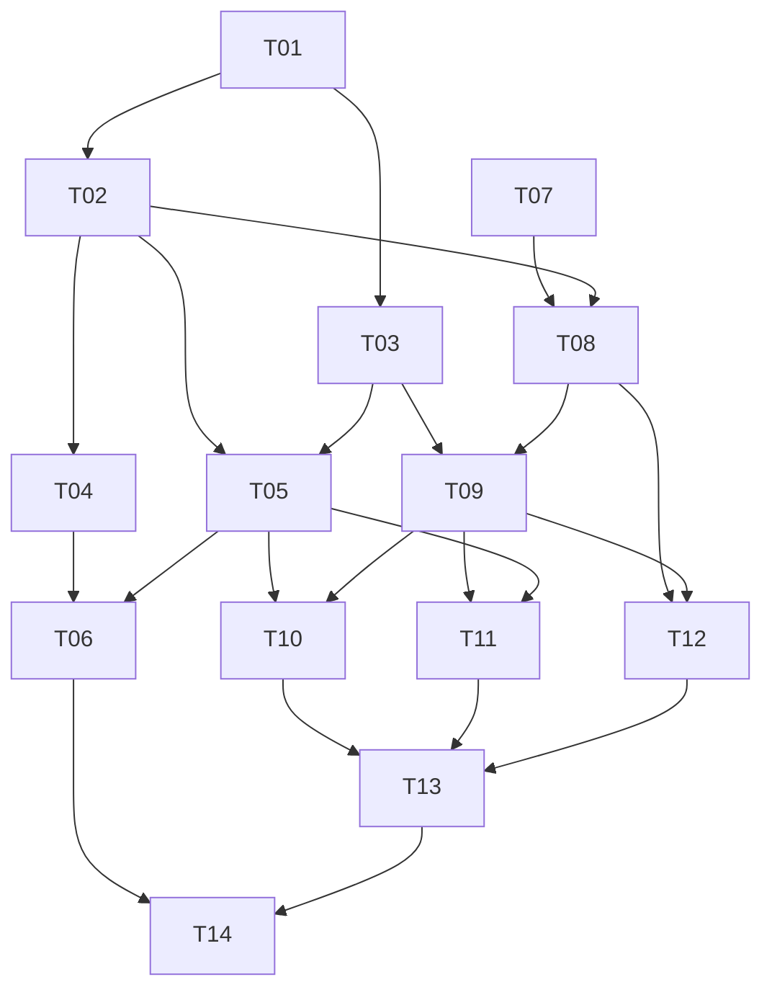

# Tasks — Kế hoạch Triển khai Cập nhật Tình hình Thực hiện & Trạng thái Hoàn thành FI (SK-CTKT)

Đọc [requirements.md](requirements.md) → [design.md](design.md) → tệp này trước khi bắt đầu sửa mã. **Trạng thái hiện tại (24/11/2026): Đã hoàn thành triển khai `T01–T14` trên nhánh `feature/fi-implementation-tracking` — Xem chi tiết kết quả tại [IMPLEMENTATION_SUMMARY.md](IMPLEMENTATION_SUMMARY.md).**

---

## 1. Quy tắc thực hiện

1. Tạo nhánh tính năng mới từ `main` (ví dụ: `feature/fi-implementation-tracking`); không chỉnh sửa trực tiếp trên `main`.
2. Toàn bộ kiểm thử backend phải chạy qua môi trường cô lập (`backend/scripts/run_isolated_checks.py` hoặc SQLite/Postgres thử mới); tuyệt đối không ghi dữ liệu thử lên Production VPS `103.200.20.225`.
3. Giữ tương thích ngược cho `PUT /fi/sk-ctkt/{id}`, `GET /fi/dashboard`, `GET /fi/history`, `GET /fi/sk-ctkt/{id}` và mọi invariant về OKR `O5.KR13` + khóa kỳ KHMT.
4. Mọi thay đổi phân quyền ở Backend (`execution.py`) PHẢI khớp tuyệt đối với Frontend (`fiExecution.ts`) và có unit test cả 5 vai trò.

---

## 2. Lộ trình và sơ đồ phụ thuộc

| Đợt | Tasks | Trọng tâm |
|---|---|---|
| **Đợt 1 — Schema, Quyền & Core Backend (P0)** | `T01–T04` | Migration `0019`, dịch vụ `execution.py`, endpoint `PUT /execution`, ảnh `stage=completion`, nới khóa `PERIOD_LOCKED` riêng cho tiến độ & siết `auto_completion` chỉ cho `Approved` (không `paused`) |
| **Đợt 2 — Dashboard, History & Export Backend (P1)** | `T05–T06` | KPI `approved_*`, bộ lọc `auto_done`/`paused`, disjunctive `facets.decisions`, mở rộng Excel export & script `revert_fi_auto_done.py` |
| **Đợt 3 — Sửa Z-index & Hộp thoại Cập nhật Tiến độ (P0/P1)** | `T07–T09` | Chuẩn hóa thang `z-index`, tạo `fiExecution.ts`, `FiExecutionBand.tsx` và `FiExecutionUpdateModal.tsx` (kèm ghi chú & ảnh hoàn thành `Ctrl+V`) |
| **Đợt 4 — Tích hợp Toàn bộ 4 Tab FI (P1)** | `T10–T12` | Gắn nút cập nhật & ảnh hoàn thành vào `Lịch sử FI` (kèm lối tắt *"Đang thực hiện đội tôi"*), `FiDetailDrawer`, `FiMatrixCellDrawer`, `FI Dashboard` và `Đăng ký SK-CTKT` |
| **Đợt 5 — Mobile, Admin Polish & Kiểm thử Tổng thể (P2)** | `T13–T14` | Sửa mobile `390×844` + bảng `/Admin → Chốt KHMT & FI`, chạy full regression + E2E + báo cáo dry-run production |

---

## 3. Danh sách công việc chi tiết

### Đợt 1 — Schema, Phân quyền & Core Backend (P0)

- [x] **T01 — Tạo Alembic migration `0019_fi_execution_tracking.py` và cập nhật ORM models**
  - **Phụ thuộc:** không.
  - **Tệp tạo/sửa:** tạo `backend/alembic/versions/0019_fi_execution_tracking.py`; sửa `backend/app/models/domain.py`, `backend/app/services/bootstrap.py`, `backend/app/services/repositories.py`.
  - **Thực hiện:**
    - Thêm `execution_status`, `execution_note`, `execution_updated_at`, `execution_updated_by` (nullable) vào `SKCTKTModel` (có index trên `execution_status`).
    - Thêm `stage` (`default="registration"`, `server_default="registration"`, `nullable=False`) vào `SKImageModel`; cập nhật `sk_image_to_dict()` trả thêm trường `stage`.
    - Bổ sung `_ensure_sk_ctkt_execution_columns()` trong `bootstrap.py` cho SQLite test harness.
  - **Kiểm tra:** Chạy `alembic upgrade head` & `alembic downgrade -1` trên DB thử và chạy `create_schema()` trên SQLite test.
  - **Hoàn thành khi:** Migration chạy sạch idempotent trên cả PostgreSQL 16 và SQLite mà không ảnh hưởng dữ liệu cũ.
  - _Requirements: R03.1, R03.2, R04.1._

- [x] **T02 — Xây dựng `backend/app/services/fi/execution.py` và endpoint `PUT /api/v1/fi/sk-ctkt/{id}/execution`**
  - **Phụ thuộc:** T01.
  - **Tệp tạo/sửa:** tạo `backend/app/services/fi/execution.py`; sửa `backend/app/schemas/common.py`, `backend/app/api/routes/fi.py`, `backend/app/services/fi/service.py`.
  - **Thực hiện:**
    - Cài đặt `resolve_execution_state(record, today)` trả về trạng thái chuẩn (`completed`, `in_progress`, `paused`, `not_applicable`), cờ `is_auto_done`, `due_date`, `completed_date`, `note`.
    - Cài đặt `can_update_execution(record, principal, db)` theo ma trận phân quyền đã chốt (`author`, `submitter`, `Team_Account` đúng đội, `FI_Coordinator` toàn xưởng, `Admin`).
    - Cài đặt `update_sk_execution(...)` dùng khóa `lock_fi_teams` → `FOR UPDATE` (KHÔNG bị chặn bởi khóa kỳ KHMT `PERIOD_LOCKED`), kiểm tra `expected_revision`, validate ngày (`> factory_today` cho `Approved` + `in_progress`; `>= factory_today` cho SK chưa duyệt; `<= factory_today` cho `completed`; tùy chọn cho `paused`), giữ nguyên tuyệt đối `status`/`approved_at`/`khmt_*`, ghi `status_history` (`reason="execution_update"`), ghi `audit_logs`, gửi thông báo `SK_EXECUTION_UPDATED` cho owner thật (bỏ qua import actor).
    - Thêm route `PUT /api/v1/fi/sk-ctkt/{record_id}/execution` và nhúng block `execution_state` vào `_sk_to_dict(...)`.
    - Đồng bộ quy tắc quyền và cho phép ngày dự kiến `>= factory_today` trong `update_sk_ctkt(...)` (giữ tương thích ngược cho caller cũ).
  - **Kiểm tra:** V01 — viết `backend/tests/unit/test_fi_execution_tracking.py` phủ 5 vai trò, khóa kỳ KHMT, `409 VERSION_CONFLICT`, ngày hôm nay/quá khứ/tương lai, và thông báo owner.
  - **Hoàn thành khi:** `Team_Account` cập nhật được tiến độ SK của đồng đội (kể cả `HIST-*` và SK đã chốt kỳ KHMT), nhưng vẫn bị chặn `403` với SK đội khác và không sửa được nội dung/KHMT.
  - _Requirements: R01.1, R01.2, R01.4, R01.5, R01.6, R03.1, R03.2, R03.6, R06.3._

- [x] **T03 — Mở quyền tải & quản lý ảnh bằng chứng hoàn thành (`stage=completion`) cho SK `Approved`**
  - **Phụ thuộc:** T01, T02.
  - **Tệp sửa:** `backend/app/api/routes/fi.py`.
  - **Thực hiện:**
    - Thêm query param `stage: Literal["registration", "completion"] = "registration"` cho `POST /fi/sk-ctkt/{record_id}/images`.
    - Khi `record.status in {'Approved', 'Completed'}`: dùng `can_update_execution` và khóa `_lock_record_for_execution_update` (bypass khóa kỳ KHMT), lưu ảnh với `stage = "completion"`.
    - Cập nhật `DELETE /fi/sk-ctkt/{record_id}/images/{image_id}`: cho phép xóa ảnh `stage="completion"` bởi người upload, `Team_Account` cùng đội hoặc `Admin`; chặn non-Admin xóa ảnh `stage="registration"` của SK đã `Approved`.
  - **Kiểm tra:** V02 — pytest kiểm tra tác giả, Đội trưởng cùng đội, Đội trưởng đội khác, Staff khác, Admin trên cả 2 stage `registration` và `completion`, kể cả khi kỳ KHMT đã chốt.
  - **Hoàn thành khi:** Sau khi SK được `Đồng ý`, tác giả và Đội trưởng tải được ảnh bằng chứng hoàn thành mà không thể xóa ảnh gốc lúc đăng ký.
  - _Requirements: R01.4, R04.1._

- [x] **T04 — Siết chặt phạm vi `auto_completion.py` chỉ cho `Approved` (không `paused`)**
  - **Phụ thuộc:** T02.
  - **Tệp sửa:** `backend/app/services/fi/auto_completion.py`, `backend/app/services/fi/service.py`, `backend/tests/unit/test_fi_service.py`.
  - **Thực hiện:**
    - Đổi logic `_plan_transition` sang allowlist `AUTO_DONE_ELIGIBLE_STATUSES = {SKStatus.APPROVED.value}` và bỏ qua `execution_status == "paused"`; khi tự tick hoàn thành cho `Approved`, đồng thời set `record.execution_status = "completed"`.
    - Cấm tuyệt đối tự động đánh dấu hoàn thành trên `Draft`, `Submitted`, `NeedMoreInfo`, `Reviewed`, `Deferred`, `Rejected`, `Cancelled` (vẫn giữ sửa ngược ngày `completed_at > today` về dự kiến).
    - Trong `service.py`, không tự ép `completion_done = True` khi chỉnh sửa nội dung SK chưa duyệt có ngày dự kiến đã qua.
    - Cập nhật unit test trong `test_fi_service.py` cho khớp chính sách mới.
  - **Kiểm tra:** V01 — pytest xác nhận `Submitted`, `Deferred`, `Draft`, `Rejected` và `Approved + paused` không bao giờ bị tự set `completed_at`, trong khi `Approved + in_progress` tới hạn vẫn tự ghi nhận hoàn thành đúng quy ước.
  - **Hoàn thành khi:** Không còn phiếu chưa duyệt hoặc phiếu tạm dừng nào bị tự động báo hoàn thành.
  - _Requirements: R06.1, R06.2, R06.3._

---

### Đợt 2 — Dashboard, History, Export & Script Dọn Dữ liệu (P1)

- [x] **T05 — Nâng cấp `GET /fi/history` và `GET /fi/dashboard` với số liệu tiến độ chuẩn & disjunctive `facets.decisions`**
  - **Phụ thuộc:** T02, T03.
  - **Tệp sửa:** `backend/app/api/routes/fi.py`, `backend/app/services/fi/history_query.py`, `backend/app/services/fi/dashboard_matrix.py`, `backend/app/services/fi/service.py`.
  - **Thực hiện:**
    - Cập nhật `history_query.py` nhận diện chuẩn `done` / `auto_done` / `paused` / `pending` theo `execution_status`, `completed_at`, `completion_plan`, `status_history` và `factory_today()`.
    - Mở rộng `GET /fi/history`: nhận `completion` với các giá trị `done`, `pending`, `auto_done`, `paused`; bổ sung `facets.decisions` (disjunctive, `exclude={"decisions"}`) để 4 thẻ trạng thái kết luận không nhảy về `0`; bổ sung `approved_completed_count`, `approved_confirmed_completed_count`, `approved_auto_done_count`, `approved_in_progress_count`, `approved_paused_count` trong `summary`.
    - Cập nhật `fi_dashboard` và `dashboard_matrix.py` trả thêm bộ chỉ số `approved_*` trong `totals`, `selected_year_totals`, `teams[]`, `selected_year_teams[]` (giữ nguyên key cũ `completed_count`/`not_completed`).
  - **Kiểm tra:** V03 — pytest `test_fi_dashboard_matrix.py` + `test_audit_remediation_contracts.py` (đảm bảo `< 12` SQL statements trên 5.000 bản ghi).
  - **Hoàn thành khi:** KPI tiến độ trên Dashboard và bộ lọc/thẻ tóm tắt trên `Lịch sử FI` khớp số liệu 100%, không bị nhiễu bởi phiếu chưa duyệt/từ chối.
  - _Requirements: R05.4, R07.1, R07.2._

- [x] **T06 — Nâng cấp Excel Export FI & mở rộng script dry-run `revert_fi_auto_done.py`**
  - **Phụ thuộc:** T04, T05.
  - **Tệp sửa:** `backend/app/services/fi/service.py`, `backend/scripts/revert_fi_auto_done.py`, `backend/tests/unit/test_revert_fi_auto_done.py`.
  - **Thực hiện:**
    - Thêm cột `Tình hình thực hiện`, `Ghi chú thực hiện`, `Số ảnh hoàn thành` vào sheet `Du lieu FI` trong `export_fi_reports_to_excel` (căn chỉnh độ rộng, màu sắc trạng thái quá hạn/tạm dừng/hoàn thành).
    - Mở rộng `revert_fi_auto_done.py` rà soát tất cả bản ghi không phải `Approved`/`Completed` (`Draft`, `Submitted`, `NeedMoreInfo`, `Reviewed`, `Deferred`, `Rejected`, `Cancelled`) đang có `completed_at` từ `completion_auto_done` (giữ `--dry-run` mặc định, chỉ ghi khi truyền `--apply`).
  - **Kiểm tra:** V03, V04 — đọc lại file `.xlsx` bằng `openpyxl` và test `revert_fi_auto_done` trên dữ liệu đủ các trạng thái.
  - **Hoàn thành khi:** File Excel xuất đủ cột tình hình thực hiện & script dry-run liệt kê chính xác danh sách cần khôi phục.
  - _Requirements: R06.4, R07.3._

---

### Đợt 3 — Sửa Z-Index & Hộp thoại Cập nhật Tình hình Thực hiện (P0/P1)

- [x] **T07 — Chuẩn hóa thang `z-index` toàn phân hệ FI & sửa sticky overlap**
  - **Phụ thuộc:** không.
  - **Tệp sửa:** `frontend/src/styles.css`.
  - **Thực hiện:**
    - Nâng `.fi-edit-modal-backdrop` từ `z-index: 120` → `200`.
    - Nâng `.image-viewer-backdrop` từ `z-index: 150` → `220`.
    - Giữ `.fi-drawer-backdrop` ở `140` và `.fi-detail-drawer-backdrop` ở `160`.
    - Điều chỉnh `.legacy-sticky-controls` (`25`), `.legacy-month-sticky-head` (`15`) và thêm `scroll-margin-top` cho `.legacy-record` để đầu thẻ mở rộng không bị che khi cuộn.
  - **Kiểm tra:** V06 — mở `FiDetailDrawer` rồi mở `FiExecutionUpdateModal`, `EditModal`, và `SkImageViewer`; xác minh bằng Playwright mọi phần tử đều nổi trên cùng và click được.
  - **Hoàn thành khi:** Không còn bất kỳ lỗi `ELEMENT_OCCLUDED` nào khi mở modal/lightbox từ trong Drawer.
  - _Requirements: R02.1, R02.2, R02.3, R05.1._

- [x] **T08 — Tạo `fiExecution.ts` & `FiExecutionBand.tsx` + cập nhật API client**
  - **Phụ thuộc:** T02, T07.
  - **Tệp tạo/sửa:** tạo `frontend/src/features/fi/utils/fiExecution.ts`, `frontend/src/features/fi/components/FiExecutionBand.tsx`; sửa `frontend/src/api/client.ts`, `frontend/src/features/fi/types/fiDashboard.ts`.
  - **Thực hiện:**
    - Thêm `api.updateSkExecution(id, payload)` và tham số `stage` cho `api.uploadSkImageWithOptions(...)` trong `client.ts`.
    - Viết các hàm thuần trong `fiExecution.ts`: `resolveExecutionView(item, today)` (hỗ trợ đủ các trạng thái `completed` / `auto_done` / `in_progress` / `paused`), `canUpdateExecution(role, userId, team, item, editMode)`, `canUploadCompletionImages(...)`, `executionBlockedHint(...)`.
    - Xây `FiExecutionBand.tsx` hiển thị `CompletionPill`, ghi chú thực hiện mới nhất, tác giả/thời điểm cập nhật gần nhất, nút nổi bật **`Cập nhật tình hình thực hiện`** (kèm cặp nút nhanh **`Xác nhận đã xong`** / **`Gia hạn`** cho phiếu tự ghi nhận) khi đủ quyền, hoặc hint giải thích ngắn gọn (khi không đủ quyền hoặc Admin tắt `Chỉnh sửa`).
    - Cập nhật `CompletionPill` hỗ trợ prop `interactive` + `onClick` để bấm trực tiếp ngay trên dòng danh sách.
  - **Kiểm tra:** V05 — tạo `frontend/src/features/fi/FiExecution.test.ts` test toàn bộ tổ hợp vai trò/trạng thái/`auto_done`/`paused`.
  - **Hoàn thành khi:** Logic hiển thị và phân quyền tiến độ được dùng từ một nguồn duy nhất trên mọi màn hình FI.
  - _Requirements: R01.1, R01.2, R01.3, R06.2._

- [x] **T09 — Xây dựng `FiExecutionUpdateModal.tsx` (Trạng thái + Ngày nhanh + Ghi chú + Ảnh hoàn thành `Ctrl+V`)**
  - **Phụ thuộc:** T03, T08.
  - **Tệp tạo/sửa:** tạo `frontend/src/features/fi/components/FiExecutionUpdateModal.tsx`; sửa `frontend/src/styles.css`.
  - **Thực hiện:**
    - Xây modal thay thế `CompletionPlanDialog` cũ với 3 lựa chọn trạng thái (`Đang thực hiện`, `Tạm dừng / Chờ dừng máy`, `Đã hoàn thành`), nút chọn nhanh ngày (`Hôm nay`, `Hôm qua`, `+15 ngày`, `+1 tháng`, `Cuối năm`), validate ngày (`> hôm nay` cho `Approved` + `Đang thực hiện`; `>= hôm nay` cho SK chưa duyệt; `<= hôm nay` cho `Đã hoàn thành`; tùy chọn cho `Tạm dừng`).
    - Thêm ô `Ghi chú tình hình thực hiện / kết quả` (tùy chọn) kèm chip chèn nhanh mẫu hay dùng.
    - Tích hợp vùng tải ảnh bằng chứng hoàn thành (tùy chọn · chọn file / camera mobile / kéo-thả / dán `Ctrl+V` từ Zalo) cho SK `Approved`, hiển thị ảnh hoàn thành hiện có + ảnh chờ tải, tải tuần tự với `expected_revision` & `Idempotency-Key` và xử lý lỗi từng ảnh an toàn.
    - Hỗ trợ `Escape` chỉ đóng modal (không đóng Drawer cha) và xử lý `409 VERSION_CONFLICT` bằng nút `Tải lại bản mới nhất`.
  - **Kiểm tra:** V05, V06 — test lưu trạng thái + ghi chú + ảnh `Ctrl+V`, test chuyển từ `Đã hoàn thành` / `Tự ghi nhận` sang `Xác nhận` hoặc `Đang thực hiện` / `Tạm dừng`, test báo lỗi khi ngày hoàn thành ở tương lai.
  - **Hoàn thành khi:** Người dùng cập nhật trọn vẹn trạng thái + ngày + ghi chú + ảnh hoàn thành chỉ trong 1 hộp thoại duy nhất.
  - _Requirements: R02.3, R03.1, R03.2, R03.3, R03.4, R03.5, R03.6, R04.1, R06.3._

---

### Đợt 4 — Tích hợp Trải nghiệm Trên Toàn bộ 4 Tab FI (P1)

- [x] **T10 — Nâng cấp tab `Lịch sử FI`: nút cập nhật trong `Xem chi tiết`, bấm pill nhanh, ảnh hoàn thành & lối tắt đội tôi**
  - **Phụ thuộc:** T05, T09.
  - **Tệp sửa:** `frontend/src/features/fi/FIWorkspace.tsx`, `frontend/src/styles.css`.
  - **Thực hiện:**
    - Thay `CompletionBand` cũ bằng `FiExecutionBand` trong khung `Xem chi tiết` của `Lịch sử FI`, mở `FiExecutionUpdateModal`.
    - Cho phép bấm trực tiếp vào `CompletionPill` trên từng dòng `Lịch sử FI` (khi đủ quyền) để mở `FiExecutionUpdateModal`.
    - Thêm nút lọc nhanh 1 chạm **`Đang thực hiện đội tôi ({n})`** (cho `Team_Account`/`Staff` thuộc 4 đội OKR) và **`SK duyệt chưa xong ({n})`** (cho `FI_Coordinator`/`Admin`).
    - Mở rộng bộ lọc `Hoàn thành` thêm `Tự ghi nhận · cần xác nhận` (`auto_done`) và `Tạm dừng` (`paused`); chuyển 4 thẻ summary kết luận sang đọc `historyMeta.facets.decisions` để không bị tụt về `0`.
    - Xóa section lặp `Đã xem xét vào KHMT` trong `legacy-expanded-content`; bổ sung hiển thị `execution_note` trong lịch sử cập nhật; phân nhóm/nhãn `Ảnh đăng ký` vs `Ảnh hoàn thành` và gắn nút **`+ Thêm ảnh hoàn thành`** ngay trong khối `Ảnh bằng chứng` của `Lịch sử FI`.
  - **Kiểm tra:** V06 — đăng nhập vai trò `Team_Account` (`minhvq`) trên môi trường test, mở `FI/07/2026-TBHTĐK-03` → `Xem chi tiết` → thấy ngay nút `Cập nhật tình hình thực hiện` + `+ Thêm ảnh hoàn thành` và cập nhật thành công.
  - **Hoàn thành khi:** Phản hồi gốc của Đội trưởng TBHTĐK được giải quyết trọn vẹn 100% tại `Lịch sử FI`.
  - _Requirements: R01.1, R01.2, R04.2, R05.1, R05.2, R05.3, R05.4._

- [x] **T11 — Nâng cấp `FI Dashboard`, `FiKhmtMatrix`, `FiMatrixCellDrawer` & `FiDetailDrawer`**
  - **Phụ thuộc:** T05, T09.
  - **Tệp sửa:** `frontend/src/features/fi/components/FiDashboardView.tsx`, `frontend/src/features/fi/components/FiKhmtMatrix.tsx`, `frontend/src/features/fi/components/FiMatrixCellDrawer.tsx`, `frontend/src/features/fi/components/FiDetailDrawer.tsx`, `frontend/src/features/fi/FIWorkspace.tsx`, `frontend/src/app/App.tsx`.
  - **Thực hiện:**
    - Cập nhật thẻ KPI `Tiến độ thực hiện` và 4 thẻ chi tiết đội trong `FiDashboardView` sử dụng mẫu số chuẩn **SK đã duyệt (`approved_completed_count / approved_total`)**, hiển thị số `tạm dừng` / `tự ghi nhận` nếu `> 0`, và click vào nhảy sang `Lịch sử FI` lọc `Approved + Chưa hoàn thành`.
    - Điều chỉnh tiêu đề phụ của `FiKhmtMatrix` theo quyền thực tế (không hứa *"gán/bỏ trực tiếp"* cho user chỉ xem).
    - Trong `FiMatrixCellDrawer`: dùng `CompletionPill` đầy đủ và gắn nút nhanh **`Cập nhật tiến độ`** khi `canUpdateExecution === true`.
    - Trong `FiDetailDrawer`: dùng `FiExecutionBand`, tách nhãn `Ảnh đăng ký` / `Ảnh hoàn thành`, và hiện nút `+ Thêm ảnh hoàn thành` khi đủ quyền trên SK `Approved`.
    - Thêm nhãn thông báo `SK_EXECUTION_UPDATED: "FI đã cập nhật tình hình thực hiện"` trong `App.tsx` (hỗ trợ deep-link mở thẳng phiếu SK).
  - **Kiểm tra:** V05, V06 — kiểm tra số liệu Dashboard khớp `Lịch sử FI`, bấm `Cập nhật tiến độ` từ cả `FiMatrixCellDrawer` lẫn `FiDetailDrawer` hoạt động mượt và tự đồng bộ lại số liệu.
  - **Hoàn thành khi:** Mọi điểm chạm trên Dashboard và Drawer đều nhất quán và phản ánh chính xác tiến độ SK đã duyệt.
  - _Requirements: R02.1, R04.2, R05.5, R07.1, R07.2._

- [x] **T12 — Tách bạch SK đã hoàn thành trên tab `Đăng ký SK-CTKT` & sửa rule ngày form đăng ký**
  - **Phụ thuộc:** T08, T09.
  - **Tệp sửa:** `frontend/src/features/fi/FIWorkspace.tsx`, `frontend/src/features/fi/FIWorkspace.test.ts`.
  - **Thực hiện:**
    - Cập nhật `ownershipBucketForItem(item)`: chỉ đưa vào `"implementation"` (`Đã duyệt – đang thực hiện`) các SK có `status === "Approved"` và **chưa hoàn thành** (`!isExecutionCompleted(item)`).
    - Hiển thị `CompletionPill compact` ngay trên từng thẻ của `Sáng kiến của tôi` và `Phiếu tôi đã gửi`, kèm nút nhanh `Cập nhật tiến độ` mở `FiExecutionUpdateModal`.
    - Cập nhật `CompletionPlanField`: cho phép ngày dự kiến `>= hôm nay` khi đăng ký/chỉnh sửa phiếu chưa duyệt (không chặn lưu nội dung phiếu cũ), đồng thời ghi chú rõ cơ chế tự ghi nhận hoàn thành chỉ áp dụng sau khi SK được Đồng ý.
  - **Kiểm tra:** V05 — cập nhật và chạy `FIWorkspace.test.ts` xác nhận phiếu đã hoàn thành không còn xuất hiện dưới mục *"đang thực hiện"*.
  - **Hoàn thành khi:** Danh sách cá nhân trên tab `Đăng ký` chỉ còn đúng các việc đang chờ duyệt và đang triển khai thực tế.
  - _Requirements: R05.6, R06.3._

---

### Đợt 5 — Mobile, Admin Polish & Kiểm thử Tổng thể (P2)

- [x] **T13 — Tinh chỉnh Mobile (`390×844`) & sửa cắt cột `/Admin → Chốt KHMT & FI` (`1440×900`)**
  - **Phụ thuộc:** T10, T11, T12.
  - **Tệp sửa:** `frontend/src/styles.css`, `frontend/src/app/App.tsx`, `frontend/src/features/admin/AdminPanel.tsx`.
  - **Thực hiện:**
    - Rút gọn tiêu đề topbar trên mobile (`≤ 430px`) và tối ưu padding/cuộn ngang cho `.fi-topbar-tabs` để không bị cắt cụt giữa chữ; căn giữa dọc cho `.fi-dashboard-year-select`.
    - Định dạng `.fi-plan-dialog` / `FiExecutionUpdateModal` trên mobile thành dạng bottom-sheet cuộn mượt, nút bấm `≥ 44px`, footer cố định dễ bấm 1 tay.
    - Giảm padding/min-width bảng `Chốt KHMT & FI` trong `AdminPanel.tsx` / `styles.css` để cột `THAO TÁC` hiển thị đầy đủ trên `1280–1440px` không bị cắt ngang.
  - **Kiểm tra:** V06 — chụp & đối chiếu trực quan ở `1440×900`, `1280×720` và `390×844` (0px tràn ngang).
  - **Hoàn thành khi:** Kỹ thuật viên cập nhật hoàn thành + chụp ảnh trên điện thoại mượt mà và bảng Admin hiển thị trọn vẹn cột thao tác.
  - _Requirements: R08.1, R08.2._

- [x] **T14 — Kiểm thử hồi quy toàn hệ thống, E2E đa vai trò & chuẩn bị dry-run dữ liệu Production**
  - **Phụ thuộc:** T06, T13.
  - **Tệp tạo/sửa:** `frontend/e2e/fi-execution-tracking.spec.ts` (hoặc mở rộng `remediation.spec.ts`).
  - **Thực hiện:**
    - Chạy toàn bộ backend test qua `run_isolated_checks.py` + `test_isolation_guard.py`.
    - Chạy `cd frontend && npm test && npm run build`.
    - Chạy Playwright E2E xác minh: (1) `Team_Account` cập nhật tiến độ + tải ảnh hoàn thành từ `Lịch sử FI → Xem chi tiết`; (2) mở `FiExecutionUpdateModal` và `SkImageViewer` từ `FiDetailDrawer` không bị che khuất; (3) kỳ KHMT đã chốt vẫn cập nhật tiến độ được nhưng bị chặn đổi KHMT; (4) responsive `390×844` và `1440×900`.
    - Khi được Chủ sản phẩm phê duyệt phát hành: chạy dry-run `revert_fi_auto_done.py` trên production để báo cáo chính xác số lượng phiếu chưa duyệt dính `completed_at` cũ trước khi quyết định `--apply`.
  - **Kiểm tra:** V01–V07 đều pass, 0 lỗi console, 0 lỗi TypeScript, `production_db_untouched: true`.
  - **Hoàn thành khi:** Sẵn sàng mở Pull Request vào `main` để CI kiểm tra và deploy production.
  - _Requirements: R01–R08._
