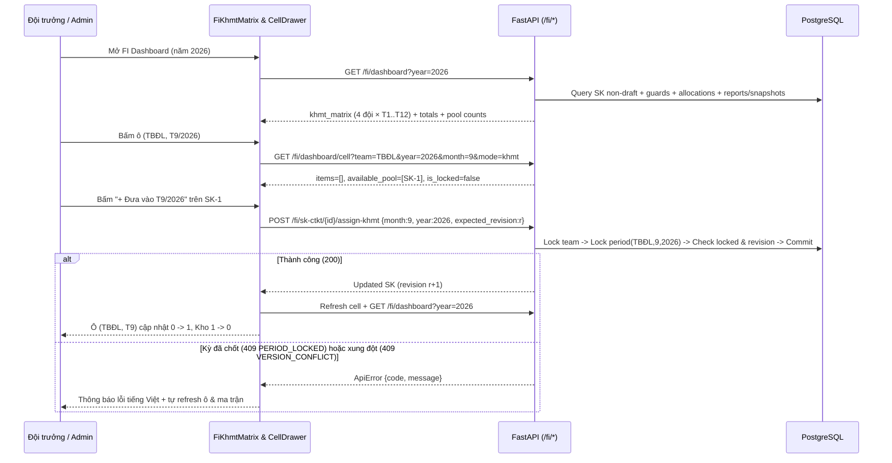

# Design — Nâng cấp Dashboard Ma trận KHMT & Đại tu Trải nghiệm Phân hệ FI (SK-CTKT)

Tài liệu thiết kế kỹ thuật cho [requirements.md](requirements.md). Trạng thái: **thiết kế đề xuất, chưa triển khai**. Mọi thay đổi được thiết kế để giữ tương thích ngược với module OKR, bộ test hiện có, và toàn bộ invariant về khóa kỳ / revision trong `specs/audit-remediation-ux/`.

---

## D01. Kiến trúc tổng thể và phạm vi tệp tác động

Giữ nguyên stack hiện tại: **FastAPI + SQLAlchemy (PostgreSQL 16 / SQLite test)** ở backend; **React 18 + TypeScript + Vite + Lucide** ở frontend. Không thêm dependency nặng, không tạo migration schema DB mới (tất cả dữ liệu cần thiết cho Ma trận KHMT đã có sẵn trong `sk_ctkt`, `fi_monthly_allocations`, `fi_period_write_guards`, `team_reports`, `historical_snapshots`!).

### Lý do cần tách module khỏi `FIWorkspace.tsx`

Tệp `frontend/src/features/fi/FIWorkspace.tsx` hiện dài **4.948 dòng**. Việc nhồi thêm Bảng Ma trận KHMT, Drawer ô ma trận, Unified Detail Drawer và bộ chọn KHMT nâng cao vào cùng một tệp sẽ làm tăng mạnh rủi ro regression và khó kiểm thử. Spec này tách rõ các thành phần mới theo cấu trúc modular:

| Vùng | Tệp hiện có sửa đổi | Tệp mới đề xuất |
|---|---|---|
| Backend FI API & Service | `backend/app/api/routes/fi.py`<br>`backend/app/services/fi/service.py` | `backend/app/services/fi/dashboard_matrix.py` *(tổng hợp ma trận, cell drill-down, pool)* |
| Frontend API Client | `frontend/src/api/client.ts` | — |
| Frontend FI Core & Utils | `frontend/src/features/fi/FIWorkspace.tsx` | `frontend/src/features/fi/utils/fiMetrics.ts`<br>`frontend/src/features/fi/types/fiDashboard.ts` |
| Frontend FI Dashboard & Drawers | — | `frontend/src/features/fi/components/FiDashboardView.tsx`<br>`frontend/src/features/fi/components/FiKhmtMatrix.tsx`<br>`frontend/src/features/fi/components/FiMatrixCellDrawer.tsx`<br>`frontend/src/features/fi/components/FiDetailDrawer.tsx`<br>`frontend/src/features/fi/components/FiKhmtMonthPicker.tsx` |
| Frontend App Shell & Admin | `frontend/src/app/App.tsx`<br>`frontend/src/features/admin/AdminPanel.tsx` | — |
| Styling | `frontend/src/styles.css` | — |
| Tests | `backend/tests/unit/test_fi_service.py`<br>`frontend/src/features/fi/FIWorkspace.test.ts` | `backend/tests/unit/test_fi_dashboard_matrix.py`<br>`frontend/src/features/fi/FiKhmtMatrix.test.tsx`<br>`frontend/e2e/fi-dashboard-matrix.spec.ts` |

---

## D02. Thiết kế Backend API và Logic Tổng hợp Dữ liệu

### D02.1. Mở rộng `GET /fi/dashboard` (Tương thích ngược 100%)

- **Endpoint:** `GET /fi/dashboard?year={int?}&scope={year|all}`
- **Quyền:** Giữ nguyên `TEAM_ACCOUNT`, `STAFF`, `FI_COORDINATOR`, `WORKSHOP_LEADER`, `ADMIN`.
- **Mặc định:**
  - `year`: nếu không truyền → `factory_today().year` (`UTC+7`).
  - `scope`: mặc định `"all"` cho trường legacy `totals`/`teams` để giữ tương thích 100% với caller cũ (`ObjectiveSection`, `AdminPanel`, test cũ), ĐỒNG THỜI trả thêm block `selected_year_totals`, `khmt_matrix` và `registration_matrix` luôn lọc chuẩn xác theo `year`.
  - Khi UI truyền `scope=year`, UI dùng `selected_year_totals` và `selected_year_teams` cho 4 thẻ KPI & biểu đồ; khi chọn `"Tất cả các năm"`, UI dùng `totals` & `teams`.

#### Cấu trúc Response mở rộng

```json
{
  "generated_at": "2026-11-23T15:30:00+00:00",
  "current_year": 2026,
  "current_month": 11,
  "year": 2026,
  "available_years": [2026],
  "status_order": ["Draft", "Submitted", "NeedMoreInfo", "Reviewed", "Approved", "Rejected", "Deferred", "Cancelled", "Completed"],

  "teams": [ /* GIỮ NGUYÊN schema cũ cho tương thích ngược */ ],
  "totals": { /* GIỮ NGUYÊN schema cũ cho tương thích ngược */ },
  "khmt_by_month": [ /* GIỮ NGUYÊN [{"year": 2026, "month": 1, "count": 8}, ...] */ ],

  "selected_year_totals": {
    "total": 186,
    "approved": 95,
    "review_passed": 95,
    "review_failed": 8,
    "pending": 63,
    "deferred": 20,
    "cancelled": 0,
    "khmt_considered": 73,
    "khmt_unassigned_approved": 22,
    "completed_count": 117,
    "not_completed": 69
  },

  "khmt_matrix": {
    "year": 2026,
    "okr_teams": ["TBCH", "TBĐL", "TBHTĐK", "TCĐK"],
    "rows": [
      {
        "team": "TBĐL",
        "display_name": "TBĐL",
        "months": [
          {
            "month": 1,
            "count": 3,
            "kr_tier": "good",
            "is_current_month": false,
            "is_future_month": false,
            "is_locked": false,
            "allocation_status": null,
            "report_assessment": "Hoàn thành tốt",
            "assessment_source": "team_report",
            "required_count": 3,
            "quota_status": "matched"
          },
          {
            "month": 9,
            "count": 0,
            "kr_tier": "none",
            "is_current_month": false,
            "is_future_month": false,
            "is_locked": false,
            "allocation_status": null,
            "report_assessment": null,
            "assessment_source": null,
            "required_count": null,
            "quota_status": "missing_fi"
          }
        ],
        "year_khmt_total": 20,
        "approved_total": 21,
        "approved_unassigned_count": 1,
        "pending_count": 21,
        "deferred_count": 0,
        "rejected_count": 0,
        "total_sk": 42
      }
    ],
    "workshop_totals": {
      "months": [
        { "month": 1, "count": 8 },
        { "month": 2, "count": 8 }
      ],
      "year_khmt_total": 73,
      "approved_total": 95,
      "approved_unassigned_count": 22,
      "pending_count": 60,
      "deferred_count": 20,
      "rejected_count": 8,
      "total_sk": 183
    },
    "non_okr_summary": [
      {
        "team": "Workshop_Staff",
        "display_name": "Xưởng quản lí",
        "total_sk": 3,
        "approved_total": 0,
        "pending_count": 3,
        "deferred_count": 0,
        "rejected_count": 0,
        "year_khmt_total": 0
      }
    ]
  },

  "registration_matrix": {
    "year": 2026,
    "rows": [
      {
        "team": "TBĐL",
        "display_name": "TBĐL",
        "months": [ { "month": 1, "count": 3, "approved_count": 3, "in_khmt_count": 3 } ],
        "year_total": 42
      }
    ],
    "workshop_totals": {
      "months": [ { "month": 1, "count": 19 } ],
      "year_total": 183
    }
  }
}
```

#### Quy tắc tính toán chi tiết trong `dashboard_matrix.py`

1. **Điều kiện đếm ô KHMT `(team, month, year)`** — khớp tuyệt đối với `count_for_okr()` (`service.py:970-984`):
   - `record.team == team`
   - `record.status in ("Approved", "Completed")`
   - `record.consider_for_khmt is True` AND `record.is_counted_for_okr is True`
   - `record.khmt_month == month` AND `record.khmt_year == year`
   *(Nếu có bản ghi dị thường `consider_for_khmt = True` nhưng không khớp 1 trong các điều kiện trên, ghi đếm riêng `anomalous_count` ở log/metadata để không âm thầm lệch số giữa OKR và FI.)*
2. **Đếm `approved_unassigned_count` (Kho sẵn sàng):**
   - `record.team == team`
   - `record.status in ("Approved", "Completed")`
   - `record.consider_for_khmt is False` (và `is_counted_for_okr is False`)
   - Lưu ý quan trọng: **Kho sẵn sàng mang tính lũy kế (pool hiện tại chưa phân bổ)** chứ không cắt theo năm đăng ký, vì một SK duyệt ở T12/2025 vẫn có thể dùng để gán vào KHMT T1/2026! Trong UI cần ghi tooltip rõ: *"SK đã duyệt của đội hiện chưa đưa vào KHMT bất kỳ tháng nào"*.
3. **Phân loại `kr_tier` và `quota_status` cho mỗi ô `(team, month)`:**
   - `is_current_month = (year == current_year and month == current_month)`
   - `is_future_month = (year > current_year) or (year == current_year and month > current_month)`
   - Resolution nguồn `report_assessment` (theo thứ tự ưu tiên giống `MonthlyHistoryHeatmap`):
     1. `FIMonthlyAllocationModel` (nếu `status == "finalized"`) → lấy `assessment` & `required_count`.
     2. `TeamReportModel` (`is_current_version = True`, ưu tiên `locked`/`submitted` trước `draft`) → `team_level.get("monthly_assessment")`.
     3. `HistoricalSnapshotModel` (`team == team, year == year, month == month`, mới nhất) → `monthly_assessment`.
   - Khi có `report_assessment`, tính `required_count` qua `quota_for_assessment()` (`Không hoàn thành → 0`, `Hoàn thành → 1`, `Hoàn thành tốt / Xuất sắc → 3`).
   - `kr_tier`:
     - Nếu `is_future_month` và `count == 0` → `"future"`
     - Ngược lại nếu `count >= 3` → `"good"`
     - Ngược lại nếu `count >= 1` → `"ok"`
     - Ngược lại (`count == 0`): nếu `required_count == 0` (tháng `Không hoàn thành`) → `"exempt_zero"`, ngược lại → `"none"`.
   - `quota_status`:
     - Nếu `required_count is None` → `"no_report"` (nếu `count == 0 and not is_future_month` thì `"missing_fi"`, ngược lại `"unverified"`)
     - Nếu `count == required_count` → `"matched"`
     - Nếu `count < required_count` → `"shortage"` *(hiện dấu `!` cảnh báo thiếu so với mức đánh giá)*
     - Nếu `count > required_count` → `"excess"` *(hiện dấu `!` cảnh báo vượt định mức, ví dụ `Không HT` định mức 0 nhưng đang gán 1)*
4. **Trạng thái khóa kỳ `is_locked`:**
   - `True` nếu tồn tại `FIPeriodWriteGuardModel(team, month, year, is_locked=True)` HOẶC `TeamReportModel(team, month, year, is_current_version=True, report_status="locked")`.
5. **Hiệu năng truy vấn:**
   - Chỉ thực hiện đúng **5 truy vấn DB có giới hạn** trong 1 request `/fi/dashboard` (1 query `sk_ctkt` non-draft, 1 query `fi_period_write_guards` theo `year`, 1 query `fi_monthly_allocations` theo `year`, 1 query `team_reports` current theo `year`, 1 query `historical_snapshots` theo `year`). Không có query N+1. Với quy mô ~200–5.000 bản ghi, thời gian phản hồi mục tiêu `< 60ms` (p95 `< 150ms`).

### D02.2. Endpoint Drill-down mới cho Drawer ô Ma trận

#### 1) `GET /fi/dashboard/cell`
- **Query params:**
  - `team`: `str` (bắt buộc — `TBCH | TBĐL | TBHTĐK | TCĐK | Workshop_Staff`)
  - `year`: `int` (2020–2100)
  - `month`: `int` (1–12)
  - `mode`: `"khmt" | "registration"` (mặc định `"khmt"`)
- **Quyền:** Mọi role được vào FI (`TEAM_ACCOUNT`, `STAFF`, `FI_COORDINATOR`, `WORKSHOP_LEADER`, `ADMIN`).
- **Response:**
  ```json
  {
    "team": "TBĐL",
    "display_name": "TBĐL",
    "year": 2026,
    "month": 8,
    "mode": "khmt",
    "cell": {
      "count": 3,
      "kr_tier": "good",
      "is_locked": false,
      "lock_reason": null,
      "report_assessment": null,
      "required_count": null,
      "quota_status": "unverified",
      "can_edit_khmt": true,
      "edit_blocked_reason": null
    },
    "items": [ /* danh sách _sk_to_dict(record, db) thuộc ô này, kèm image_count */ ],
    "available_pool": [
      /* Chỉ trả khi mode=="khmt": danh sách SK Approved/Completed của đội đó chưa vào KHMT,
         sắp xếp oldest_approved_first (approved_at ASC, sk_code ASC) giống monthly_allocation.py */
    ]
  }
  ```
- **Lưu ý bảo mật & phân quyền `can_edit_khmt`:**
  - Backend tính sẵn `can_edit_khmt` cho principal hiện tại: `True` chỉ khi (`role == "Admin"` hoặc (`role == "Team_Account"` và `principal_team == team`)) VÀ `not is_locked` VÀ `team in OKR_TEAMS`.
  - Frontend kết hợp thêm `editMode` của Admin (`role === "Admin" ? editMode && cell.can_edit_khmt : cell.can_edit_khmt`).
  - Mọi hành động gán/bỏ vẫn đi qua endpoint hiện có `POST /fi/sk-ctkt/{id}/assign-khmt` và `DELETE /fi/sk-ctkt/{id}/assign-khmt` với `expected_revision` (không tạo đường ghi song song bỏ qua lock guard!).

#### 2) `GET /fi/dashboard/pool`
- **Query params:**
  - `team`: `str` (bắt buộc)
  - `kind`: `"unassigned_approved" | "pending"` (bắt buộc)
- **Response:** `{ team, display_name, kind, total, can_edit_khmt, items: [...] }` — dùng khi người dùng bấm thẳng vào ô số cột `Kho sẵn sàng` hoặc `Chờ duyệt` trên bảng ma trận.

### D02.3. Chuẩn hóa `GET /fi/history` và `GET /fi/reports/export`

1. **`GET /fi/history`** (`backend/app/api/routes/fi.py`):
   - Thêm aggregate:
     ```python
     "khmt_unassigned_approved": func.sum(
         case(
             (and_(SKCTKTModel.status.in_(["Approved", "Completed"]), SKCTKTModel.consider_for_khmt.is_(False)), 1),
             else_=0,
         )
     )
     ```
   - Trả trong `summary`: giữ `khmt_missing` (tương thích cũ) và thêm `khmt_unassigned_approved` để UI hiển thị chính xác `22 SK đạt chưa vào KHMT` thay vì `113 chưa vào`.
2. **`GET /fi/reports/export`** (`backend/app/services/fi/service.py`):
   - Bổ sung bảng **`MA TRẬN FI XÉT VÀO KHMT THEO ĐỘI/TỔ × THÁNG (NĂM {year})`** vào sheet `Tong hop` (ngay dưới khối KPI cards, dùng style Navy `#2C398E` + Green `#169045` + màu phân mức `≥3` xanh lá nhạt, `1–2` xanh dương nhạt, `0` vàng/hồng nhạt).
   - Cho phép truyền query param tùy chọn `matrix_year` (mặc định năm lọc hoặc năm hiện tại) để nút `Xuất Excel` trên `FI Dashboard` xuất luôn đúng ma trận năm đang xem kèm toàn bộ danh sách chi tiết ở sheet `Du lieu FI`.

---

## D03. Thiết kế Giao diện & Kiến trúc Thành phần Frontend

### D03.1. Wireframe Desktop `FI Dashboard` (`1280px – 1440px`)

```text
┌────────────────────────────────────────────────────────────────────────────────────────┐
│ FI Dashboard · Cập nhật 22:38 23/11/2026      [Năm: 2026 ▾] [Xuất Excel] [↻ Tải lại]  │
├────────────────────────────────────────────────────────────────────────────────────────┤
│ ┌─────────────────┐ ┌─────────────────┐ ┌─────────────────┐ ┌───────────────────────┐ │
│ │ TỔNG SK-CTKT    │ │ ĐÃ VÀO KHMT     │ │ CHỜ XỬ LÝ       │ │ TIẾN ĐỘ THỰC HIỆN     │ │
│ │ 186             │ │ 73              │ │ 63 chờ duyệt    │ │ 117 / 186 (63%)       │ │
│ │ 95 đạt · 8 K.đạt│ │ 77% đạt · 22 kho│ │ 20 xem xét sau  │ │ 69 đang thực hiện     │ │
│ └─────────────────┘ └─────────────────┘ └─────────────────┘ └───────────────────────┘ │
├────────────────────────────────────────────────────────────────────────────────────────┤
│ ★ MA TRẬN FI XÉT VÀO KHMT THEO THÁNG — NĂM 2026                                        │
│   [ Xét vào KHMT | Đăng ký mới ]      [ Đến T11 (hiện tại) | Cả năm T1–T12 ]          │
│                                                                                        │
│ Đội/tổ    │ T1 │ T2 │ T3 │ T4 │ T5 │ T6 │ T7 │ T8 │ T9 │T10 │*T11*│ T12 │Tổng│Kho │Chờ │
│ ──────────┼────┼────┼────┼────┼────┼────┼────┼────┼────┼────┼─────┼─────┼────┼───┼─── │
│ TBCH      │ 1  │ 3  │ 1! │ 1! │ 3  │ 3  │ 3  │ 1  │ 0  │ 0  │  0  │  —  │ 16 │ 7 │ 7  │
│ TBĐL (Bạn)│ 3  │ 1  │ 3  │ 1! │ 3  │ 3  │ 3  │ 3  │ 0  │ 0  │  0  │  —  │ 20 │ 1 │ 21 │
│ TBHTĐK    │ 1  │ 1  │ 3  │ 3  │ 1  │ 3  │ 3  │ 0  │ 0  │ 3  │  0  │  —  │ 18 │ 6 │ 7  │
│ TCĐK      │ 3  │ 3  │ 3  │ 3  │ 3  │ 3  │ 1  │ 0  │ 0  │ 0  │  0  │  —  │ 19 │ 8 │ 25 │
│ ──────────┼────┼────┼────┼────┼────┼────┼────┼────┼────┼────┼─────┼─────┼────┼───┼─── │
│ Tổng Xưởng│ 8  │ 8  │ 10 │ 8  │ 10 │ 12 │ 10 │ 4  │ 0  │ 3  │  0  │  0  │ 73 │22 │ 60 │
│                                                                                        │
│ Chú giải: [■ ≥3: HT tốt/XS] [■ 1–2: HT] [■ 0: Chưa có] [— Tháng tới] [🔒 Đã chốt]      │
│           [! Lệch định mức OKR]   · Bấm vào bất kỳ ô nào để xem & gán/bỏ SK            │
│ ℹ Khối Xưởng quản lí (không tính ma trận OKR): 3 SK (3 chờ duyệt)                      │
├────────────────────────────────────────────────────────────────────────────────────────┤
│ ┌──────────────────────────────────────┐ ┌───────────────────────────────────────────┐ │
│ │ Phân bố kết luận xét duyệt (186 SK)  │ │ So sánh giữa các đội/tổ (4 đội + Xưởng)   │ │
│ │  Donut CHUẨN 100%:                   │ │  Legend nằm TRÊN đầu biểu đồ              │ │
│ │  ● Đồng ý: 95 (51%)                  │ │  TBCH   [████████████░░] 23 · 9 · 7 · 4   │ │
│ │  ● Chờ duyệt: 63 (34%)               │ │  TBĐL   [██████░░░░░░░░] 21 · 0 · 21 · 0  │ │
│ │  ● Xem xét sau: 20 (11%)             │ │  TBHTĐK [█████████░░░░░] 24 · 3 · 7 · 1   │ │
│ │  ● Không đồng ý/Hủy: 8 (4%)          │ │  TCĐK   [███████████░░░] 27 · 8 · 25 · 3  │ │
│ └──────────────────────────────────────┘ └───────────────────────────────────────────┘ │
└────────────────────────────────────────────────────────────────────────────────────────┘
```

### D03.2. Wireframe Slide-Over Drawer khi bấm ô `(TBĐL, T9/2026)`

```text
                                            ┌──────────────────────────────────────────┐
                                            │ TBĐL · KHMT Tháng 9/2026            [✕] │
                                            │ 0 FI · Chưa có FI vào KHMT · 🔓 Đang mở  │
                                            ├──────────────────────────────────────────┤
                                            │ ĐANG XÉT VÀO KHMT T9/2026 (0)            │
                                            │  Chưa có SK-CTKT nào trong tháng này.    │
                                            │  Mức HT cần ≥1 FI · Mức HT tốt cần ≥3 FI │
                                            ├──────────────────────────────────────────┤
                                            │ THÊM NHANH TỪ KHO ĐÃ DUYỆT TBĐL (1)      │
                                            │ [🔍 Tìm nhanh trong kho TBĐL...]         │
                                            │ ┌──────────────────────────────────────┐ │
                                            │ │ FI/08/2026-TBĐL-01 · Duyệt 25/08     │ │
                                            │ │ Cải tiến hiệu chuẩn cảm biến áp suất │ │
                                            │ │ Tác giả: Nguyễn Văn A · ✓ Hoàn thành │ │
                                            │ │ [Xem chi tiết]   [+ Đưa vào T9/2026] │ │
                                            │ └──────────────────────────────────────┘ │
                                            │ ⚠ TBĐL đang có 21 SK chờ duyệt.          │
                                            │   [Xem 21 SK chờ duyệt của TBĐL →]       │
                                            ├──────────────────────────────────────────┤
                                            │ [Mở trong Lịch sử FI] [Chốt T9 (Admin)→] │
                                            └──────────────────────────────────────────┘
```

### D03.3. Wireframe Mobile (`390×844`) cho Ma trận KHMT

Trên viewport `≤ 760px`, mặc định hiển thị chế độ **Thẻ từng đội (`Lưới 4×3`)** với nút chuyển nhanh sang dạng **Bảng cuộn ngang**:

```text
┌─────────────────────────────────────┐
│ Ma trận KHMT 2026   [Thẻ | Bảng]   │
│ [Xét KHMT | ĐK mới] [2026 ▾]       │
├─────────────────────────────────────┤
│ TBĐL (Đội của bạn)     Tổng: 20 FI  │
│ Kho sẵn sàng: 1 · Chờ duyệt: 21     │
│ ┌──────┐ ┌──────┐ ┌──────┐ ┌──────┐ │
│ │ T1   │ │ T2   │ │ T3   │ │ T4   │ │
│ │  3   │ │  1   │ │  3   │ │  1!  │ │
│ └──────┘ └──────┘ └──────┘ └──────┘ │
│ ┌──────┐ ┌──────┐ ┌──────┐ ┌──────┐ │
│ │ T5   │ │ T6   │ │ T7   │ │ T8   │ │
│ │  3   │ │  3   │ │  3   │ │  3   │ │
│ └──────┘ └──────┘ └──────┘ └──────┘ │
│ ┌──────┐ ┌──────┐ ┌──────┐ ┌──────┐ │
│ │ T9   │ │ T10  │ │*T11* │ │ T12  │ │
│ │  0   │ │  0   │ │  0   │ │  —   │ │
│ └──────┘ └──────┘ └──────┘ └──────┘ │
└─────────────────────────────────────┘
```
Mỗi ô nút cao tối thiểu `44px`, chạm 1 lần mở modal chi tiết ô giống Desktop!

### D03.4. Quy chuẩn màu sắc & tương phản (PVCFC Brand + WCAG AA)

| Trạng thái ô (`kr_tier`) | Nền | Viền | Chữ số | Ý nghĩa & Ký hiệu đi kèm |
|---|---|---|---|---|
| `good` (`≥ 3`) | `#DCFCE7` | `#86EFAC` | `#14532D` (bold) | Đạt mức *Hoàn thành tốt / Xuất sắc* (`O5.KR13 = GOOD`) |
| `ok` (`1–2`) | `#DBEAFE` | `#93C5FD` | `#1E3A8A` (bold) | Đạt mức *Hoàn thành* (`O5.KR13 = OK`) |
| `none` (`0`, quá khứ/hiện tại) | `#FEF2F2` | `#FECACA` | `#991B1B` (bold) | Chưa có FI vào KHMT (`O5.KR13 = NG`) |
| `exempt_zero` (`0`, kỳ `Không HT`) | `#F1F5F9` | `#CBD5E1` | `#475569` | Kỳ `Không HT` (định mức `0`) |
| `future` (tháng tương lai) | `#F8FAFC` | `#E2E8F0` | `#94A3B8` | Tháng chưa tới (hiển thị `—`) |
| Cột tháng hiện tại (`*T11*`) | Header `#EAEDFA` | Viền top `2px solid #2C398E` | `#2C398E` | Đánh dấu kỳ đang chạy |
| Biểu tượng khóa (`is_locked`) | Góc trên phải ô | — | `#334155` `Lock` 11px | Kỳ đã chốt (không sửa tay) |
| Cảnh báo lệch (`quota_status ∈ {shortage, excess}`) | Chấm/badge `!` góc trên phải | `#F59E0B` | `#92400E` | Số FI lệch định mức OKR của kỳ |

### D03.5. Chi tiết các thành phần mới và sửa đổi quan trọng

1. **`frontend/src/features/fi/utils/fiMetrics.ts`**
   - `buildStatusSlices(totals)`: **sửa triệt để lỗi Donut 208/186**:
     ```ts
     export function buildStatusSlices(totals: Record<string, any>): StatusSlice[] {
       const approved = reviewPassedCount(totals);
       const pending = Number(totals.pending ?? 0);
       const deferred = Number(totals.deferred ?? 0);
       const rejected = reviewFailedCount(totals) + Number(totals.cancelled ?? 0);
       return [
         { key: "approved", label: "Đồng ý", value: approved, color: "#16a34a", tone: "success" },
         { key: "pending", label: "Chờ xét duyệt", value: pending, color: "#2563eb", tone: "info" },
         { key: "deferred", label: "Xem xét sau", value: deferred, color: "#f59e0b", tone: "warning" },
         { key: "rejected", label: "Không đồng ý / Đã hủy", value: rejected, color: "#ef4444", tone: "danger" },
       ].filter((slice) => slice.value > 0);
     }
     ```
     Invariant bắt buộc: `sum(slices.value) === totals.total` (với mọi tập dữ liệu non-draft).
   - `visibleActionsForSk(role, currentUserId, item, editMode, currentTeam?)`:
     - Sửa dòng 1040: thay `item.team === currentUserId` thành `const ownerTeam = currentTeam ?? currentUserId; ... item.team === ownerTeam`.
     - Giữ tương thích chữ ký hàm cũ bằng tham số tùy chọn `currentTeam?: string | null` ở cuối.
   - `buildOwnershipSections(rows, mode)`:
     - Với `mode === "sent"`, giữ các SK trạng thái `Approved` trong `sections.implementation` thay vì đẩy sang `sections.history`, để tab `Phiếu tôi đã gửi` hiển thị mục con `Đã duyệt – đang thực hiện`. (Cập nhật tương ứng unit test ở `FIWorkspace.test.ts`.)

2. **`frontend/src/features/fi/components/FiKhmtMonthPicker.tsx`**
   - Thay thế `<select>` + nút `<button>Lưu</button>` rời rạc trong `Lịch sử FI` bằng nút pill hiển thị giá trị hiện tại (`KHMT T8/2026 ▾` hoặc `Chưa vào KHMT ▾`).
   - Khi bấm mở popover:
     - Thanh chọn **Năm** (`‹ 2026 ›` hoặc dropdown năm `registration_year - 1 .. current_year + 1`).
     - Lưới **12 nút tháng (`T1` → `T12`)**, mỗi nút hiển thị: nhãn `T{m}`, số FI hiện tại của đội đó trong tháng đó lấy từ `khmt_matrix` (tô màu theo mức `0 / 1–2 / ≥3`), icon `🔒` và `disabled` nếu tháng đã chốt.
     - Nút **`Bỏ khỏi KHMT`** ở đáy popover nếu SK đang được gán.
     - Bấm chọn tháng → gọi thẳng `api.assignKhmt(item.id, month, year, revision)` → đóng popover, hiện toast xác nhận, cập nhật đồng thời danh sách lịch sử và cache `khmt_matrix`.

3. **`frontend/src/features/fi/components/FiDetailDrawer.tsx`**
   - Slide-over drawer thống nhất (width `min(680px, 92vw)` trên desktop, fullscreen modal trên mobile `≤ 760px`), có backdrop mờ, đóng bằng nút `✕` / phím `Escape` / click backdrop, quản lý focus qua `useDialogFocus`.
   - Thay thế hoàn toàn `.fi-detail-card` nằm ở đáy trang của tab `Đăng ký` và `Xét duyệt`, đồng thời dùng được khi bấm `Xem chi tiết` từ `FiMatrixCellDrawer` hoặc từ **Chuông thông báo** (`focusRequest`).
   - Chứa đầy đủ: Header (mã SK, badge trạng thái, đội/tổ, nút Chỉnh sửa / Xóa / Thêm ảnh), Metadata grid, `CompletionBand` (nút Cập nhật tiến độ), KHMT control (`FiKhmtMonthPicker` nếu đủ quyền), Nội dung chi tiết, Ảnh bằng chứng + Lightbox, Khung đánh giá inline (cho `FI_Coordinator`/`Admin`), và Timeline lịch sử xử lý.

4. **Sửa lỗi các tab khác & App shell**:
   - **`Lịch sử FI` (`FIWorkspace.tsx`)**:
     - Thêm ô `<input type="search">` ở đầu `.fi-history-toolbar` gắn `historyQuery`.
     - Thêm `<span className="legacy-row-code">{item.sk_code}</span>` và `<span className="legacy-row-team">{displayTeam(item.team)}</span>` vào `.legacy-row-head`.
     - Sửa `selectHistoryTeams` chỉ gọi `setHistoryTeams(teams); setSelectedItem(null);` (không xóa 7 bộ lọc khác!).
     - Cân đối lưới summary stat cards (hiển thị 6 thẻ gọn trên 1 hàng desktop hoặc `grid-template-columns: repeat(auto-fit, minmax(150px, 1fr))` không để 1 thẻ mồ côi), sửa `/ 69 chưa xong` → `69 chưa xong`, căn `align-items: center` cho `.fi-history-select-chip`.
     - Dùng `historyMeta.summary.khmt_unassigned_approved` cho dòng phụ của thẻ `Đã vào KHMT` (`22 SK đạt chưa vào`).
   - **`Xét duyệt SK-CTKT` (`FIWorkspace.tsx`)**:
     - Thêm thanh lọc cục bộ phía trên danh sách: ô tìm kiếm từ khóa + chip lọc theo đội (có badge số lượng chờ của từng đội, tự sort đội nhiều tồn đọng lên rõ ràng) + dropdown tháng đăng ký.
   - **`Đăng ký SK-CTKT` (`FIWorkspace.tsx` + `styles.css`)**:
     - Đổi breakpoint rớt 1 cột của `.fi-register-layout` từ `1200px` xuống `1080px`; bỏ `max-height: min(340px, ...)` trên `.fi-processing-panel .list` (dùng phân nhóm gọn + `Xem thêm` như đã có).
     - Bắt sự kiện `onPaste` trên form đăng ký/chỉnh sửa để nhận ảnh từ clipboard (`clipboardData.items` có `type.startsWith("image/")`), tạo `File` tên chuẩn `clipboard-YYYYMMDD-HHmmss.png` đưa vào `evidenceFiles` (hoặc upload ngay khi đang ở edit modal).
     - Thêm nút gọn **`Chèn mẫu gợi ý`** ngay trên label `Nội dung đăng ký` chèn khung:
       ```text
       1. Hiện trạng / Vấn đề:
       2. Giải pháp cải tiến:
       3. Hiệu quả dự kiến:
       ```
   - **`AdminPanel.tsx` + `styles.css`**:
     - Bỏ `min-width: 1240px` trên `.admin-khmt-table`; dùng `width: 100%; table-layout: auto; min-width: 880px` và thu gọn `min-width` của `<select>` mức đánh giá xuống `185px` để vừa khít `1280px–1440px` không cắt cột.
     - Gỡ nút `Tải lại` trùng lặp ở thanh header phụ.
     - Thêm liên kết `Xem Ma trận cả năm →` chuyển sang `/FI` (tab `FI Dashboard`).
   - **`App.tsx`**:
     - Dòng 1109: đổi `{tab === "admin" && <LazyAdminPanel />}` thành `{tab === "admin" && canAccessTab(role, "admin") && <LazyAdminPanel />}`.
     - Thêm `padding-bottom: calc(80px + env(safe-area-inset-bottom, 0px))` cho `.workspace` khi `.mobile-view` để bottom nav không đè lên nội dung.

---

## D04. Xử lý Concurrency, Khóa kỳ & Edge Cases



### Edge Cases bắt buộc xử lý

1. **Năm không có dữ liệu** (vd. người dùng chọn năm mới 2027 khi chưa có SK): Ma trận vẫn hiện đủ 4 đội × `T1 → T12` với tất cả ô `0`/`—`, không crash, hiển thị dòng hướng dẫn rõ ràng.
2. **Tháng 12 đăng ký gán sang KHMT Tháng 1 năm sau:** Ở năm 2026 ô `Đăng ký mới` T12 tính 1, ở năm 2027 ô `Xét vào KHMT` T1 tính 1; `available_years` bao gồm cả `khmt_year` lẫn `registration_year` lẫn `current_year`.
3. **Bản ghi cũ `Draft`/`Rejected` còn `completed_at`:** Không để ảnh hưởng đến số `Đạt` và `KHMT` (vì ma trận KHMT chỉ lọc `status IN ('Approved', 'Completed')`). Đồng thời giữ công cụ `revert_fi_auto_done.py` chạy dry-run kiểm chứng trong quy trình vận hành.
4. **Chuyển nhanh ô liên tiếp trong Ma trận:** Dùng `AbortController` / request epoch trong `FiMatrixCellDrawer` để response chậm của ô A không bao giờ ghi đè lên nội dung của ô B đang mở.
5. **Admin đang tắt chế độ `Chỉnh sửa` (`editMode = false`):** Khi mở Drawer ô ma trận, Admin vẫn xem đầy đủ danh sách SK và kho sẵn sàng, nhưng nút `+ Đưa vào` / `Bỏ khỏi` bị ẩn và hiện thông báo gợi ý *"Bật 'Chỉnh sửa' ở góc trên để phân bổ KHMT trực tiếp"*.
6. **Chuyển đổi role trong Sandbox:** Khi đổi tài khoản giả lập trong Sandbox, `FiKhmtMatrix` và `FiMatrixCellDrawer` tự động đóng drawer đang mở và tải lại theo quyền & `currentTeam` mới.

---

## D05. Chiến lược Kiểm thử & Tiêu chí Xác minh

Mọi test backend PHẢI chạy qua harness cô lập (`backend/scripts/run_isolated_checks.py` hoặc pytest với DB/storage tạm). Tuyệt đối không kết nối hoặc ghi vào database production.

| Mã kiểm thử | Phạm vi | Tiêu chí xác minh |
|---|---|---|
| **V01** | Backend Unit (`test_fi_dashboard_matrix.py`) | Đếm chính xác 4 đội × 12 tháng; giữ đủ tháng 0; lọc năm chính xác; tách `Workshop_Staff` khỏi ma trận 4 đội; gắn đúng `is_locked`, `report_assessment`, `required_count`, `quota_status` (`matched`/`shortage`/`excess`); tương thích ngược các field cũ của `GET /fi/dashboard`. |
| **V02** | Backend Unit (`test_fi_dashboard_matrix.py`) | `GET /fi/dashboard/cell` trả đúng `items` & `available_pool` (sort `oldest_approved_first`); `can_edit_khmt` đúng cho cả 5 role + trạng thái khóa kỳ; `GET /fi/dashboard/pool` đúng cho `unassigned_approved` và `pending`. |
| **V03** | Backend Unit (`test_fi_service.py`) | `GET /fi/history` trả đúng `summary.khmt_unassigned_approved` khớp `FI Dashboard`; `GET /fi/reports/export` tạo sheet `Tong hop` có bảng Ma trận KHMT 4 đội × T1–T12 khớp tổng số. |
| **V04** | Frontend Unit (`FIWorkspace.test.ts`, `FiKhmtMatrix.test.tsx`) | `buildStatusSlices` có tổng lát cắt `=== total` ngay cả khi `completed_count > approved`; `visibleActionsForSk` cho phép `Team_Account` khi `currentTeam === item.team` (`user_id != team`); `buildOwnershipSections("sent")` giữ `Approved` ở `implementation`; đổi `historyTeams` không xóa filter khác; `classifyKhmtCellTone` đúng đủ 5 tier. |
| **V05** | E2E Playwright (`fi-dashboard-matrix.spec.ts`) | Desktop (`1440×900`, `1280×720`) & Mobile (`390×844`): ma trận T1–T12 hiển thị không tràn ngang trên desktop; bấm ô mở Drawer; gán nhanh từ kho cập nhật ô tức thì; kỳ chốt hiện `🔒` và chặn sửa; `Lịch sử FI` có ô search + badge đội + chọn KHMT tháng/năm; `Xét duyệt` có lọc đội + Detail Drawer; Mobile không bị bottom nav che thẻ cuối; đăng nhập Staff tại `/Admin` không sinh request `403`. |
