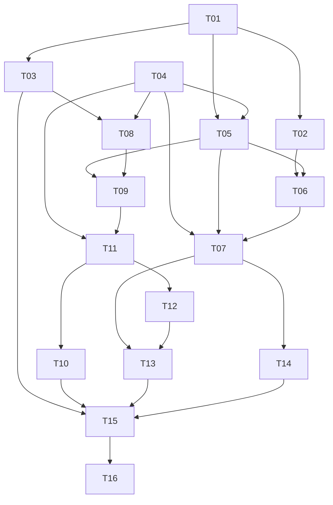

# Tasks — Kế hoạch Triển khai Nâng cấp Dashboard Ma trận KHMT & UX Phân hệ FI

Đọc [requirements.md](requirements.md) → [design.md](design.md) → tệp này trước khi bắt đầu sửa mã. **Trạng thái thực thi (23/11/2026): Đã hoàn tất `T01–T15` và review đa viewport trên nhánh `feature/fi-khmt-dashboard-ux`; `T16` bước chạy dry-run trên VPS production chỉ thực hiện khi có lệnh duyệt từ chủ sản phẩm.**

## 1. Quy tắc thực hiện

1. Tạo nhánh tính năng riêng từ `main` (vd. `feature/fi-khmt-dashboard-ux`); không sửa trực tiếp trên `main`.
2. Chạy toàn bộ test backend bằng môi trường thử cô lập (`backend/scripts/run_isolated_checks.py` hoặc SQLite/Postgres thử mới); tuyệt đối không kết nối, ghi, seed hoặc deploy lên VPS production khi chưa có lệnh rõ ràng từ chủ sản phẩm.
3. Giữ nguyên tương thích ngược cho `GET /fi/dashboard`, toàn bộ kiểm soát khóa kỳ (`PERIOD_LOCKED`), revision (`VERSION_CONFLICT`) và quy tắc phân quyền hiện có trừ khi chủ sản phẩm xác nhận thay đổi ở Mục 5 của `requirements.md`.
4. Mỗi task hoàn thành phải đi kèm bằng chứng kiểm thử (pytest / vitest / Playwright / screenshot local) và không để lại cảnh báo TypeScript hoặc lint.

---

## 2. Lộ trình và sơ đồ phụ thuộc

| Đợt | Tasks | Trọng tâm |
|---|---|---|
| Đợt 1 — Backend Foundation | T01–T03 | API Ma trận KHMT/Đăng ký T1–T12, endpoint Drill-down cell/pool, chuẩn hóa `khmt_unassigned_approved` và Excel export |
| Đợt 2 — Hero Matrix & Dashboard (P0) | T04–T07 | Sửa toán học Donut & quyền `Team_Account`, xây `FiKhmtMatrix`, `FiMatrixCellDrawer`, `FiDashboardView` |
| Đợt 3 — `Lịch sử FI`, `Xét duyệt` & Unified Drawer (P1) | T08–T11 | Ô tìm kiếm + badge đội + giữ filter trên `Lịch sử FI`, `FiKhmtMonthPicker`, lọc hàng đợi `Xét duyệt`, `FiDetailDrawer` thống nhất |
| Đợt 4 — `Đăng ký`, Mobile & Admin Polish (P1/P2) | T12–T14 | Cải tổ `Đăng ký SK-CTKT` + dán ảnh `Ctrl+V`, responsive mobile `390×844`, sửa bảng Admin `Chốt KHMT & FI` & chặn 403 `App.tsx` |
| Đợt 5 — Kiểm thử tổng thể & Vận hành | T15–T16 | Regression suite + E2E đa viewport/role, kiểm tra dry-run dữ liệu legacy và đóng gói bàn giao |

---

## 3. Danh sách công việc chi tiết

### Đợt 1 — Backend Foundation (API Ma trận, Drill-down & Export)

- [x] **T01 — Xây dựng dịch vụ tổng hợp Ma trận Đội/Tổ × Tháng (`T1–T12`) và mở rộng `GET /fi/dashboard`**
  - **Phụ thuộc:** không.
  - **Tệp tạo/sửa:** tạo `backend/app/services/fi/dashboard_matrix.py`; sửa `backend/app/services/fi/service.py`, `backend/app/api/routes/fi.py`.
  - **Thực hiện:**
    - Chấp nhận query params tùy chọn `year: int | None` và `scope: Literal["year", "all"] = "all"` trên `GET /fi/dashboard`.
    - Tính `khmt_matrix` cho 4 đội OKR (`TBCH`, `TBĐL`, `TBHTĐK`, `TCĐK`) × 12 tháng (`T1–T12`) theo đúng tiêu chí `count_for_okr()`, kèm `workshop_totals`, `approved_unassigned_count` (pool lũy kế), `pending_count`, `deferred_count`, `rejected_count`, `available_years`, `current_year`, `current_month`, và tách riêng `non_okr_summary` (vd. `Workshop_Staff`).
    - Ghép metadata khóa kỳ (`FIPeriodWriteGuardModel` / `TeamReportModel.report_status == 'locked'`), đánh giá tháng OKR (`FIMonthlyAllocationModel` → `TeamReportModel` → `HistoricalSnapshotModel`), `required_count`, `kr_tier`, và `quota_status` bằng tối đa 5 query có giới hạn (không N+1).
    - Tính thêm `registration_matrix` (4 đội × 12 tháng theo `registration_month / registration_year`) và `selected_year_totals`.
    - Giữ nguyên 100% các key cũ (`generated_at`, `teams`, `totals`, `khmt_by_month`, `status_order`).
  - **Kiểm tra:** V01 — pytest với dữ liệu nhiều năm, tháng rỗng `0`, kỳ khóa, kỳ `Không HT` định mức `0`, kỳ lệch định mức, và bản ghi `Workshop_Staff`; đảm bảo mọi test cũ trong `test_fi_service.py` tiếp tục pass.
  - **Hoàn thành khi:** `GET /fi/dashboard?year=2026` trả đầy đủ ma trận 12 tháng khớp hoàn toàn với `count_for_okr()` và không phá caller OKR cũ.
  - _Requirements: R01.2, R01.3, R01.5, R01.6, R01.8, R01.9, R03.2._

- [x] **T02 — Tạo endpoint Drill-down `GET /fi/dashboard/cell` và `GET /fi/dashboard/pool`**
  - **Phụ thuộc:** T01.
  - **Tệp sửa:** `backend/app/services/fi/dashboard_matrix.py`, `backend/app/api/routes/fi.py`, `frontend/src/api/client.ts`.
  - **Thực hiện:**
    - Thêm `GET /fi/dashboard/cell?team=&year=&month=&mode=khmt|registration` trả metadata ô (`is_locked`, `lock_reason`, `report_assessment`, `required_count`, `quota_status`, `can_edit_khmt`, `edit_blocked_reason`), danh sách `items` (kèm `image_count`) và `available_pool` (khi `mode=khmt`, sắp xếp `oldest_approved_first`).
    - Thêm `GET /fi/dashboard/pool?team=&kind=unassigned_approved|pending` trả danh sách kho sẵn sàng hoặc phiếu chờ duyệt của một đội.
    - Cập nhật TypeScript client methods (`api.fiDashboard(params)`, `api.fiDashboardCell(params)`, `api.fiDashboardPool(params)`) trong `frontend/src/api/client.ts`.
  - **Kiểm tra:** V02 — kiểm tra quyền `can_edit_khmt` cho 5 vai trò (đặc biệt `Team_Account` chỉ được phép ở đúng đội mình và khi kỳ chưa khóa), kiểm tra thứ tự `available_pool`.
  - **Hoàn thành khi:** Cả hai endpoint trả dữ liệu chuẩn, đúng phân quyền và sẵn sàng cho Drawer frontend.
  - _Requirements: R02.1, R02.2, R02.3, R02.5, R02.6._

- [x] **T03 — Chuẩn hóa `khmt_unassigned_approved` trên `GET /fi/history` và thêm Ma trận KHMT vào Excel Export**
  - **Phụ thuộc:** T01.
  - **Tệp sửa:** `backend/app/api/routes/fi.py`, `backend/app/services/fi/service.py`.
  - **Thực hiện:**
    - Bổ sung aggregate `khmt_unassigned_approved` (`status IN ('Approved', 'Completed') AND consider_for_khmt = False`) vào `summary` của `GET /fi/history` (vẫn giữ `khmt_missing` để tương thích ngược).
    - Nâng cấp `_write_fi_export_summary` trong `service.py` để ghi bảng **`Ma trận FI xét vào KHMT (Đội/Tổ × T1–T12)`** vào sheet `Tong hop` (hỗ trợ query param `matrix_year` trên `/fi/reports/export`), định dạng màu theo chuẩn PVCFC và mức `O5.KR13`.
  - **Kiểm tra:** V03 — pytest kiểm tra giá trị `khmt_unassigned_approved` khớp `FI Dashboard` và đọc lại workbook `openpyxl` xuất ra để xác nhận đủ 4 đội × T1–T12 + dòng Tổng Xưởng.
  - **Hoàn thành khi:** Số liệu *"SK đạt chưa vào KHMT"* khớp tuyệt đối giữa Dashboard, History và file Excel.
  - _Requirements: R03.4, R03.5._

---

### Đợt 2 — Hero Matrix & Đại tu FI Dashboard (P0)

- [x] **T04 — Tách `fiMetrics.ts`, sửa lỗi Donut 208/186 và sửa lỗi quyền `Team_Account`**
  - **Phụ thuộc:** không.
  - **Tệp tạo/sửa:** tạo `frontend/src/features/fi/utils/fiMetrics.ts`, `frontend/src/features/fi/types/fiDashboard.ts`; sửa `frontend/src/features/fi/FIWorkspace.tsx`, `frontend/src/features/fi/FIWorkspace.test.ts`.
  - **Thực hiện:**
    - Sửa `buildStatusSlices` chỉ chia theo trạng thái xét duyệt loại trừ nhau (`Đồng ý`, `Chờ xét duyệt`, `Xem xét sau`, `Không đồng ý / Đã hủy`), tổng luôn bằng `100%` (`totals.total`).
    - Sửa `visibleActionsForSk` nhận thêm `currentTeam?: string | null` và kiểm tra `item.team === (currentTeam ?? currentUserId)` cho `Team_Account`; truyền `currentTeam` tại mọi điểm gọi trong `FIWorkspace.tsx`.
    - Bổ sung hàm thuần `classifyKhmtCellTone`, `resolveVisibleMonths(currentYear, currentMonth, selectedYear, rangeMode)` để dễ unit test.
  - **Kiểm tra:** V04 — Vitest kiểm tra trường hợp `completed_count > approved` (như production 117 > 95) vẫn cho tổng Donut đúng `186`; kiểm tra `Team_Account` (`userId="haint", currentTeam="TBĐL"`) có action `assignKhmt` cho SK của `TBĐL` và không có cho `TBCH`.
  - **Hoàn thành khi:** Không còn sai lệch toán học ở Donut và mọi Đội/Tổ trưởng thật đều có quyền gán KHMT nhất quán trên UI.
  - _Requirements: R03.1, R04.4._

- [x] **T05 — Xây dựng thành phần `FiKhmtMatrix.tsx` (Bảng Ma trận 4 Đội × `T1–T12` Desktop & Mobile)**
  - **Phụ thuộc:** T01, T04.
  - **Tệp tạo/sửa:** tạo `frontend/src/features/fi/components/FiKhmtMatrix.tsx`; cập nhật `frontend/src/styles.css`.
  - **Thực hiện:**
    - Render thanh điều khiển ma trận: chuyển chế độ `Xét vào KHMT` / `Đăng ký mới`, chuyển phạm vi `Đến T{hiện tại}` / `Cả năm (T1–T12)` (hiển thị khi đang xem năm hiện tại).
    - Render bảng desktop gọn vừa khung `1280px–1440px` không tràn ngang: cột `Đội/tổ` sticky trái (highlight `"Đội của bạn"`), 12 cột `T1..T12` (đánh dấu cột tháng hiện tại, mờ tháng tương lai `—`, tô màu ngữ nghĩa `good/ok/none/exempt_zero/future`, icon `🔒` và cảnh báo `!` kèm tooltip), 3 cột phải `Tổng năm`, `Kho sẵn sàng`, `Chờ duyệt`, và hàng `Tổng Xưởng`.
    - Render dòng phụ tách biệt cho `non_okr_summary` (`Xưởng quản lí`) nếu có dữ liệu.
    - Render chú giải (Legend) rõ ràng dưới bảng.
    - Trên mobile (`≤ 760px`), hỗ trợ nút chuyển `Thẻ` *(mặc định: lưới 4×3 T1–T12 từng đội, touch target ≥ 44px)* và `Bảng` *(cuộn ngang có ghim cột Đội/tổ)*.
    - Hỗ trợ đầy đủ accessibility (`aria-label` mô tả chi tiết cho mỗi nút ô, keyboard navigation).
  - **Kiểm tra:** V04 — Vitest/Testing Library kiểm tra render đủ 12 tháng kể cả tháng 0, badge khóa/cảnh báo, highlight đội hiện tại, chuyển chế độ `Xét vào KHMT` ↔ `Đăng ký mới`, chuyển phạm vi `Đến T11` ↔ `T1–T12`.
  - **Hoàn thành khi:** Mở ma trận nhìn 1 giây biết ngay từng đội mỗi tháng có mấy FI vào KHMT, tháng nào trống, kho còn bao nhiêu.
  - _Requirements: R01.1, R01.2, R01.3, R01.4, R01.5, R01.6, R01.7, R01.8, R01.9, R06.1._

- [x] **T06 — Xây dựng `FiMatrixCellDrawer.tsx` (Drill-down ô ma trận & Gán/Bỏ KHMT tại chỗ)**
  - **Phụ thuộc:** T02, T05.
  - **Tệp tạo/sửa:** tạo `frontend/src/features/fi/components/FiMatrixCellDrawer.tsx`; cập nhật `frontend/src/styles.css`.
  - **Thực hiện:**
    - Mở Drawer trượt bên phải (modal trên mobile) khi bấm ô `(team, month)`, ô `Kho sẵn sàng` hoặc ô `Chờ duyệt`; dùng `AbortController` tránh response cũ ghi đè ô mới.
    - Hiển thị trạng thái kỳ (số lượng, mức OKR, khóa kỳ, đánh giá OKR nếu có) và danh sách SK trong ô kèm nút `Xem chi tiết` (mở `FiDetailDrawer`).
    - Khi user có quyền (`can_edit_khmt` + Admin `editMode`) và kỳ chưa khóa: hiển thị nút `Bỏ khỏi T{m}/{y}`, `Chuyển tháng` trên SK hiện tại, và khối `Kho SK đã duyệt chưa vào KHMT` có ô tìm nhanh + nút 1 chạm `+ Đưa vào T{m}/{y}` gọi `api.assignKhmt` kèm `expected_revision`.
    - Khi kỳ đã khóa: hiển thị trạng thái chỉ xem + lý do rõ ràng; xử lý `409 PERIOD_LOCKED` / `409 VERSION_CONFLICT` bằng thông báo tiếng Việt + auto-refresh.
    - Thêm nút deep-link `Mở trong Lịch sử FI` (truyền filter sẵn) và nút `Chốt kỳ T{m}/{y}` cho Admin.
  - **Kiểm tra:** V04/V05 — test gán nhanh 1 chạm cập nhật ngay ô ma trận & kho; test kỳ chốt vô hiệu hóa nút; test đổi ô liên tiếp không bị stale response.
  - **Hoàn thành khi:** Đội trưởng và Admin có thể vừa xem bảng tháng vừa phân bổ SK vào các tháng trống ngay trong 1 màn hình.
  - _Requirements: R02.1, R02.2, R02.3, R02.4, R02.5, R02.6, R02.7._

- [x] **T07 — Xây dựng `FiDashboardView.tsx` và tích hợp thay thế tab `FI Dashboard` cũ**
  - **Phụ thuộc:** T04, T05, T06.
  - **Tệp tạo/sửa:** tạo `frontend/src/features/fi/components/FiDashboardView.tsx`; sửa `frontend/src/features/fi/FIWorkspace.tsx`, `frontend/src/styles.css`.
  - **Thực hiện:**
    - Thanh header mới gồm bộ chọn **Năm** (`available_years`), toggle phạm vi KPI (`Năm {year}` / `Tất cả các năm`), nút **`Xuất Excel`** (gọi `/fi/reports/export?matrix_year={year}`), và nút `Tải lại`.
    - Dải **4 thẻ KPI cân đối** (`Tổng SK-CTKT`, `Đã vào KHMT`, `Chờ xử lý`, `Tiến độ thực hiện`), bấm vào thẻ `Chờ xử lý` hoặc `Đã vào KHMT` điều hướng nhanh tới danh sách tương ứng.
    - Đặt **`FiKhmtMatrix`** làm panel chính ngay dưới 4 thẻ KPI.
    - Bên dưới ma trận: giữ cặp 2 biểu đồ gọn (`Phân bố kết luận xét duyệt` đã sửa chuẩn 100% + `So sánh giữa các đội/tổ` đưa Legend lên đầu thanh) và bỏ 2 block lặp (`KHMT theo tháng` thẻ xanh + `Tóm tắt trạng thái`).
  - **Kiểm tra:** Kiểm tra ảnh chụp desktop `1440×900`, `1280×720` và mobile `390×844` không có lỗ trống 3+2, không sai số tổng, không trùng lặp block.
  - **Hoàn thành khi:** Tab `FI Dashboard` gọn, chính xác 100%, tập trung hoàn toàn vào câu hỏi KHMT theo đội × tháng.
  - _Requirements: R01.1, R01.3, R03.1, R03.2, R03.3, R03.5._

---

### Đợt 3 — Nâng cấp `Lịch sử FI`, `Xét duyệt` & Unified Detail Drawer (P1)

- [x] **T08 — Khôi phục ô Tìm kiếm, hiển thị Mã SK & Badge Đội/tổ và sửa bộ lọc `Lịch sử FI`**
  - **Phụ thuộc:** T03, T04.
  - **Tệp sửa:** `frontend/src/features/fi/FIWorkspace.tsx`, `frontend/src/styles.css`.
  - **Thực hiện:**
    - Render `<input type="search">` tìm theo mã SK, tên thiết bị, tiêu đề, tác giả, nội dung ở đầu `.fi-history-toolbar` (gắn `historyQuery` + nút xóa nhanh).
    - Hiển thị `sk_code` pill và badge `Đội/tổ` trên mọi dòng trong `Lịch sử FI`.
    - Sửa `selectHistoryTeams` giữ nguyên mọi bộ lọc khác đang hoạt động (không xóa trắng `khmt`, `months`, `decisions`, ...).
    - Dùng `historyMeta.summary.khmt_unassigned_approved` cho dòng phụ của thẻ `Đã vào KHMT` (`{n} SK đạt chưa vào`).
    - Cân chỉnh lưới thẻ thống kê nhanh (không rớt 6+1), sửa nhãn `/ {n} chưa xong` → `{n} chưa xong`, căn giữa dọc cho chip `Năm`.
  - **Kiểm tra:** V04/V05 — tìm kiếm theo mã thiết bị/mã FI trả đúng kết quả & khớp export Excel; đổi đội giữ nguyên bộ lọc `Đã vào KHMT`; số *"SK đạt chưa vào"* khớp `FI Dashboard`.
  - **Hoàn thành khi:** Tra cứu trên `Lịch sử FI` nhanh, rõ đội/mã và đồng nhất số liệu với Dashboard.
  - _Requirements: R03.4, R04.1, R04.2, R04.3, R04.6._

- [x] **T09 — Xây dựng `FiKhmtMonthPicker.tsx` (Chọn Tháng + Năm kèm số FI hiện có từng tháng)**
  - **Phụ thuộc:** T05, T08.
  - **Tệp tạo/sửa:** tạo `frontend/src/features/fi/components/FiKhmtMonthPicker.tsx`; sửa `frontend/src/features/fi/FIWorkspace.tsx`, `frontend/src/styles.css`.
  - **Thực hiện:**
    - Tạo popover chọn KHMT hỗ trợ cả **Năm** và **12 Tháng (`T1–T12`)**, đọc trực tiếp số FI hiện có và trạng thái khóa `🔒` từ `khmt_matrix` của đội tương ứng.
    - Bấm chọn tháng lưu ngay (gọi `assignKhmt` kèm `expected_revision`), nút `Bỏ khỏi KHMT` gọi `clearKhmt`, hiển thị toast xác nhận và tự đồng bộ lại `khmt_matrix` (loại bỏ bước bấm nút `Lưu` nhỏ dễ quên).
    - Tích hợp vào cột `KHMT` của `Lịch sử FI` và vào `FiDetailDrawer`.
  - **Kiểm tra:** Test gán SK đăng ký T12/2026 vào KHMT T1/2027 thành công; tháng đã chốt bị disabled với icon `🔒`; số lượng mỗi tháng cập nhật ngay sau khi lưu.
  - **Hoàn thành khi:** Người dùng gán KHMT ở mọi màn hình đều thấy trước tháng đích đang có mấy FI và có thể gán chéo năm.
  - _Requirements: R04.4, R04.5._

- [x] **T10 — Nâng cấp bộ lọc hàng đợi `Xét duyệt SK-CTKT`**
  - **Phụ thuộc:** T11.
  - **Tệp sửa:** `frontend/src/features/fi/FIWorkspace.tsx`, `frontend/src/styles.css`.
  - **Thực hiện:**
    - Thêm ô tìm kiếm từ khóa, hàng chip lọc `Đội/tổ` kèm số phiếu chờ duyệt từng đội (`TCĐK (25)`, `TBĐL (21)`, ...), và bộ lọc `Tháng đăng ký` trên tab `Xét duyệt SK-CTKT`.
    - Hỗ trợ nhận filter đội truyền từ `FiMatrixCellDrawer` (khi người duyệt bấm *"Xem 21 SK chờ duyệt của TBĐL"*).
    - Nén padding thẻ hàng đợi hợp lý để nhìn được 5–6 phiếu trong 1 khung màn hình laptop thay vì 2–3 phiếu.
  - **Kiểm tra:** Lọc theo từng đội + từ khóa chính xác; nút chuyển từ Drawer ma trận mở đúng hàng đợi đã lọc sẵn đội đó.
  - **Hoàn thành khi:** Người duyệt có thể xử lý tồn đọng theo từng đội nhanh chóng mà không phải cuộn qua toàn bộ 60 phiếu.
  - _Requirements: R05.1._

- [x] **T11 — Xây dựng `FiDetailDrawer.tsx` thống nhất thay thế `.fi-detail-card` cuối trang**
  - **Phụ thuộc:** T04, T09.
  - **Tệp tạo/sửa:** tạo `frontend/src/features/fi/components/FiDetailDrawer.tsx`; sửa `frontend/src/features/fi/FIWorkspace.tsx`, `frontend/src/styles.css`.
  - **Thực hiện:**
    - Chuyển toàn bộ nội dung `.fi-detail-card` (header, metadata, `CompletionBand`, `FiKhmtMonthPicker`, mô tả, ảnh bằng chứng + upload/xóa + Lightbox, khung xét duyệt inline cho reviewer, timeline lịch sử) sang `FiDetailDrawer` trượt cạnh phải (fullscreen modal trên mobile).
    - Hỗ trợ đóng bằng `Escape`/nút đóng/backdrop và khôi phục focus về phần tử kích hoạt.
    - Nối mở `FiDetailDrawer` từ: `Đăng ký SK-CTKT`, `Xét duyệt SK-CTKT`, `FiMatrixCellDrawer`, và `focusRequest` từ Chuông thông báo.
  - **Kiểm tra:** Bấm bất kỳ SK nào (kể cả phiếu số 5/60 trong hàng đợi duyệt hay từ chuông thông báo) mở ngay Drawer trước mặt mà không cuộn xuống đáy trang.
  - **Hoàn thành khi:** Loại bỏ hoàn toàn thẻ `.fi-detail-card` cuối trang, thống nhất trải nghiệm xem & xử lý chi tiết SK toàn hệ thống.
  - _Requirements: R05.2._

---

### Đợt 4 — Hoàn thiện `Đăng ký SK-CTKT`, Mobile & Quản trị (P1/P2)

- [x] **T12 — Nâng cấp `Đăng ký SK-CTKT`: bố cục laptop, dán ảnh `Ctrl+V`, mẫu gợi ý và theo dõi phiếu gửi hộ**
  - **Phụ thuộc:** T11.
  - **Tệp sửa:** `frontend/src/features/fi/FIWorkspace.tsx`, `frontend/src/features/fi/FIWorkspace.test.ts`, `frontend/src/styles.css`.
  - **Thực hiện:**
    - Hạ breakpoint rớt 1 cột của `.fi-register-layout` từ `1200px` xuống `1080px`; gỡ giới hạn `max-height: min(340px, ...)` trên `.fi-processing-panel .list`.
    - Bổ sung handler `onPaste` (Clipboard) và kéo-thả (Drag & Drop) ảnh bằng chứng vào form đăng ký và modal chỉnh sửa.
    - Thêm nút 1 chạm **`Chèn mẫu gợi ý`** (*Hiện trạng / Giải pháp / Hiệu quả dự kiến*) bên cạnh ô nội dung.
    - Cập nhật `buildOwnershipSections(rows, "sent")` giữ các phiếu `Approved` hiển thị trong mục con `Đã duyệt – đang thực hiện` dưới `Phiếu tôi đã gửi` (cập nhật tương ứng unit test ở `FIWorkspace.test.ts`).
  - **Kiểm tra:** Kiểm tra bố cục 2 cột tại `1280×720` và `1440×900`; test dán ảnh clipboard và nút chèn mẫu không làm mất nội dung đang nhập; test phiếu gửi hộ đã duyệt vẫn hiển thị và bấm cập nhật tiến độ được.
  - **Hoàn thành khi:** Kỹ thuật viên và Tổ trưởng đăng ký + theo dõi sáng kiến gọn, nhanh và không bị mất dấu phiếu đăng ký hộ.
  - _Requirements: R05.3, R05.4, R05.5._

- [x] **T13 — Sửa lỗi hiển thị Mobile (`320–430px`) trên toàn phân hệ FI**
  - **Phụ thuộc:** T07, T12.
  - **Tệp sửa:** `frontend/src/styles.css`, `frontend/src/app/App.tsx`.
  - **Thực hiện:**
    - Thêm `padding-bottom: calc(80px + env(safe-area-inset-bottom, 0px))` cho `.app-shell.mobile-view .workspace` để thanh điều hướng đáy không che thẻ cuối.
    - Tinh gọn header mobile (rút ngắn/thu gọn padding, tránh cắt cụt tiêu đề đụng nút) và thêm chỉ báo cuộn ngang nhẹ (fade cạnh phải) cho hàng sub-tab `.fi-topbar-tabs` trên `390px`.
    - Kiểm tra chiều cao sticky trên mobile tuân thủ giới hạn `≤ min(128px, 25vh)` và không có overflow ngang toàn trang.
  - **Kiểm tra:** Chụp kiểm chứng Playwright tại `390×844` và `360×740` trên cả 4 tab FI (`Đăng ký`, `Xét duyệt`, `FI Dashboard`, `Lịch sử FI`).
  - **Hoàn thành khi:** Mọi tab FI hiển thị trọn vẹn, dễ chạm ngón tay và không bị bottom nav che nội dung.
  - _Requirements: R06.1._

- [x] **T14 — Sửa bảng `/Admin → Chốt KHMT & FI`, liên kết chéo Ma trận và chặn mount trái phép `AdminPanel`**
  - **Phụ thuộc:** T07.
  - **Tệp sửa:** `frontend/src/features/admin/AdminPanel.tsx`, `frontend/src/app/App.tsx`, `frontend/src/styles.css`.
  - **Thực hiện:**
    - Sửa `.admin-khmt-table` bỏ `min-width: 1240px`, tối ưu độ rộng cột để hiển thị đầy đủ cả 8 cột trên màn hình `1280px–1440px` không bị cắt ngang.
    - Loại bỏ nút `Tải lại` trùng lặp trên tab `Chốt KHMT & FI`; thêm nút liên kết nhanh `Xem Ma trận KHMT năm {year}` sang `/FI`.
    - Sửa `App.tsx:1109` thêm guard `canAccessTab(role, "admin")` trước `<LazyAdminPanel />` để tài khoản Staff/Team không bao giờ bắn request `403` khi mở/redirect từ `/Admin`.
  - **Kiểm tra:** Mở `/Admin → Chốt KHMT & FI` ở `1280×720` và `1440×900` thấy đủ cột `Thao tác`; đăng nhập Staff tại đường dẫn `/Admin` kiểm tra tab Network không có bất kỳ response `403` nào.
  - **Hoàn thành khi:** Quản trị chốt tháng nhìn đủ cột và hệ thống sạch lỗi 403 ngầm.
  - _Requirements: R06.2, R06.3._

---

### Đợt 5 — Kiểm thử Tổng thể, Kiểm chứng Dữ liệu & Đóng gói Bàn giao

- [x] **T15 — Hoàn thiện bộ kiểm thử Backend, Frontend và Playwright E2E**
  - **Phụ thuộc:** T03, T10, T13, T14.
  - **Tệp tạo/sửa:** `backend/tests/unit/test_fi_dashboard_matrix.py`, `frontend/src/features/fi/FiKhmtMatrix.test.tsx`, `frontend/e2e/fi-dashboard-matrix.spec.ts`.
  - **Thực hiện:**
    - Chạy toàn bộ backend test suite qua harness cô lập (`pytest`).
    - Chạy toàn bộ frontend unit tests (`npm test`) và build production (`npm run build`).
    - Chạy Playwright E2E phủ đủ ma trận `5 vai trò × 3 kích thước màn hình (1440×900, 1280×720, 390×844)` trên môi trường local/fake data; lưu ảnh chụp before/after.
  - **Kiểm tra:** Toàn bộ test cũ và mới đạt 100%, không lỗi console/network 403/500, không lỗi TypeScript.
  - **Hoàn thành khi:** Có báo cáo traceability đầy đủ `R01.1–R06.4` → test case → kết quả PASS.
  - _Requirements: R01–R06._

- [ ] **T16 — Kiểm tra vận hành (dry-run dữ liệu legacy) và chuẩn bị gói bàn giao/PR**
  - **Phụ thuộc:** T15.
  - **Thực hiện:**
    - Lập ghi chú vận hành cho bước chạy **chỉ đọc** `python -m scripts.revert_fi_auto_done` (không truyền `--apply`) để xác nhận danh sách `Draft`/`Rejected` lịch sử còn `completed_at` cũ cần chủ sản phẩm quyết định dọn dẹp.
    - Tổng hợp tóm tắt thay đổi, ảnh chụp màn hình trước/sau và danh sách câu hỏi/quyết định đã chốt để tạo Pull Request vào `main` (chỉ deploy sau khi PR pass CI và chủ sản phẩm duyệt).
  - **Kiểm tra:** Không chứa credentials/secrets trong diff, commit hoặc tài liệu; không chạy lệnh ghi trên production.
  - **Hoàn thành khi:** Gói PR + tài liệu kiểm chứng sẵn sàng để chủ sản phẩm review và merge.
  - _Requirements: R06.4._
